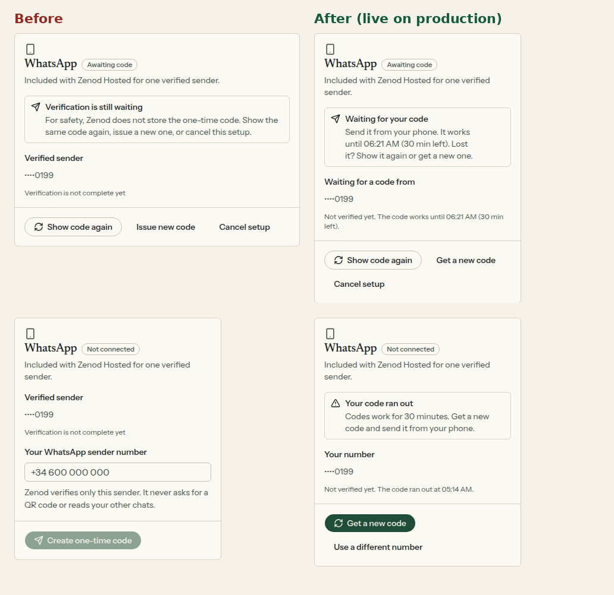

# E26-S24: clear words on the WhatsApp setup page, live 2026-11-14

**A new tester no longer sees "Verified sender" before the number is verified. The page says it is waiting for the code, shows until when the code works, and offers a new code in one tap once it runs out.**

Row: E26-S24 in [EPIC-26](../tester-invite-three-clear-promises-first.md). Run: run_97859891-41f5-4707-a239-061dcde43fdb. Source: snags 2 and 3 of the [E26-S23 phone setup review](e26-s23-2026-11-14.md).
Evidence page: http://vps3.taild81fbb.ts.net:9001/ (page_server.py on :9001, unit `zenod-e26-s24-page.service`, folder `/var/lib/vps3-scratch/t3agent/artifacts/zenod-e26-s24`, registered in agent_team docs/pages/registry.json cb3f6b99).

| Moment | Before (production c8d85d8) | Now (production c7354269) |
|---|---|---|
| Code sent, not verified | ✗ "Verified sender ••••0199 · Verification is not complete yet" | ✓ "Waiting for a code from ••••0199 · Not verified yet. The code works until 06:21 AM (30 min left)." |
| Code on screen | ✗ no time limit | ✓ "The code works until 06:21 AM (30 min left)." |
| Back on the page | "Verification is still waiting · For safety, Zenod does not store…" | ✓ "Waiting for your code · Send it from your phone. It works until … Lost it? Show it again or get a new one." |
| 30 minutes passed | ✗ "Verified sender" again plus an empty number box, nothing says the code ran out | ✓ "Your code ran out · Codes work for 30 minutes." + **Get a new code** (one tap) and **Use a different number** |

## Change

- [#1664](https://github.com/zenod-ai/zenod/pull/1664) merged **c7354269** (ci green, 10 min). Web only: `apps/web/src/components/whatsapp-connect.tsx`. The page already received `verificationExpiresAt`; a ran-out code is a held number whose expiry has passed (checked against the browser clock too, so it flips on time). **Get a new code** re-issues with no number, using the Phylax fallback to the held number from #1663 (f44151b). If that number was already released, the error opens the number box.
- Tests in `apps/web/src/views/HostedChannelsPanel.test.tsx`: waiting state (no "Verified sender", expiry and minutes left), ran-out state with one-tap new code (POST without a number, then 30 min left), and "Use a different number". Web suite 215/215, typecheck, lint, build green.

## Walked on production (T7 account operations@alpha9.io, made-up number +1 555 010 0199, 390 px)

| Time (UTC) | Step | Result |
|---|---|---|
| 04:40 | before: Create code, reload | "Verified sender" while awaiting ([1](e26-s24/before-waiting-390.png), [2](e26-s24/before-reload-390.png)); Cancel setup |
| 04:44 | started a code to let it run out | code issued, expiry 05:14 |
| 05:16 | before, ran out (still c8d85d8) | "Verified sender" + empty number box ([3](e26-s24/before-expired-390.png)) |
| 05:50:13 | promote tick (promote-now flag) | production c8d85d8 → **c7354269**, question set passed: demo 96/100/1.7, private 94.1/94.7/3.1 |
| 05:51 | now, ran out | "Your code ran out", "The code ran out at 05:14 AM", Get a new code ([4](e26-s24/after-expired-390.png)) |
| 05:51 | tap Get a new code | new code, "works until 06:21 AM (30 min left)" ([5](e26-s24/after-waiting-390.png)) |
| 05:51 | reload | "Waiting for your code", "Waiting for a code from ••••0199" ([6](e26-s24/after-reload-390.png)) |
| 05:52 | Cancel setup | back to the empty number box; nothing held for the test number |

Not walked: a real phone sending the code (needs a real number); unchanged by this row.
