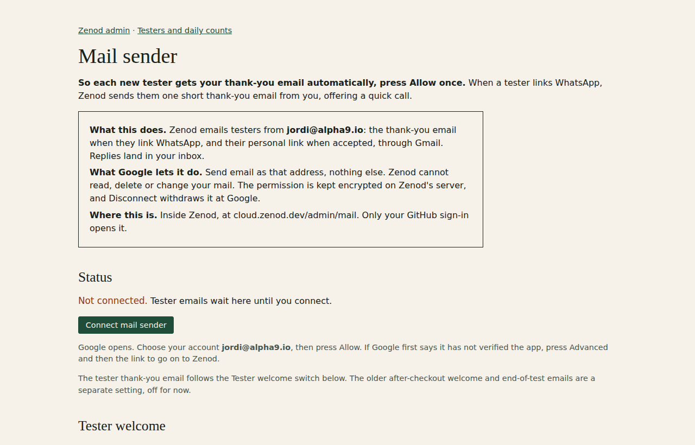

# E26-S28 iteration 3, 2026-11-15: the thank-you email goes from Jordi's mailbox, no step for him

**Answer:** both waiting thank-you emails went from jordi@alpha9.io through the team's Gmail connection at 10:43Z, each once, and every new tester's goes the same way within 15 minutes, by itself.

```
 tester links WhatsApp ─▶ Zenod queues 1 thank-you ─▶ vps3 timer (15 min) ─▶ gmail_send from jordi@alpha9.io ─▶ mail-sent (once per address)
                                                       reads mail-queue on VPS1 (token stays there), opens a short console run
```

Page: [vps3.taild81fbb.ts.net:9003](http://vps3.taild81fbb.ts.net:9003/) (the received email, read back from his Sent folder). Screenshots: [1280](e26-s28/evidence-1280.png) · [390](e26-s28/evidence-390.png) · [the email](e26-s28/thank-you-email.png).

| Step | Result |
|---|---|
| Decision | Delivery Manager 2026-11-15 (spine Decisions, E26-A16 withdrawn): send through team Gmail, no Allow from Jordi. Zenod's own sender stays; his Connect on /admin/mail would take over |
| Server | [#1671](https://github.com/zenod-ai/zenod/pull/1671) 2e12d5d3: `GET /api/ops/testers/onboarding/mail-queue` (id, to, subject, text, html, queuedAt; one per address; empty while off) and `POST .../mail-sent {id, via, messageId}` (idempotent; closes other unsent records to the same address), ops token only. 3 new tests; ci green |
| Sender chosen | **timer**, not the wake fallback. `scripts/tester-thanks/send.py` + `zenod-tester-thanks.timer` (vps3 user timer, `*:07/15`, runs the script from origin/main). HTTP path: console `POST /api/mcp/gmail` `gmail_send` with a running run; the script opens a short run on the Zenod Delivery Manager's assignment only when mail waits (the pattern agent_team `scripts/daily_report.py` already uses), so no new key, no widened access. Delivery Manager persona: Send on, 10 a day, recipients `anyone`. Local ledger stops a resend after a failed mark. 5 script tests. Fix [#1673](https://github.com/zenod-ai/zenod/pull/1673): `curl -o /dev/stdout` failed over ssh on the first live tick |
| Production | promoted df8c793 → 2e12d5d at 10:43:18Z by `scripts/promote-production.sh` (authorised by the Delivery Manager for this row), question set passed: demo 96/100/1.7, private 94.1/93/3.1. Rollback `scripts/promote-production.sh --rollback` |
| Send 10:43:56Z | one tick: `2 sent through team-gmail, 2 marked sent` (console run run_aeb535cd). Message-IDs `<ea8f4114-…@alpha9.io>` to jordi@alpha9.io, `<db2fb497-…@alpha9.io>` to jordi+zenod-night-ship@polyqu.com, both his own test addresses |
| Sent folder | team Gmail search, read only, run_e221b6e4: `in:sent subject:"Thank you for testing Zenod" newer_than:2d` → exactly 2, one per address. From: "Jordi" on the polyqu.com one (what a tester sees); "Delivery Manager" on the alpha9.io one (the console names the persona on mail to his own address) |
| Queue after | `/api/ops/testers/onboarding`: mode on, queued 0, sent 2, failing 0; mail-queue `[]`; a second tick sent nothing |
| No second mail | test-send to his WhatsApp-linked account (by account id): `{"whatsapp":"already sent","mail":"already sent"}`; by email it picked his other account: `{"whatsapp":"skipped","mail":"not queued"}`. Queue unchanged |
| ✗ fresh link live | a brand-new link queueing exactly one is proven by the unit test ("arms a tester, queues one thank-you on the link, never twice"), not live: his account is already welcomed, and no real tester was used. The first real tester link shows it (E26-S3) |
| Admin page | /admin/mail lead now: "Nothing to do here. Tester thank-you emails go from your mailbox through the team's Gmail connection. Connect here only to send from Zenod itself." Live on 2e12d5d |
| Steps page | [e26-s28-allow](http://vps3.taild81fbb.ts.net:8921/e26-s28-allow/) rewritten: nothing is needed from him; the Allow step is withdrawn |

Rollback: `systemctl --user disable --now zenod-tester-thanks.timer` stops sending (mail stays queued); `scripts/promote-production.sh --rollback` for the routes.

---

# E26-S28 iteration 2, 2026-11-15: the Connect mail sender button works

**What it is for:** when a tester links WhatsApp, they get one short thank-you email from Jordi offering a quick call, sent automatically. It needs one Allow from Jordi at Google.

```
 /admin/mail ──Connect──▶ /admin/mail/connect ──303──▶ Google sign-in (jordi@alpha9.io) ──Allow──▶ Connected, queue goes
              before: browser blocked this jump (CSP form-action)   after: allowed, verified
```

Jordi, 2026-11-15 06:05Z (steps-page note): "I press the button and nothing happens. Also, I have only jordi@alpha9.io and jordi@zenod.dev is an alias. ... What is the ultimate goal of this.."

## What was broken
- Production sent `form-action 'self' https://checkout.stripe.com` on /admin/mail. The button posts to /admin/mail/connect, which redirects to Google; browsers apply form-action to that redirect, so Chromium silently stayed on the page.
- Reproduced in headless Chromium against the page code: before, the URL after the click stays `/admin/mail` with the console error "Sending form data to '.../admin/mail/connect' violates ... form-action"; after, the browser reaches accounts.google.com.
- Fix [#1669](https://github.com/zenod-ai/zenod/pull/1669) (fdfb4505): form-action allows https://accounts.google.com on /admin/mail and /admin/mail/connect only. Live check: `curl -sI https://cloud.zenod.dev/admin/mail` now shows `form-action 'self' https://accounts.google.com`.

## The account
- jordi@alpha9.io is his only Google account; jordi@zenod.dev is an alias. Team Gmail (read only, run_55957205): `in:sent from:jordi@zenod.dev` returns nothing, while hello@epicsocial.app and dm@epicteam.app do appear as senders. So jordi@zenod.dev is not a "Send mail as" address, and Zenod now signs in and sends as jordi@alpha9.io (Cloudflare, if ever set, keeps jordi@zenod.dev). The thank-you text still says "write to me at jordi@zenod.dev", which reaches him.

## Google answers with its sign-in, with Zenod's real client
- New ops route (ops token) [#1670](https://github.com/zenod-ai/zenod/pull/1670): builds the exact Connect link server-side and follows Google's first answer. Production df8c7933, 2026-11-15 08:03Z:
  `{"ok":true,"googleStatus":302,"googleNext":"accounts.google.com/v3/signin/identifier","accountHint":"jordi@alpha9.io"}`
  (An earlier probe on fdfb4505 got Google's error page; that was the probe's own placeholder PKCE value, fixed in #1670, not the button, which always sent a real one.)

## Route decision
- Kept Zenod's own Google sender, not the console's team Gmail send: team Gmail sends only when an agent wakes, is capped at 10 a day, reaches outside addresses only after an ask, and would tie Zenod to agent_team (root L-7). Zenod's sender goes the minute a tester links WhatsApp.

## Deploys
- Production zenod-mt: d511968 → fdfb450 (06:58:25Z) → df8c793 (08:02:12Z), both through scripts/promote-production.sh, question set passed (demo 96/100/1.7, private 94.1/94.7/3.1 on fdfb450). Rollback: `scripts/promote-production.sh --rollback`.

## State now
- Tester welcome switch `on`; thank-you mail queued 2, sent 0, failing 0 (both test sends to his own addresses). Mail sender: not connected; waits on his Allow, ask E26-A16.


