# E26-S29: your first 50 memories free, in place of one free month

**Answer:** live on production f6803691 (checked 2026-11-15 13:50Z): zenod.dev/testers, the home line and the join page all say "your first 50 memories free, no card".

Source: Jordi 2026-11-15 ~09:05Z, vn_891cd2f9: "for Zenote, I don't think it's one free month. I think it's like some level of consumption, you know, the first few memories or whatever ... we will figure out." Objective 1, Five testers use Zenod: an offer people read at a glance.

## Before and after: zenod.dev/testers

| | 390 px | 1280 px |
|---|---|---|
| Before, production df8c7933, first screen | 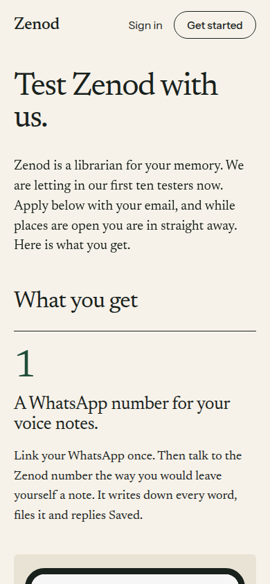 | 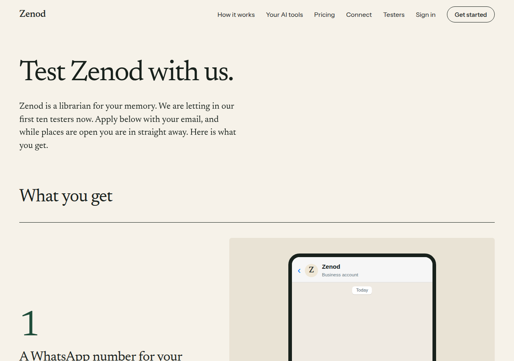 |
| After, staging e8b11678, first screen |  |  |
| Before, "What it costs" | 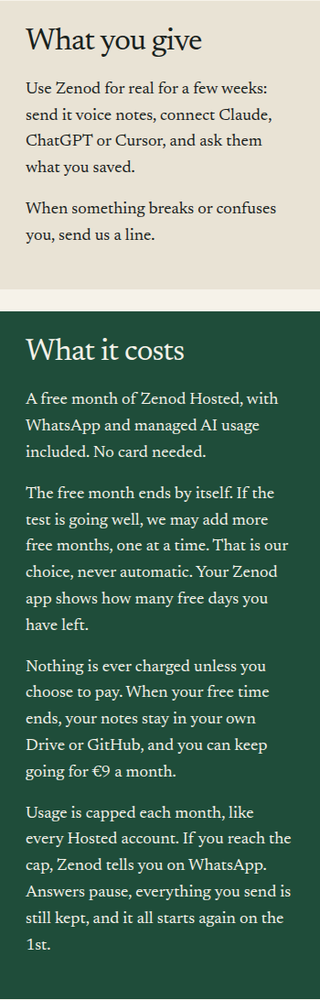 | 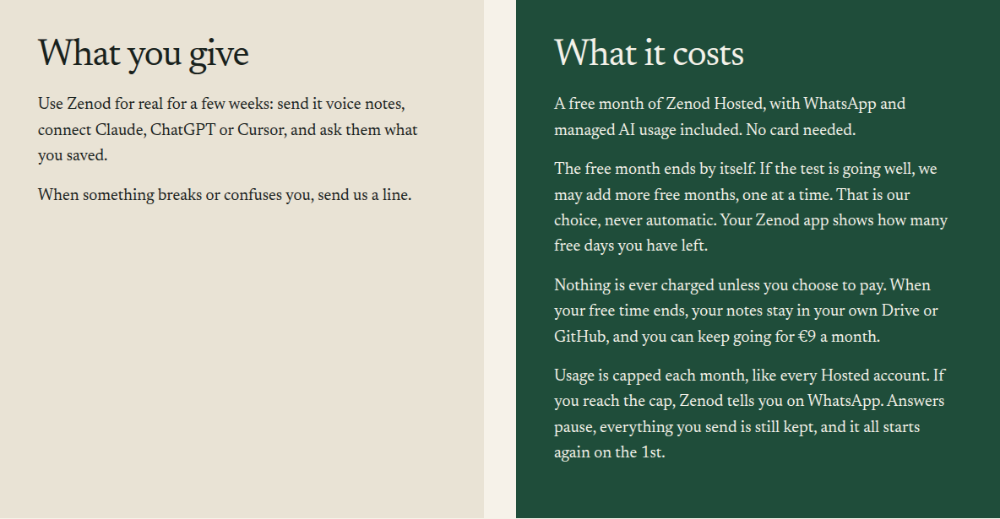 |
| After, "What it costs" | 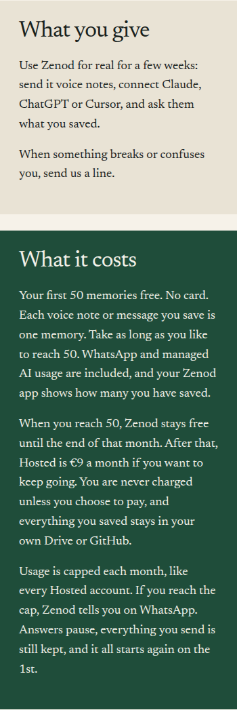 | 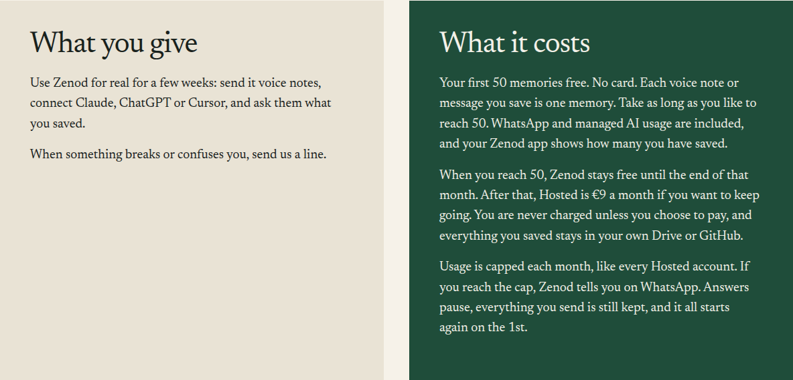 |

## What changed (PR #1672, merged e8b11678, ci green)

- **N is one setting.** `ZENOD_TESTER_FREE_MEMORIES`, default 50. Jordi's number on card E46-S43 changes it with a Dokploy env change and no code. The page reads it from `GET /api/public/testers/offer` (staging answers `{"free_memories":50,"line":"Your first 50 memories free. No card."}`).
- **The counter** is the finished-saves count the public counts already use (`store` and `media_ingest` jobs done, all time).
- **The rule** (month-end job, every 6 hours): while a tester has saved fewer than N, the next month goes to €0 by itself, using the same safe extension as the team's button (if Stripe does not confirm €0, the month ends instead and the team is alerted, so nobody is ever billed by itself). A month the old one-month rule had set to end comes back while memories are left.
- **The moment N is reached:** the month that is running stays free. Six days before it ends, Zenod sets it to end, alerts the team with the count (`saved`, `free_memories`), and sends the €9 offer email ("You have saved your first 50 memories, the free part of your test. Zenod stays free until …"). The app's plan line reads "Free · 50 of 50 free memories used" and the notice says "You have used your free memories. Zenod stays free until <date>. After that, Hosted is €9 a month if you want to keep going. Everything you saved stays in your Drive or GitHub." Saving keeps working until that date. Nothing saved is touched, and if they do not pay Zenod pauses as for any ended subscription (the existing end-of-test words).
- **Words, the same everywhere:** testers page (hero line and "What it costs"), home page hero line ("your first 50 memories free, no card"), join page, Stripe checkout for a tester code, tester invite email, thank-you email, end-of-test email and offer, in-app notice and plan line ("You have saved 12 of 50, with no time limit"), operator page rule. Run past the humanizer rules.
- **Not changed:** the WhatsApp welcome message (it never mentioned the month, and root L-6 keeps chat replies as they are), prices, the Stripe coupons (no new Stripe objects, no money moves).

## Checks

- Server tests: `packages/server/test/testerFreeMemories.test.ts` (setting and bad values, counter, rule under and at the cap, revived old endings, job extends without alert or offer, job ends with count and offer at the cap, never bills when €0 is not confirmed, words in the invite, join page, thank-you and offer email). Updated: `customerLayer.test.ts` (checkout words for a ZT- code), `testerFlow.test.ts` (operator page).
- Site tests (testers page words, `fetchFreeMemories` fallback to 50) and web tests (notice under and at the cap).
- GitHub `ci` on PR #1672: pass (12m49s). A local full run was cut off by this host's time limit; one unrelated `packages/core` filing test times out at 5 s on this busy host and passes on GitHub.
- Staging e8b11678 (tailnet, `zenod-staging`): `/testers` and `/` show the new words (screens above); `/join?code=ZT-…` says "Your first 50 memories free. No card."; `/api/public/testers/offer` answers 50. Staging has no Stripe, so the checkout step itself is covered by the test above, not by a staging click.

## Live on production

Production `zenod-mt` runs f6803691 (`/api/health` sha, e8b11678 an ancestor, promoted by the scheduled tick at 12:41Z). Checked 2026-11-15 ~13:50Z in a real browser, signed out:

| | 390 px | 1280 px |
|---|---|---|
| [zenod.dev/testers](https://zenod.dev/testers): "Your first 50 memories free. No card." | 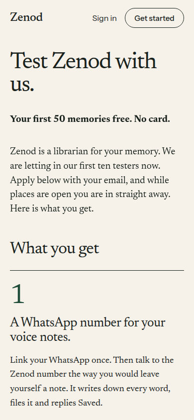 | 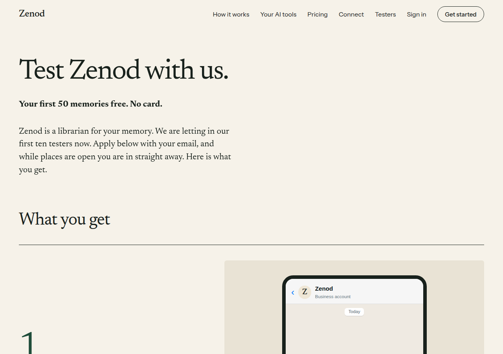 |
| [zenod.dev](https://zenod.dev/) home line: "your first 50 memories free, no card" | 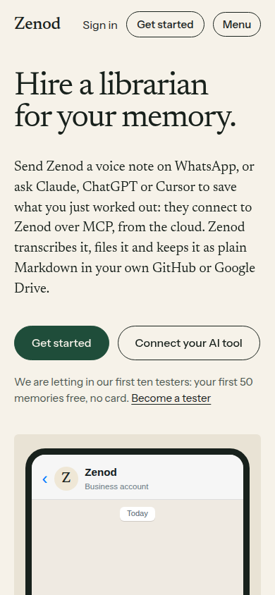 | 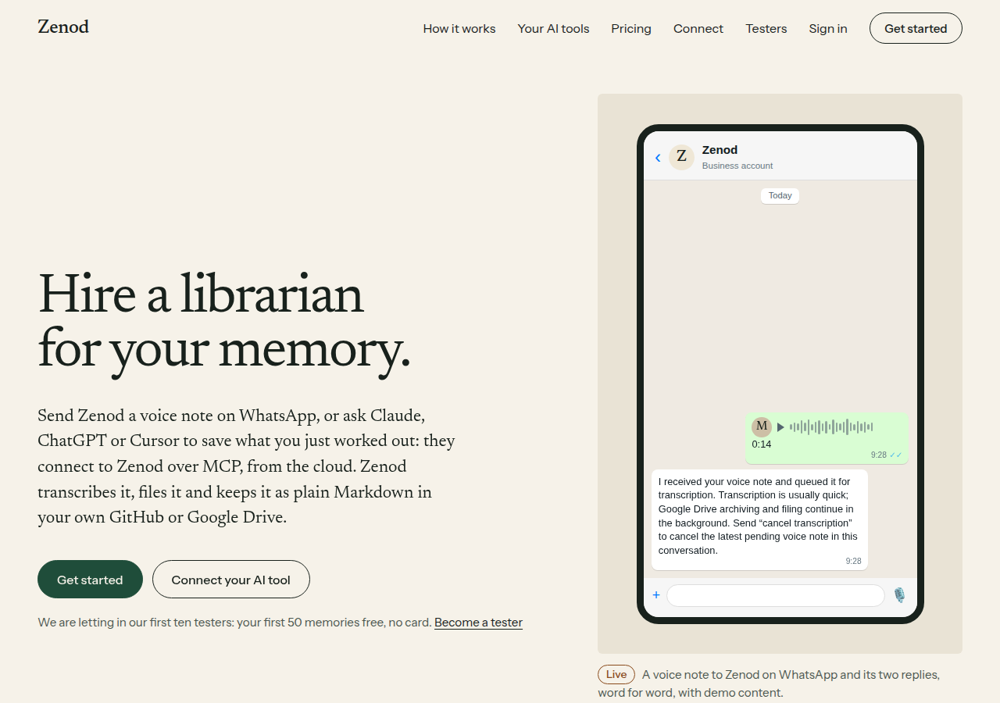 |
| join page `/join?code=ZT-…`: "€0 and no card … Your first 50 memories free." | 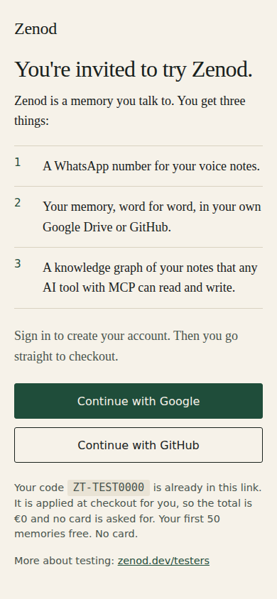 | 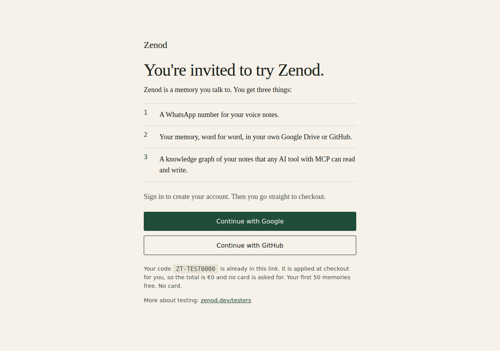 |

- **The number shows.** "What it costs" on /testers reads "Your first 50 memories free. No card. … Take as long as you like to reach 50 … When you reach 50, Zenod stays free until the end of that month."
- **The 401 was not the offer.** `GET https://zenod.dev/api/public/testers/offer` answers 200 `{"free_memories":50,"line":"Your first 50 memories free. No card."}` from outside (curl and the browser). The 401 in the page's network log is `/api/me`, the signed-out session check every public page makes. No bug, no fix needed.
- **Only the link preview omits the number.** The page `<title>` and `og:title` say "your first memories free, no card" (static, so a change of N never leaves a stale number in shared previews).
- **Tester checkout** needs a real tester code and a Google or GitHub sign-in, so it was not opened from outside. The Stripe message above the pay button ("Your first 50 memories free") is covered by the `customerLayer.test.ts` case for a ZT- code (PR #1672, ci green).

## State

Live on production f6803691. zenod-social told by desk note that posts can drop "one free month" and point at zenod.dev/testers. Jordi's number for N: the card asks it (default 50, one Dokploy setting, no code).
