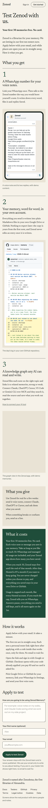
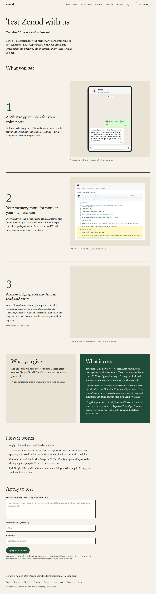
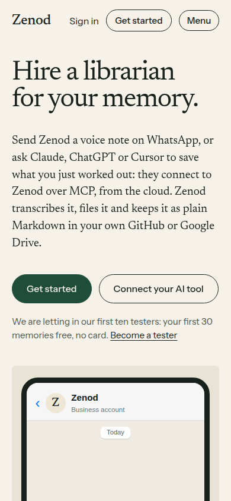
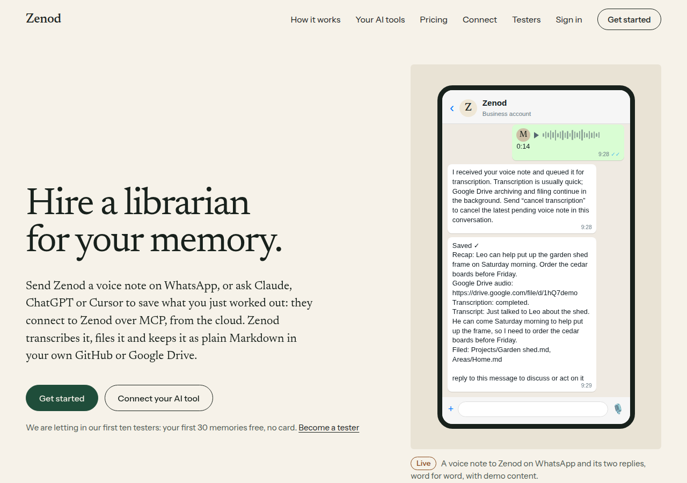
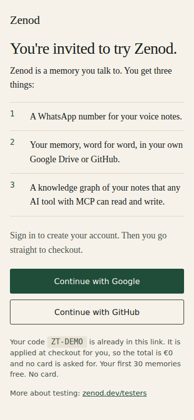
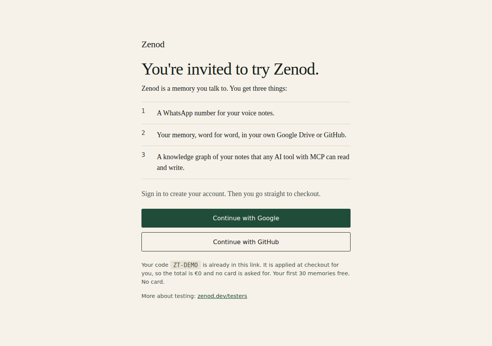

# E26-S30 evidence: testers get their first 30 memories free (2026-11-16)

**Bottom line: better.** Every page a tester sees on production now says 30, Jordi's own number (vn_e622f472, 16 Nov: "Let's say 30, OK, those are your first 30 memories"). Before: 50. No page or code fallback says 50.

| Where | Production answer | 390 px | 1280 px |
|---|---|---|---|
| Offer endpoint `zenod.dev/api/public/testers/offer` | `{"free_memories":30,"line":"Your first 30 memories free. No card."}` | | |
| [zenod.dev/testers](https://zenod.dev/testers) | "Your first 30 memories free. No card." · "Take as long as you like to reach 30." |  |  |
| [zenod.dev](https://zenod.dev/) home | "your first 30 memories free, no card" |  |  |
| Join page `cloud.zenod.dev/join` | "Your first 30 memories …" |  |  |

## What changed

- **Setting:** `ZENOD_TESTER_FREE_MEMORIES=30` on `zenod-mt` (production, image sha-f680369) and `zenod-staging`, set with the `dokploy` wrapper and redeployed 2026-11-16 04:46Z. The join page, invite and thank-you mails, checkout text, end-of-test offer and operator page all read this setting.
- **Code ([#1675](https://github.com/zenod-ai/zenod/pull/1675)):** the fallback when the setting is missing is 30 (server and zenod.dev, so the page says 30 before the endpoint answers). The app's plan line now says how many are left: "Free · 18 of 30 free memories left"; the notice "You have saved 12 of 30, 18 left. No time limit." It reaches production at the next promote.
- **og:title** says "your first memories free, no card", with no number, so nothing to change.
- **The app notice** needs a tester's sign-in, so it is proven by its tests (limit 30, used 12 → "18 left") and by the setting the account endpoint reads; a live screen follows with the first tester who signs in.

## Existing testers

One real tester has signed up (`/api/public/counts`: signed_up 1, active_testers 0). He has saved 0 memories, far under 30, so nothing changes for him: his offer reads 30 from now on and his free time continues.

## Rollback

`printf 50 | dokploy env-set zenod-mt ZENOD_TESTER_FREE_MEMORIES --stdin && dokploy deploy zenod-mt` (and the same on `zenod-staging`).
