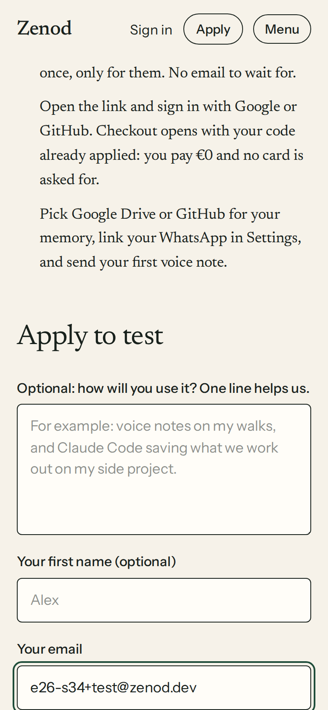
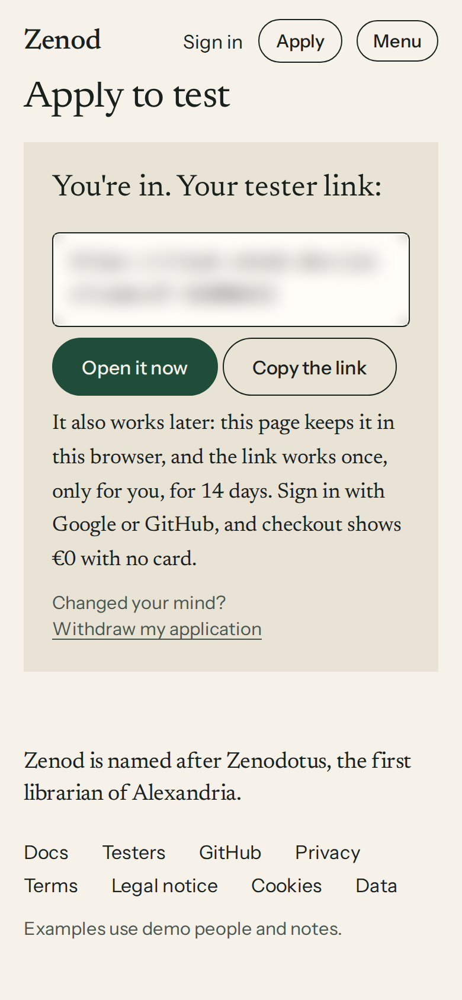

# E26-S34: tester page test 1, apply with only an email, 2026-11-19

**Live on production `20cdf60` since 10:53:11Z, 19 Nov (gate passed). On zenod.dev/testers a stranger can apply with only an email; the usage box reads "Optional: how will you use it? One line helps us." Proven at 390 px at 10:54Z with our test email.**

Row: E26-S34 in [EPIC-26](../tester-invite-three-clear-promises-first.md). Run: run_3d1327bc-bba8-493b-951b-03f7b21e2861. Source: zenod-social's improvement request E46-A57 ([desk note](../../desk/inbox/2026-11-19-zenod-social-improvement-e46-a57.md)), approved by Jordi 19 Nov: "one test a day on what a reader meets (a post's promise, the link, the testers page), read the next morning against applications". PR [#1705](https://github.com/zenod-ai/zenod/pull/1705), merge `20cdf60`.

```
zenod.dev/testers apply form
  before: [How are you going to be using Zenod Memory?  *required, 10+ chars]  [first name, optional]  [email *required]
  after:  [Optional: how will you use it? One line helps us.]                    [first name, optional]  [email *required]
          POST /api/public/testers/apply: empty `use` accepted (2,000-char cap kept); email still required and checked
```

## What changed, and nothing else

| Where | Change |
|---|---|
| `apps/site/src/lib/testers.ts` | `TESTERS_QUESTION` reads "Optional: how will you use it? One line helps us." |
| `apps/site/src/components/testers-page.tsx` | the `use` textarea drops `required` and `minLength={10}`; rows, placeholder, order, other fields and copy unchanged |
| `packages/server/src/testerApplications.ts` | no minimum length on `use`; over 2,000 characters still refused |
| counts | `publicCounts.ts`, `testerApplicants.ts`, `testerFlow.ts` already read a missing or empty `use` as `""`; per-?s= counts and the admin list are unchanged |
| tests | new "keeps an application with only an email"; paper-landing now asserts the field is not required |

## Proof

| Check | Result |
|---|---|
| `ci` on PR #1705 | green (10:17Z), self-merged as `20cdf60` |
| staging `zenod-staging` | `20cdf60` at 10:43Z |
| promote gate (`scripts/promote-production.sh --sha 20cdf60`) | staging healthy; question set demo 96/100/1.7, private 100/91.2/1.6, both at or above the floor |
| production `zenod-mt` | `ed5f2fb` → `20cdf60`, live 10:53:11Z, `https://zenod.dev/api/health` reports `20cdf601755d…` |
| live form, 390 px (Playwright, mobile) | label "Optional: how will you use it? One line helps us."; `#tester-use` required = false; `#tester-contact` required = true |
| live submit with only an email, 10:54:26Z | `e26-s34+test@zenod.dev` from `zenod.dev/testers?s=TEST`, usage box empty: `POST /api/public/testers/apply` 200, "You're in. Your tester link:" |
| it counts as a test, never a real applicant (its tester code is blurred in the screenshot) | `+test` and the `zenod.dev` domain match `looksLikeOurTest`, and `?s=TEST`: counted only in test_applications and takes no tester place |
| rollback | `scripts/promote-production.sh --rollback` returns production to `ed5f2fb` |

| The form at 390 px, email only | After submit |
|---|---|
|  |  |

Read tomorrow: zenod-social reads applications and visits by `?s=` on 20 Nov 07:00Z against 18 Nov (about 22 tagged visits, 0 applications).
