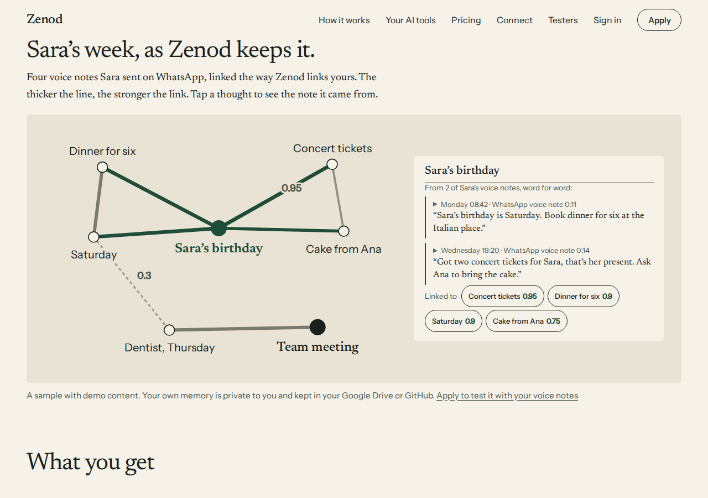
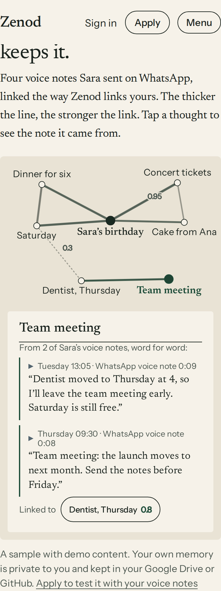

# E26-S35: a public sample memory on zenod.dev/testers, 2026-11-19

**Live on production `06511b9` since 22:05:40Z, 19 Nov (gate passed). On [zenod.dev/testers](https://zenod.dev/testers), right under the hero, a stranger sees Sara's week as a cloud of linked thoughts and taps a thought to read the voice note it came from. Proven at 390 and 1280 px at 22:11Z with a real tap.**



Row: E26-S35 in [EPIC-26](../tester-invite-three-clear-promises-first.md). Run: run_642b0612-7702-4a82-ba76-a8df54e04433. Source: Jordi 8 Nov 16:09Z ([Log/2026-11-08.md#^e-6d07aa](../../Log/2026-11-08.md)): "So this graph functionality is incredibly cool. It really helps demonstrate, and I think it should be part of the landing page."; zenod-social's note (their E6-S86): 22 tagged visits on 18 Nov, 0 applications, no product before the form. PR [#1711](https://github.com/zenod-ai/zenod/pull/1711), merge `06511b9`.

```
zenod.dev/testers, top to bottom
  hero: Test Zenod with us · Your first 30 memories free. No card. · [Apply now]      (unchanged)
  NEW   Sara's week, as Zenod keeps it.   [ cloud of 7 thoughts | the note it came from ]
  What you get (3 promises) · What you give / costs · How it works · Apply (email only)  (unchanged)
```

## What it is

| Part | What |
|---|---|
| Data | `apps/site/src/lib/sample-memory.ts`: four voice notes of one week (Sara's birthday dinner, concert tickets, a dentist visit, a team meeting), seven thoughts, eight links with strengths. Static, no fetch, no account, nothing personal. |
| Drawing | `apps/site/src/components/sample-memory.tsx`: the landing's cloud-of-thoughts look (paper stage, ink dots, topics in serif), line weight from the app's `strengthLook` (EPIC-18), weak links dashed. Opens on Sara's birthday so a note shows with no tap. |
| Tap | Each thought is a button (keyboard too): it turns green with its links, and the panel shows its notes word for word, time and length, and "Linked to" chips that open the next thought. Tap areas 40 px or more. |
| Weight | about 3 kB of script and CSS, no new dependency. |
| Kept | The 30-free-memories offer, the hero's Apply now (still before the sample), the visit counter and the email-only form are unchanged. |

## Proof

| Check | Result |
|---|---|
| tests | site 58/58, new: sample sits after Apply now and before What you get and the form, 7 tappable thoughts, the note text, no garden or Westcombe words |
| `ci` on PR #1711 | green, self-merged as `06511b9`, worktree and branch removed |
| staging `zenod-staging` | `06511b9` at 21:55Z |
| promote gate (`scripts/promote-production.sh --sha 06511b9`) | staging healthy; question set demo 96/100/1.7, private 100/91.2/1.6; production `07ba61d` → `06511b9` at 22:05:40Z (only this change between them); rollback `--rollback` |
| live 390 px (22:11Z) | sample starts 558 px down; tapping Team meeting shows its two notes ("Dentist moved to Thursday at 4…", "Team meeting: the launch moves…") |
| live 1280 px (22:11Z) | graph beside the note panel, same tap result |
| look check | agent_team `clean_look_check.py --screens --paths /testers` on the build: no finding in the new section (its tap-size and small-text findings are the existing nav and WhatsApp scene) |



## Not done

- ✗ It is not on the home page zenod.dev itself; Jordi's 8 Nov words say "landing page". Follow-up proposed on the row.
- The live checks counted two visits on /testers without a source tag.
