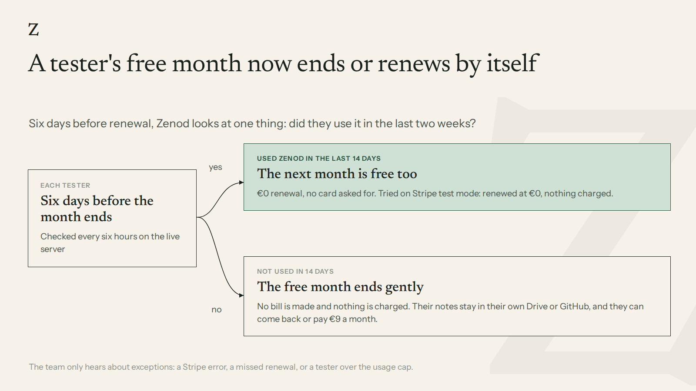

# A tester's free month now ends or renews by itself

EPIC-26 row E26-S5, 2026-11-10, run_aaccfa1c. Until today a tester's free month needed a person: five days before it
ended, tester-watch alerted the team and someone put the extension on by hand. Now Zenod does it itself, under one rule.

## The rule

Six days before a tester's month renews, Zenod checks one thing: did they use it in the last 14 days? Using it means
anything they did in their own Zenod: a note or voice note saved, a question asked in chat or by an AI tool through MCP.

- **Used it:** the next month is free too. Zenod puts the one-month free coupon on their subscription, so the renewal
  is €0 and no card is asked for.
- **Did not:** the free month ends gently. Zenod sets the subscription to end on its renewal date, so no bill is made
  and nothing is charged. On that date the account stops like any ended one: Zenod sends the usual message ("your
  subscription has ended … your notes stay in your vault; to start again, open your console"). Their notes stay in
  their own Google Drive or GitHub. They can come back or pay €9 a month.
- **Came back before the end:** if a tester set to end uses Zenod again before the date, the end is undone and the
  next month is free.

The team hears only about exceptions, on the health page row 20 and the HQ alert thread: Stripe refused a change,
an extension did not leave the next bill at €0, a renewal already went past due, the Stripe key may not change
subscriptions, or an active tester was extended while over the usage cap.

## Proof in Stripe test mode: both paths, nothing charged

The real month-end code ran against the Stripe sandbox on test clocks (Stripe's simulated time). Two testers signed up
with the tester coupon and no card: A used Zenod 2 days before the check, B never did. The job ran 3 days before
renewal; then the clocks moved to 1 day after renewal. Script and full output:
[month-end-sandbox.mjs](e26-s5-sandbox/month-end-sandbox.mjs), [month-end-sandbox.out.json](e26-s5-sandbox/month-end-sandbox.out.json).

| | A: used Zenod | B: did not |
|---|---|---|
| What the job did | extended: next bill €0 | set to end at renewal |
| After renewal | active, renewed at €0, next renewal a month later | ended on its renewal date |
| Bills | sign-up €0, renewal €0 | sign-up €0, no renewal bill at all |
| Card on file | none | none |
| Charges | 0 | 0 |
| Alerts | none | none |

A second run straight after changed nothing (A "already free", B "ending"). The sandbox test clocks were deleted
afterwards. Unit tests: `packages/server/test/testerMonthEnd.test.ts` (the rule, the comeback, each exception).

## Live

LIVE_SECTION

## What it does not cover

- tester-watch on VPS1 still runs its earlier copy: the repo copy now stays quiet for a planned end, but installing it
  needs root on VPS1. Until then, a tester the job ended shows one "subscription canceled" line in tester-watch.
- The end-of-test offer (what a tester sees and one click to the €9 checkout) is row E26-S6.
