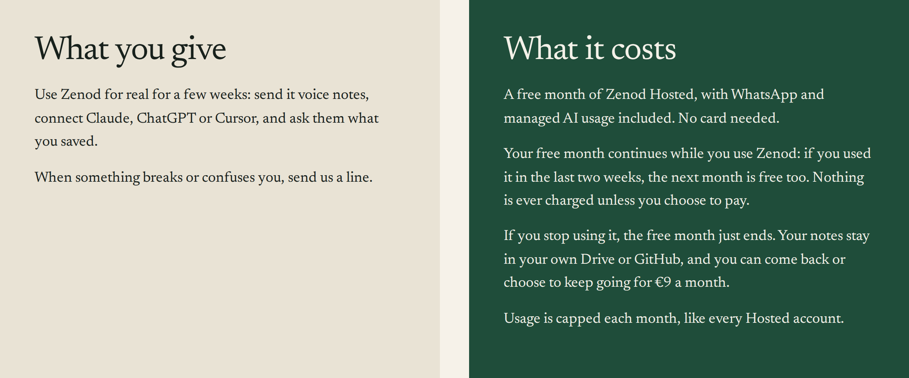

# Nothing charges a tester by itself

EPIC-26 row E26-S5, round 2, 2026-11-10, run_b1ed9b93. Jordi read round 1 and asked: "what do you mean it renews by
itself????" The answer in plain words first, then what changed.

## The short answer

- **Does anything ever charge a tester by itself?** No. A tester gives no card when they join: their code makes the
  checkout €0, so Stripe never asks for one. With no card, Stripe has nothing it could charge. And from today, if Zenod
  ever cannot make a tester's next month free, it ends their free month instead of letting a bill be made.
- **What "renews" meant.** It was Stripe's word, not the tester's. In Stripe a tester is a €9 a month plan with a 100%
  discount, and every month Stripe "renews" that plan by making a €0 bill. That is all it was: a €0 line in Stripe. We
  stopped using the word.
- **What the tester experiences.** Their free month continues while they use Zenod. If they stop using it, the free
  month ends: Zenod tells them it ended, their notes stay in their own Google Drive or GitHub, and they can come back or
  choose to pay €9 a month. They never get a bill.
- **How long can a tester stay free?** Today, for as long as they keep using Zenod: each month, anyone who saved or
  asked something in the last two weeks gets the next month free too. There is no end date. That matches what EPIC-7
  promised testers: "a free month of Hosted, extended month by month while you test, usage capped". Whether it should
  have an end is a choice, below.
- **What the tester is told.** On [zenod.dev/testers](https://zenod.dev/testers), "What it costs": "Your free month
  continues while you use Zenod: if you used it in the last two weeks, the next month is free too. Nothing is ever
  charged unless you choose to pay." The tester email now says the same in one line.

## What changed today

1. **The fail-safe.** Until today, if Stripe refused to make a tester's next month free, the job only alerted the team.
   With no card nothing could be charged, but Stripe would make an unpaid €9 bill and the tester could be told their
   payment failed. Now the job ends that free month instead (no bill at all) and alerts the team. If the tester keeps
   using Zenod, the next pass, six hours later, tries again and keeps them on once it works. Tests cover a refused
   extension, a next bill that is still not €0, and the retry.
2. **The words.** [zenod.dev/testers](https://zenod.dev/testers) "What it costs" and the tester email say "Your free
   month continues while you use Zenod" and "Nothing is ever charged unless you choose to pay". The word "renews" is
   gone from what a tester reads, the card and this page.

Prices did not change. Code: [#1606](https://github.com/zenod-ai/zenod/pull/1606), live in Zenod production as `29872f6b` since 2026-11-10T21:48Z (cloud.zenod.dev health), and the tester page with it.

## The one way money could ever move

A tester can open billing settings and add a card themselves. Even then, a charge would need Zenod to fail to make their
next month free for six days in a row, every six hours, and also fail to end it. Each failure alerts the team at once.
Paying €9 is always the tester's own click.

## The choice for Jordi: should a tester's free time end?

Today a tester who keeps using Zenod stays free with no end. The options:

1. **Keep it as it is.** Free month by month while they use it. Simple and kind; but nobody ever reaches a moment where
   paying is the next step.
2. **A fixed free time, then an offer.** For example three free months at most. After that the free time ends and the
   tester gets one email with a one-click €9 a month checkout. Nothing is charged unless they click.
3. **A cap per tester.** Free while active, up to a number of months set per person, so a close friend can stay longer.

Our recommendation is 2, with three months: it keeps the EPIC-7 promise (free month by month while you test), gives
every tester a clear moment to decide, and fits the first ten testers. It is one setting in the job and can be changed
back. Today's rule stays switched on as it is until Jordi answers, since no tester has reached a month end yet.

## Round 1, for the record

The rule, the Stripe test-mode proof (one tester kept free at €0, one ended, no card, nothing charged) and the first
live log are on the [round 1 page](http://vps3.taild81fbb.ts.net:8921/e26-s5/), and in
[e26-s5-2026-11-10.md](e26-s5-2026-11-10.md).
