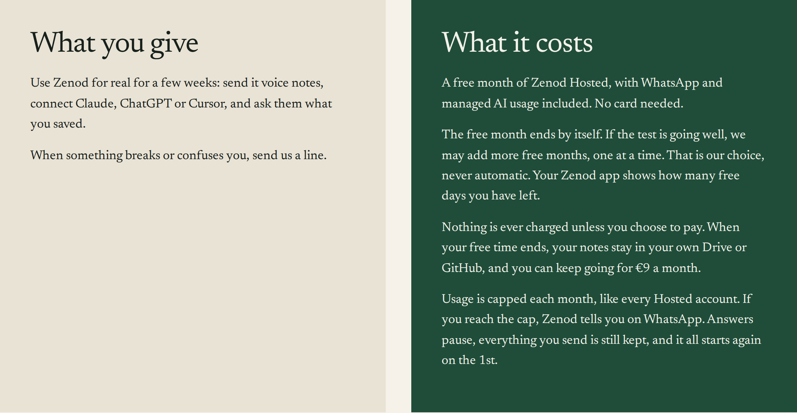

# A tester gets one free month, more only if we add it, and usage stops at $5

**The rule in one sentence:** every tester gets one free month, it ends by itself, only we can add another month (one tester, one month at a time), nothing is ever charged, and a tester's AI use stops at $5 a month at most.

EPIC-26 row E26-S5, round 3, 2026-11-11, run_aa690fa3. Source: Jordi's answer to ask E26-A7 (voice note vn_8f98a59f):
"They get one month and then renewable at our discretion, you know, if the test is continuing or not, but they get at
least one month. Or we can say 60 days free, but capped, you know, it's not like they get unlimited for sure. They get
capped, you know, they like not more than $5 a month should be. Let's tighten this up, man. Definitely auto renewal for
free is a no-no, and with no caps, big no-no."

## What changed

1. **No free month renews by itself.** Rounds 1 and 2 gave the next month free to anyone who used Zenod in the last two
   weeks. That is gone. Six days before a tester's free month ends, Zenod sets it to end. No bill is made and nothing is
   charged. At the same moment the team gets an alert with that tester's usage: days left, AI dollars this month against
   the cap, and how many days since they last used Zenod.
2. **Only we extend, one tester and one month at a time.** The tester admin page at
   cloud.zenod.dev/admin/testers, which only Jordi's sign-in opens, now has a *Free time* section. It lists each tester
   with their free-until date, AI use this month and when they last used Zenod, and a **One more free month** button.
   The button covers one more month. Next month the free time ends again unless someone presses it again. If Stripe
   does not confirm the next month at €0, the month is ended instead and the team is alerted, so a tester is never billed.
3. **Usage is capped at $5 a month at most.** The cap EPIC-7 promised has been live and enforced since 1 November: $3 of
   AI per account per month. When a tester reaches it, Zenod tells them on WhatsApp that answers pause until the 1st,
   and everything they send is still kept. Saving and sorting notes could run $3 past that, to $6. That margin is now $2,
   so an account's model cost stops at $5 a month at most. Past $5, notes are still kept as they were sent and sorted
   after the 1st.
4. **The words.** zenod.dev/testers "What it costs", the tester invite email and the free-plan notice inside the Zenod
   app now say: one free month that ends by itself, more only when we add it, one at a time, never automatic; nothing is
   ever charged unless you choose to pay; usage is capped, and what happens at the cap. Prices did not change.

## One month or 60 days

We picked **one month**. The tester code already gives exactly one month, and every code sent so far is built on it. 60
days would need a new live Stripe coupon and new codes. One month also gives us a decision point after the first month
of real use. Any tester we want for 60 days gets there with one press of the button.

## What the tester sees

- On zenod.dev/testers, before applying: the four lines above.
- In the invite email: "You get one free month. If the test is going well, we may add more, one month at a time.
  Nothing is ever charged unless you choose to pay."
- In the Zenod app: "Free pass · N days left" beside their name, and "Your free period runs until <date>. It ends then
  unless we add another month while the test goes on. If we do, this date moves. Nothing is charged unless you choose
  to pay."
- At the cap, on WhatsApp: "You have used this month's AI allowance on your Zenod plan, so I can't answer questions until
  1 December. Everything you send is still kept in your memory."

## Live

Live in Zenod production as `17c008e2` since 2026-11-11T00:49Z (cloud.zenod.dev health). zenod.dev/testers shows the new words (screenshot above). The tester admin page and its button answer Not Found to anyone without Jordi's sign-in. No tester has signed up yet, so no free month has ended or been extended for real so far.

Tests: the month-end rule (ends every month we did not extend, even an active tester's; leaves an extended month alone;
ends it instead if the next invoice is not €0; an extension covers one month only), the button (admin only, same site
only, one tester), the $5 stop, and the tester page, email and app words.
Code: [#1612](https://github.com/zenod-ai/zenod/pull/1612).

## Rounds 1 and 2, for the record

[Round 2: nothing charges a tester](http://vps3.taild81fbb.ts.net:8921/e26-s5-r2/) and
[round 1: the rule and its proof](http://vps3.taild81fbb.ts.net:8921/e26-s5/).
