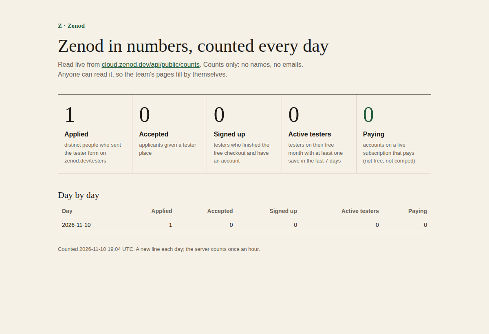
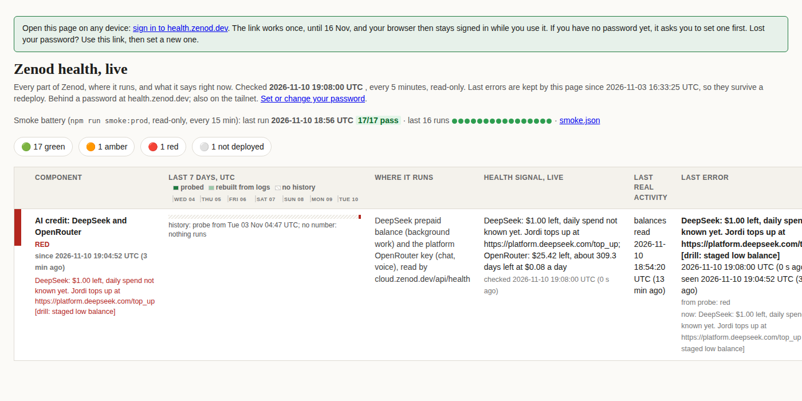

# E26-S7 and E26-S8: daily counts anyone can read, and an AI credit alert days ahead

Rows E26-S7 and E26-S8 in [EPIC-26](../tester-invite-three-clear-promises-first.md), from zenod-social's gaps 6 and 7
(desk note 2026-11-10, live by 30 Nov). Run: run_3c01dcde-de5f-47f7-9e3b-a5f57dd3ffb8. Counts and amounts only on this
page: no names, emails or ids.

**Live:** Zenod `8c3333b` ([#1598](https://github.com/zenod-ai/zenod/pull/1598), push-to-main roll), cloud.zenod.dev
`/api/health` sha `8c3333b6` seen 2026-11-10 18:54:37Z. Health page probe: main `9b5eeb1d` + fix `db8e96f8`, installed
in `~/.local/lib/epic6-s1-health/` on VPS3 at 19:01Z.

## E26-S7: the counts

`GET https://cloud.zenod.dev/api/public/counts` (public, CORS `*`), schema `zenod-counts/v1`:

| Field | Counts |
|---|---|
| `applications` | distinct people who sent the tester form on zenod.dev/testers |
| `accepted` | applicants given a tester place |
| `signed_up` | testers who finished the free checkout and have an account |
| `active_testers` | testers on their free month with at least one save in the last 7 days |
| `paying_customers` | accounts on a live subscription that pays: not free, not comped |

Plus `date`, `at`, `definitions` and `history`, one line per UTC day for 60 days, kept in `public-counts.json` on the
production data volume. The server counts once an hour, so a day with no visitors still gets its line. Team and
friends accounts (free forever) and comped accounts count nowhere. A tester is a 100%-off code with an end date, or
an accepted applicant's email.

Live reading at 2026-11-10 19:04Z: **applications 1, accepted 0, signed_up 0, active_testers 0, paying_customers 0**.
The one application came before the automatic flow, which explains accepted 0. tester-watch agrees: 3 accounts,
none a tester and none paying.

A readable page that fetches the endpoint live: [Zenod in numbers](http://vps3.taild81fbb.ts.net:8921/e26-s7/counts.html)
(source `docs/evidence/e26-s7/counts.html`).

Code: `packages/server/src/publicCounts.ts`, tests `packages/server/test/publicCounts.test.ts` (funnel rules, a tester
who starts paying, the read-only saves count, one line per day, no `@` in the answer or the file). zenod-social was
told where to read it by desk note `2026-11-10-zenod-gaps-6-and-7-answered-daily-counts-are-l.md` (750df6c).

## E26-S8: the AI credit alert

`/api/health` now carries `credit.openrouter` next to `background` (DeepSeek): the platform OpenRouter key's limit,
what is left, and its daily, weekly and monthly spend. At 18:54Z: OpenRouter key **$25.42 left of $26**, DeepSeek
**$8.77** at about 19:00Z.

The health page has a new **row 19, AI credit: DeepSeek and OpenRouter**. It goes red when either provider has
5 days or less left at the current daily spend, $2 or less, is out of credit, or refused a call for credit (402) in
the last 6 h. It goes amber at 10 days or $5. The daily spend comes from the balance samples the page keeps, and a
top-up does not count as spend. The red text names who tops up and where: *Jordi tops up at
https://platform.deepseek.com/top_up*, *Jordi adds credit at https://openrouter.ai/settings/credits or raises the
key limit at https://openrouter.ai/settings/keys*. Red goes to the HQ thread through the page's sender (`row-19`).
Rules: [AGGREGATOR.md](../health/AGGREGATOR.md#e26-s8-row-19-ai-credit-deepseek-and-openrouter). Tests: `Credit` in
`test_aggregate.py` (7), `CreditRefusals` in `test_probe.py`, `backgroundRoute.test.ts`.

**Staged low balance, fired once and cleared:**

| When (UTC) | What |
|---|---|
| 19:04:10 | `probe.py --drill credit` staged one credit event on VPS1 |
| 19:04:52 | row 19 green to red: "DeepSeek: $1.00 left … Jordi tops up at https://platform.deepseek.com/top_up [drill: staged low balance]" |
| 19:05:42 | one `ALERT[page/row-19]` in the alert log, delivered to the HQ thread (watchdog row: 57 of 57 delivered in 24 h) |
| 19:23:00 | row 19 red to green; 19:23:49 one `RECOVERED[row-19]` |

**One false alert, fixed:** at 18:43Z row 19 alerted "DeepSeek refused 1 calls for credit". The trigger was a
successful DeepSeek call logged with `output=402`, a count of 402 tokens. It recovered at 18:56Z. The refusal rule now
needs an HTTP 402 or a balance message (`db8e96f8`, test `CreditRefusals`).

**Watch:** DeepSeek fell from $9.23 (18:08Z) to $8.74 (19:23Z), about $9 a day if that pace holds, so about a day
left. The row knows the spend once it has 6 hours of samples. At that pace it turns red tonight and Jordi gets the
top-up alert. That is the alert doing its job, not a fault.

**Limit:** the account-wide OpenRouter balance needs a management key, which deliberately stays off the servers.
The row reads the platform key's own limit. If that key ever has no limit, only the 402 rule applies.
