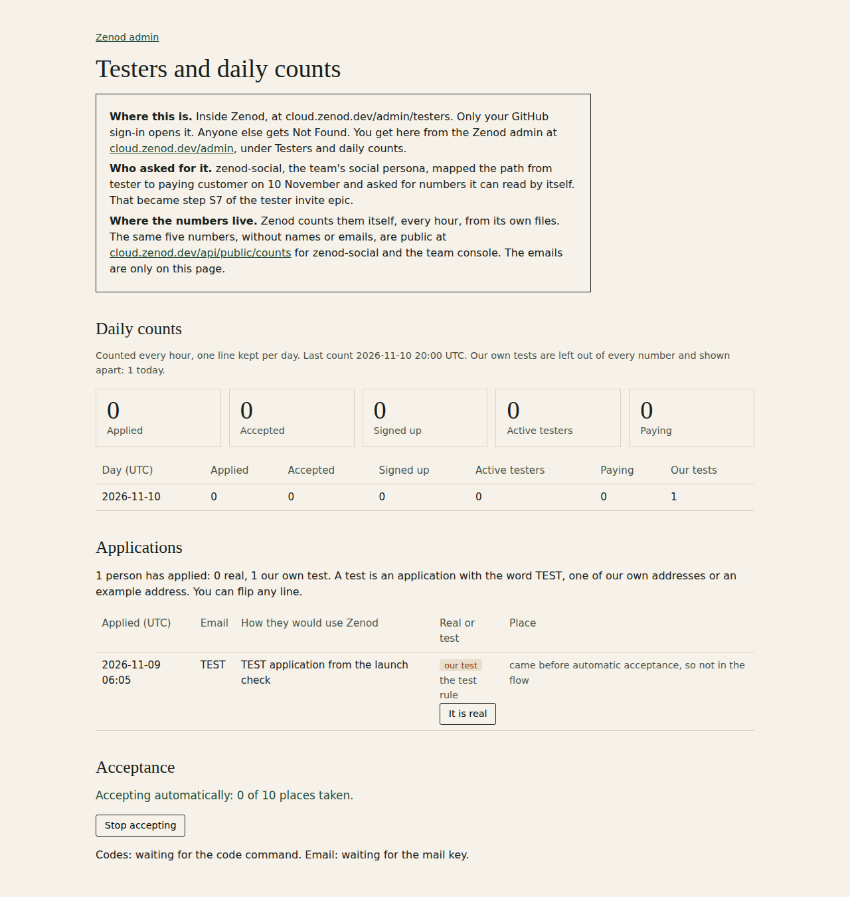

# E26-S7 round 2: where the counts live, who asked, and who applied

Row E26-S7 in [EPIC-26](../tester-invite-three-clear-promises-first.md), round 2 (E26-S10 folded in). Run:
run_e14d3883-59db-48ca-90dd-a9e20a6c6212. No emails on this page; they are only on the in-app page.

Jordi, 2026-11-10: "where is this page hosted at? How do you get to it? ... I see that one applied. Was this like
ourselves or is it like a real application? We should get the email. Could I see the emails of the applications?
... who asked for this."

## The plain answers

- **Who asked.** zenod-social, the team's social persona, mapped the path from tester to paying customer on
  10 November and asked for numbers it can read by itself (desk note 2026-11-10, gaps 6 and 7). That became row S7.
- **Where it lives now.** Inside Zenod: [cloud.zenod.dev/admin/testers](https://cloud.zenod.dev/admin/testers).
  Only Jordi's GitHub sign-in opens it; everyone else gets Not Found. It is linked from
  [cloud.zenod.dev/admin](https://cloud.zenod.dev/admin) as "Testers and daily counts". The first screen says where
  it is, who asked and where the numbers come from.
- **Where the numbers live.** Zenod counts them itself every hour from its own files on the production data volume.
  The same numbers, counts only, stay public at
  [cloud.zenod.dev/api/public/counts](https://cloud.zenod.dev/api/public/counts) for zenod-social and the console.
  The old tailnet page from round 1 is no longer the place to look.
- **The emails.** The in-app page lists every application from the form with its email and what they wrote, its
  place in the flow, and a mark: real or our test. Jordi can flip any mark.
- **The one applicant.** Ours. On 9 November at 06:05Z the agent that built the testers page sent one TEST
  application through the live form to prove it saved ([ZAL-A13 evidence](zal-a13-2026-11-09.md)). The counts
  counted one distinct applicant since, so that line is the only one. The public counts now confirm it by
  themselves: see the live reading below.

## What changed (Zenod `71cbe683`, [#1604](https://github.com/zenod-ai/zenod/pull/1604))

- `/admin/testers`: where it is and who asked; the five counts and one line per day; every application with its
  email; real or test, flippable (private `tester-marks.json`, 0600); acceptance and the stop switch as before.
- Test rule: the word TEST, our own domains, example addresses, or the team list `ZENOD_TEAM_EMAILS`.
- `/api/public/counts`: our tests are left out of every count and counted apart as `test_applications`.
- `/admin` links to it. The console and Epic Book link was asked of agent_team by desk note
  `2026-11-10-zenod-also-in-jordi-s-note-on-e26-s7-vn-2a805c.md` (agent_team 54fca1a3); Zenod does not edit their repo.

The screenshot is the real page drawn with sample data, so no address appears in this public repo.

## Live

Zenod `71cbe683`, push-to-main roll; `cloud.zenod.dev/api/health` sha `71cbe683` seen 2026-11-10 21:04:46Z.

| Check, 21:04Z | Result |
|---|---|
| `GET /api/public/counts` | applications 0, accepted 0, signed up 0, active testers 0, paying 0, **test_applications 1**; no `@` anywhere in the answer |
| `GET /admin/testers` and `/admin` without a sign-in | 404 Not Found |
| `POST /admin/testers/mark` without a sign-in | 404 Not Found |

So the one application is marked as our test by the rule, and real applications are zero. Jordi sees the address
itself on the in-app page. The round 1 tailnet page stays as a picture of the public numbers only.

Tests: `testerMarks.test.ts` (new: the rule, a stranger who wants to "test" stays real, the operator's mark wins,
file 0600), `publicCounts.test.ts` (tests left out, counted apart), `testerFlow.test.ts` (the page says where and who,
shows counts and emails, escapes what people wrote, same-origin flip only), `App.admin.test.tsx` (the link); CI green.
