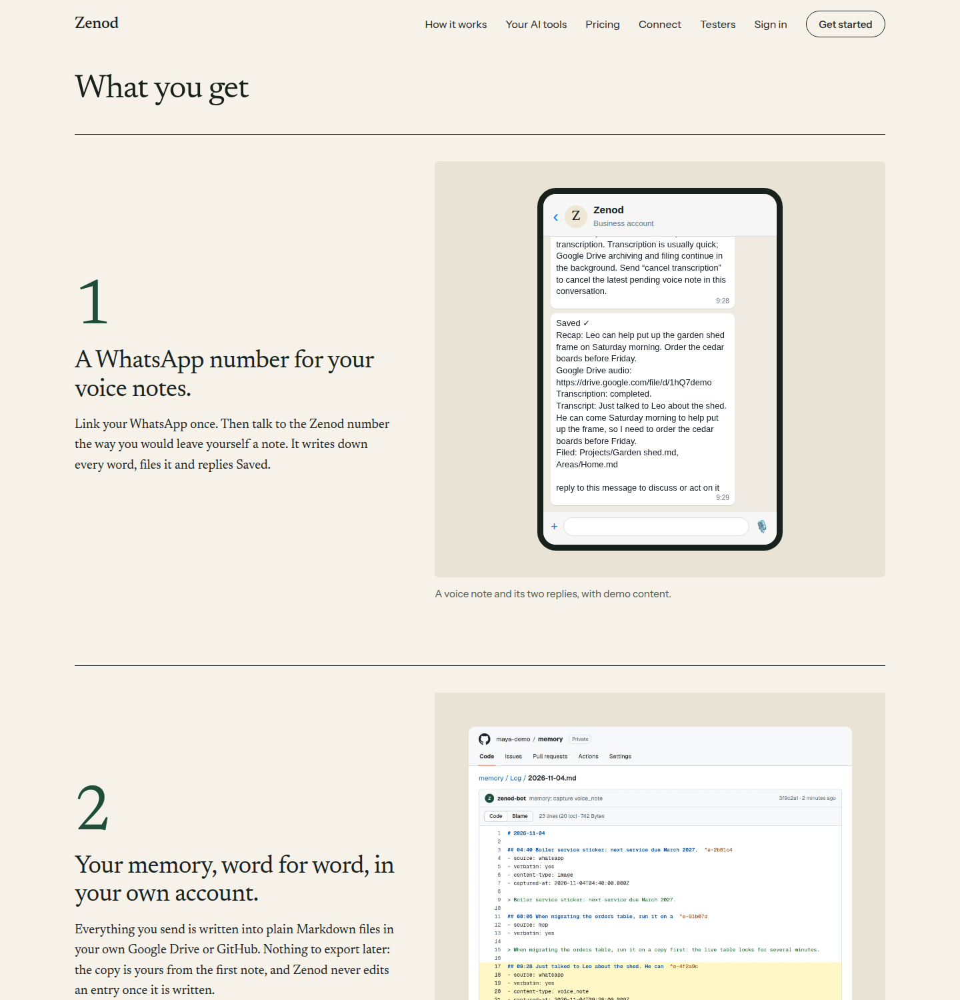

# E26-T1: the three promises on zenod.dev/testers, and the first invite ready (2026-11-10)

Run `run_dcd204c7-29b6-4957-95a2-de3c83044505`. Bound epic: [EPIC-26](../tester-invite-three-clear-promises-first.md), row T1, Done means E26-1 and E26-2. Source: Jordi's WhatsApp voice note, 2026-11-10 03:54Z (Zenod Log ^e-ecf0b8): "what they will get is an account on Zenod and a WhatsApp number where they can drop voice notes … you get maybe three things … a literal copy of your memory … a knowledge graph … an interface for external parties through MCP". Page (tailnet): http://vps3.taild81fbb.ts.net:8921/e26-t1/. The repo is public: no names, codes or tokens here.

## 1. zenod.dev/testers leads with the three things

Live: https://zenod.dev/testers, production at `ce1181e` (health ok, sha ce1181ec) (PR #1581, merge `ce1181e`), publish run 42754656754 deployed 2026-11-10T04:38Z.

| Promise on the page | Why it is true of production today |
|---|---|
| 1. A WhatsApp number for your voice notes. | WhatsApp linking in the app (Settings › WhatsApp & Telegram) and the Saved reply are live (EPIC-7 T2/T3, E23-U1); the animation is the landing's production WhatsApp scene with demo content |
| 2. Your memory, word for word, in your own account. | The vault is the user's own Google Drive or GitHub (chosen right after checkout, E23-U1 walk); every entry lands verbatim in the dated log and is never edited (landing "Kept exactly as you said it") |
| 3. A knowledge graph any AI can read and write. | Filing and the graph view with weighted links are live (E12-S2, E18-W1); the MCP connector with read and write tools is on zenod.dev/connect (store_memory, search_memory, get_memory) |

Below them, unchanged in substance: what testing asks of you, what it costs (free month, no card, extended monthly, capped) and how it works, now with a fourth step: pick Drive or GitHub, link WhatsApp in Settings, send the first voice note. Checks: site tests 43/43 (one new: the three promises come first, in order), typecheck clean, `ci` green; no page errors and no sideways scroll at 1440 and 390 px.

## 2. The first invite, ready for Jordi to send

For someone he knows, by WhatsApp or email. He sends it; agents never contact the person. Source copy: [invite-dm.md](../epic7/invite-dm.md) (the Reddit DM there now says the three things too).

> Hi {NAME}, I've been building something called Zenod, a memory you talk to, and I'd love you to be one of the first people to try it.
>
> You get three things:
> 1. A WhatsApp number for your voice notes. Talk to it like you'd leave yourself a note. It writes down every word and files it.
> 2. Your memory stays in your own account. Everything you send is written word for word into plain files in your own Google Drive or GitHub.
> 3. A knowledge graph of your notes that Claude, ChatGPT, Cursor or any AI tool with MCP can read and add to.
>
> It's free while you test, and no card is needed. What happens next:
> 1. Sign in at https://cloud.zenod.dev with Google, choose Hosted, and at checkout click "Add promotion code" and enter {CODE}. The total is €0.
> 2. Pick Google Drive or GitHub for your notes. Then in Settings › WhatsApp & Telegram type your number and send the code it shows to the Zenod number on WhatsApp. From then on, just talk to it.
>
> More on what you get: https://zenod.dev/testers. If anything breaks or feels odd, tell me, even one line helps. The code is only for you and works for two weeks.

Email subject: "Want to try Zenod before anyone else?"

### The tester code: not minted

**✗ Agents cannot make a live tester code today.** The tool (`scripts/stripe-testers.mjs issue`) needs the live Stripe key, which only root can read on VPS1, and since E59-S9 agents' root is a named list without that line (checked 2026-11-10 04:00Z: `sudo -l` has `tester-watch` read-only, no issue command). The only existing code is the rehearsal's (0 uses, expires 2026-11-15), kept for E7-A15. So `{CODE}` stays a placeholder until one of these happens:

- Jordi answers E23-A1 with a name, and the code is issued for that person (still needs root once), or
- the narrow root line below is added, after which agents issue each tester's code themselves.

Proposed ask (for the Delivery manager to post; one decision): **Let agents make tester codes themselves?** — what: add one pinned root line on VPS1 that runs only `stripe-testers.mjs issue <label>` (and `status`) against the live Zenod Stripe account, printing the code into the private ledger — context: agents' root narrowed in E59-S9; tester codes were approved in E7-A6 but issuing still needs Jordi's root each time — impact: the first invite and every later one get their code in minutes, no root session for Jordi per tester — risk: the line can only create €0 single-use codes on the existing tester coupon, nothing is charged; rollback: remove the line — recommend: yes, so the invite he sends is complete — why Jordi: root on VPS1 is his key since E59-S9.

## Reproduce

- Page: open https://zenod.dev/testers; the shot is headless Chromium 1248 at 1440 px.
- Tests: `cd apps/site && npx vitest run` (43 pass).
