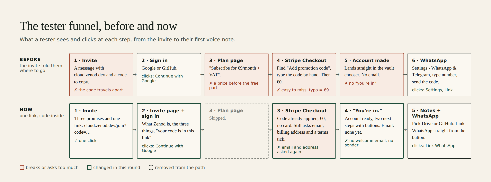
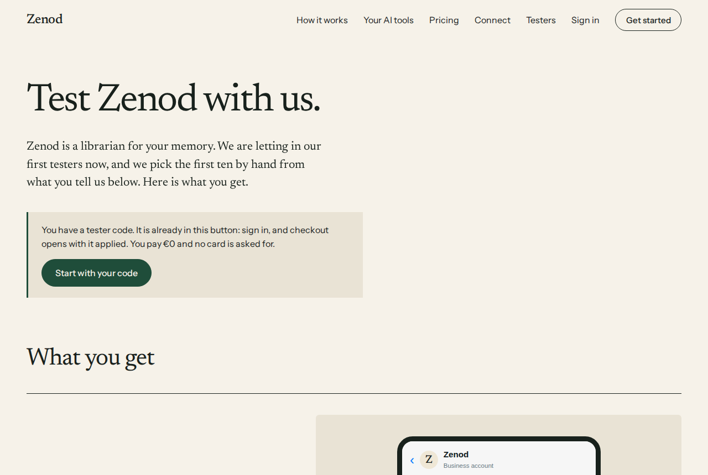
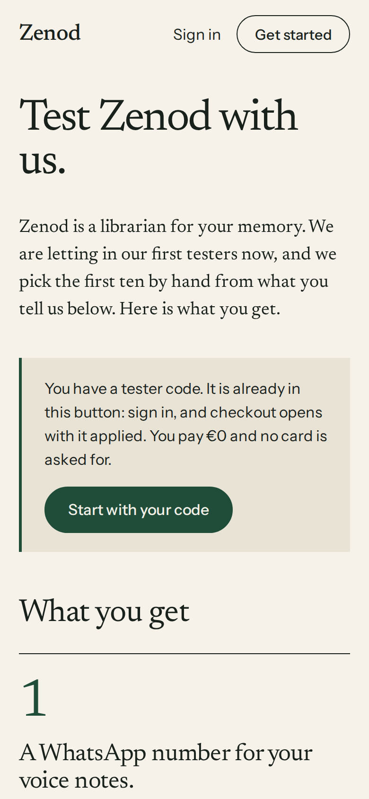
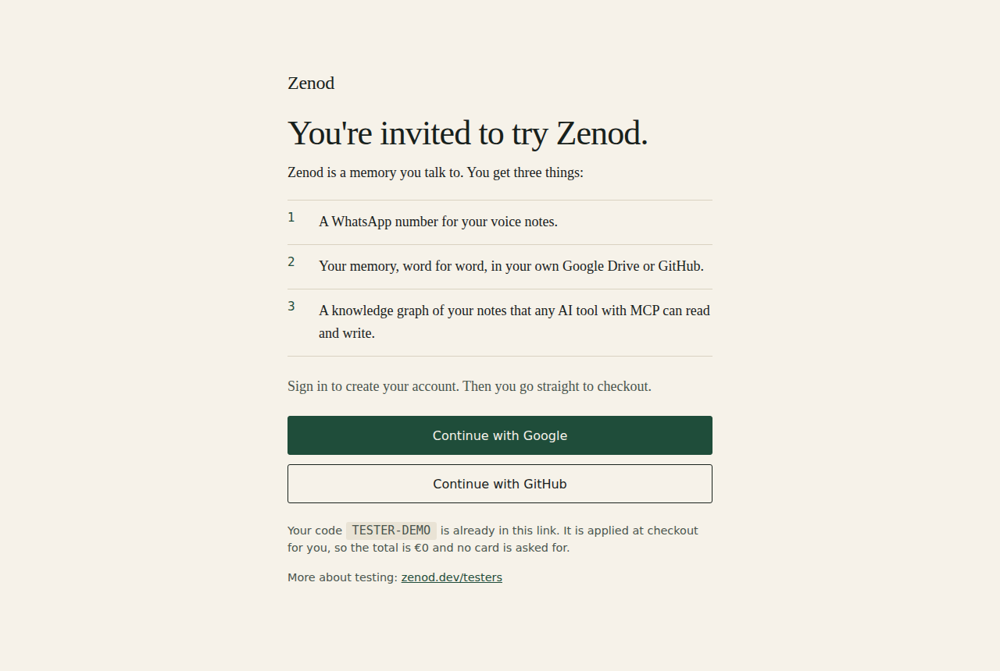
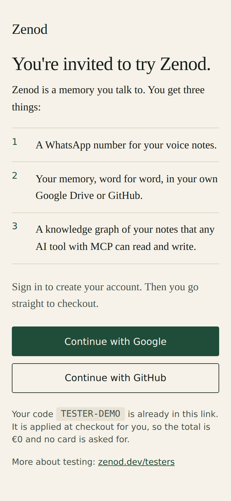
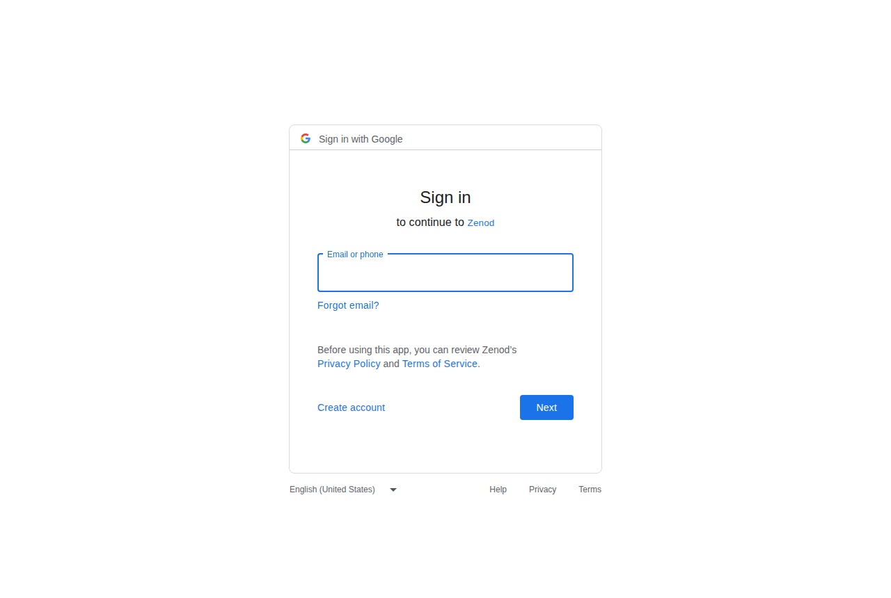
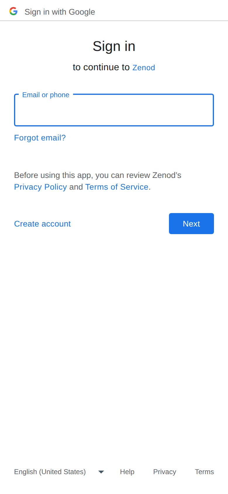
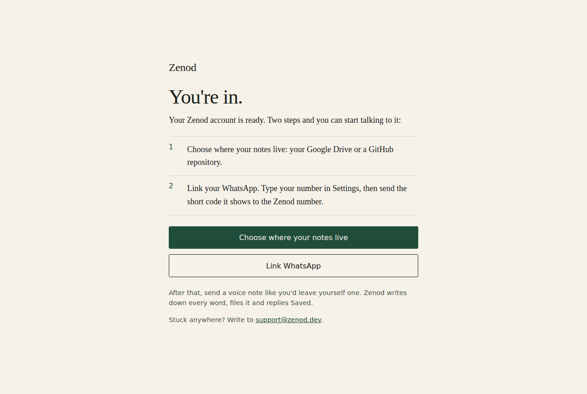
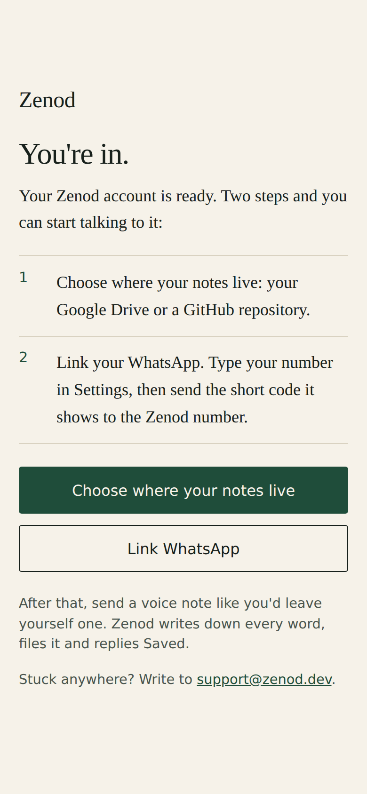

# The tester funnel: one link, code inside (EPIC-26 T1, round 2)

**Bottom line: the invite is now one link with the code inside, live on production (sha 51c0fe51). It signs the tester in with Google or GitHub, skips the plan page and opens Stripe Checkout with the code already applied, then lands on a "You're in" page with the two next steps. There is no welcome email: Zenod has no mailer today, and Stripe sends no receipt for a €0 checkout because nothing is paid. Checkout itself was not seen live in this round: agents hold no Stripe key, live or sandbox, and no sign-in of their own. The first real tester's sign-up proves it, with an agent watching. The first real code needs the tester-code command from E26-A2.**

Jordi's words (2026-11-10, his review of T1): "the invite should be at the end, you make a click and you go through the funnel. You basically give them a code and say, use this code at checkout, right?"

## The funnel today



| Step | What the tester sees | What they click | Where it breaks or asks too much |
|---|---|---|---|
| 1 Invite | One line of what Zenod is, the three things, one link `https://cloud.zenod.dev/join?code=…` | the link | nothing to copy |
| 2 Invite page | What Zenod is, the three things, "your code is already in this link" | Continue with Google or Continue with GitHub | none |
| 3 Sign in | Google's or GitHub's own sign-in for Zenod | their account | a new Google account outside Jordi's has never granted Drive later on (E23-U1 item 10) |
| 4 Stripe Checkout | Zenod monthly with the code applied, €0, no card, "Your Zenod code is already applied" above the button | Subscribe | still asks their email again, a billing address and the terms tick; not seen live yet |
| 5 You're in | "Your Zenod account is ready" and the two steps with buttons | Choose where your notes live, then Link WhatsApp | no welcome email |
| 6 WhatsApp | Settings, type their number, send the short code to the Zenod number | Link | the welcome page does not show the Zenod number itself, Settings does |

A tester who already has an active plan goes straight to the app. A code Stripe does not know, or one already used, falls back to checkout with the open "Add promotion code" field, so nobody is stuck. An existing link on zenod.dev/testers?code=… shows a "Start with your code" button that opens the same invite link.

## Screens, desktop and phone

Captured 2026-11-10 11:42Z from production with a made-up code, `TESTER-DEMO`, which Stripe does not hold, so nothing could be spent.

1. zenod.dev/testers with a code: the "Start with your code" button points to `https://cloud.zenod.dev/join?code=TESTER-DEMO` (read from the live page).




2. The invite page, cloud.zenod.dev/join?code=…, live.




3. Continue with Google lands on Google's "Sign in to continue to Zenod", live. Sign-in asks only for name and email; Drive is asked later, when they pick where notes live.




4. Stripe Checkout with the code applied: no screenshot. Opening it needs a signed-in account and a code Stripe holds; agents have neither a sign-in nor any Stripe key (the sandbox key on VPS1 is root-only too). What the code sends is pinned by tests in `packages/server/test/customerLayer.test.ts`: the session carries the promotion code as a discount instead of the open field, `payment_method_collection: if_required` (no card at €0, proven live twice before with a 100% code, EPIC-7 T1), and the success link goes to the welcome page.

5. "You're in", rendered from `packages/server/src/testerInvite.ts`, unchanged since it went live in ffa1659b. The live page needs a signed-in account, so this is the same HTML production serves, drawn locally.




## Email after checkout

- Zenod has no way to send email to a customer today: no mailer in the server; the only `send_email` in the code is the outbound agent's tool, not a customer path.
- Stripe sends receipts for payments. A €0 checkout charges nothing, so there is no receipt.
- So the "you're provisioned" message is the You're in page, and it is said plainly here. A welcome email needs a sender first (a follow-up, below).

## The invite text

In [invite-dm](../epic7/invite-dm.md), first section: one line of what Zenod is, the three things, and the one link with `{CODE}` inside.

```
Hi {NAME}, I'm building Zenod, a memory you talk to, and I'd love you to be one of the first to try it. You get three things:

1. A WhatsApp number for your voice notes.
2. Your memory, word for word, in your own Google Drive or GitHub.
3. A knowledge graph of your notes that any AI tool with MCP can read and write.

It's free while you test, no card needed. Start here, your code is already in the link:
https://cloud.zenod.dev/join?code={CODE}
```
 `{CODE}` is filled in when the tester-code command exists (E26-A2) and Jordi names the person (E23-A1).

## What was built and where

- PR [#1593](https://github.com/zenod-ai/zenod/pull/1593) merged ffa1659b: the invite link, the checkout with the code applied, the You're in page, the testers page button.
- 5559c414: the invite text.
- Live: `https://cloud.zenod.dev/api/health` reports sha 51c0fe51 (2026-11-10 11:40Z), which contains both.

## Follow-ups

- Start: a welcome email after checkout. Zenod needs a sender first; ask-tier because it contacts people.
- Start: prefill the tester's email at checkout and see whether the billing address can be dropped for a €0 tester checkout (tax rules decide).
- Waiting: E26-A2 (the tester-code command) and E23-A1 (who the first tester is); the first real sign-up proves step 4 live.
