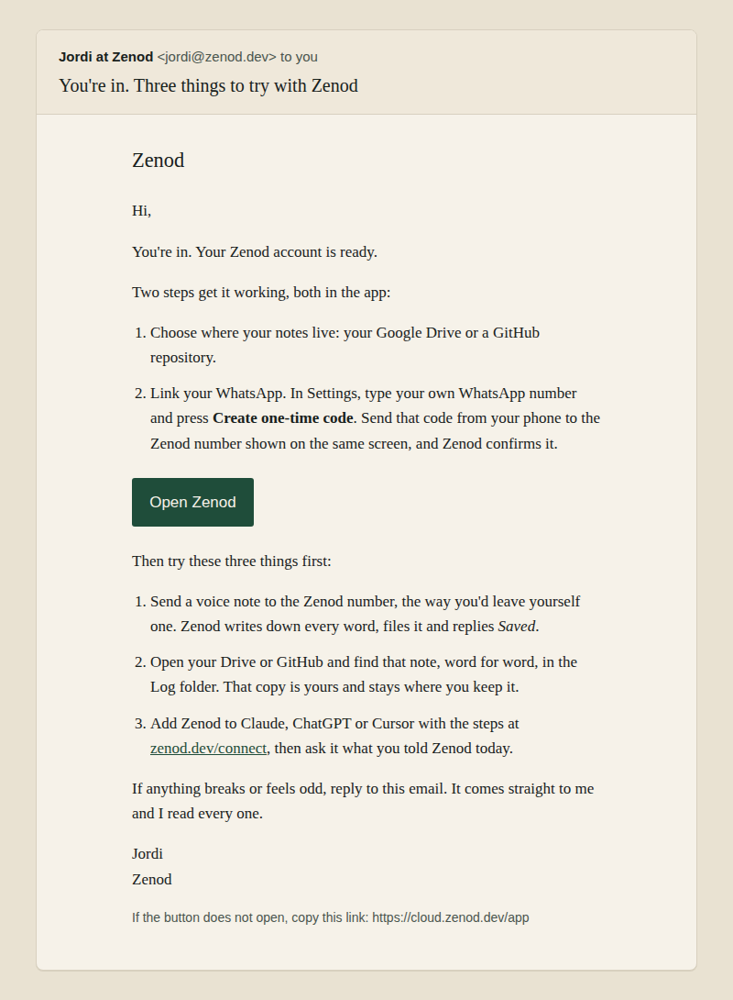

# The welcome email after checkout (EPIC-26 T2)

Jordi, closing T1 on 2026-11-10: "a welcome email after checkout". Built by run_8edfca31 on 2026-11-10. Code: [#1605](https://github.com/zenod-ai/zenod/pull/1605).

## What a new account gets

One email, a few seconds after checkout, from Jordi's own mailbox (jordi@zenod.dev). Replies go straight to him.

Every line is true of production today: the two set-up steps and the Create one-time code button are what the app shows, the Saved reply is what Zenod sends after a voice note, the Log folder is where the word-for-word copy lands, and zenod.dev/connect has the steps for Claude, ChatGPT and Cursor.

## When it is sent

- After a successful checkout, on either path: the return page or Stripe's webhook.
- Once per account. Stripe retries webhooks and both paths can fire; the first one queues the email, every later one does nothing.
- If the send fails, it is retried every 10 minutes. A mail problem never breaks a checkout.

## How it is sent

- One sender for all Zenod mail: the Gmail API with Zenod's own send-only Google key (ask E26-A6), sending as jordi@zenod.dev. The tester link email from E26-S2 now uses the same sender.
- No outside mail service. Resend stays only as a fallback in code and is not set up.

## State on 2026-11-10

| Item | State |
|---|---|
| Code | in PR #1605, tests pass (the Gmail sign-in is checked against a stub, one email across the return page plus two webhook retries) |
| Zenod's Google mail key | not yet in production: waits on ask E26-A6 (Mac agent) |
| Welcome switch | off. It turns on only with `ZENOD_WELCOME_MAIL=1` and the Google key together |
| Next | when the key lands: send Jordi one test welcome, then switch it on |

The list of who was welcomed lives in a private file on the data volume, never in this repo.
