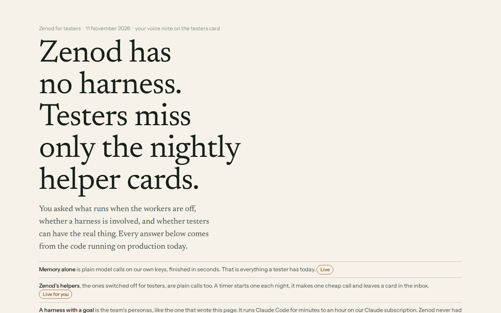
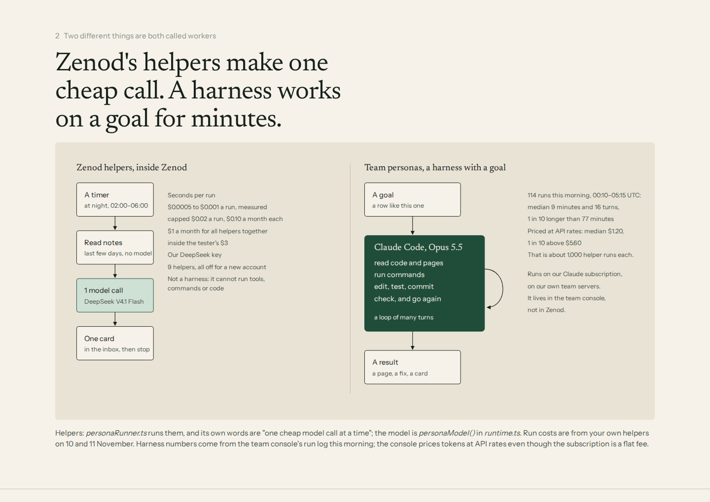
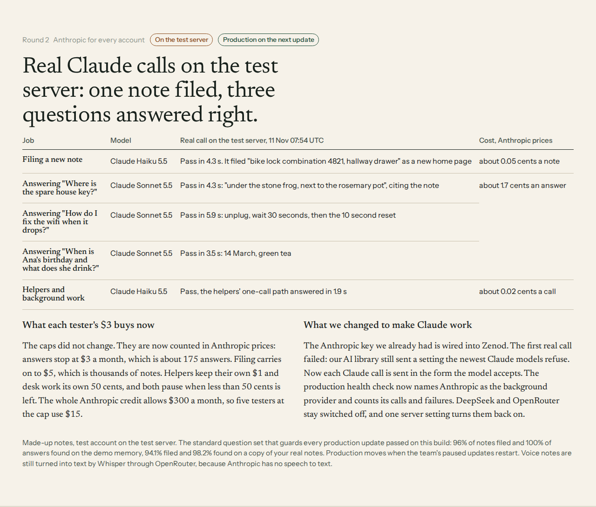

# E7-S1: memory alone, helpers, and a harness: what testers get (2026-11-11)

Rows: E7-S1 in [EPIC-7](../EPIC-7-REAL-USER-TEST.md); U7 iteration 2 in [EPIC-23](../zenod-our-first-live-test-user-then-five.md) folded in (same voice note). Run: run_b944ece0-cf07-4096-9602-6b7ce90fb888.
Live page (tailnet): http://vps3.taild81fbb.ts.net:8921/e7-s1/

Jordi, voice note vn_38178af8: "what is the execution model? These workers, what's the difference between the worker and the normal memory? … We still have a harness, right? … These are pure LLM calls. The problem is when a harness comes in … Can we get them on the real thing, man, with the workers and everything?"

## Answer, from the code on production d9ebdd6

- **Memory alone** (what testers have): filing is one call on DeepSeek V4.1 Flash on DeepSeek's own API (`backgroundRoute.ts`, health `background.provider: deepseek`, balance $7.50 at 05:05Z); answers are a tool loop of at most 8 rounds (`DEFAULT_MAX_STEPS = 8`, `aisdk.ts`) on OpenRouter `deepseek/deepseek-chat` or `google/gemini-3.1-flash-lite`. Our platform keys. Per tester $3 a month for answers, $5 at most with filing (`limits.ts`). No harness, no Claude.
- **Zenod helpers** (switched off for testers by U7, `ZENOD_HELPERS_FOR_TESTERS` unset in `zenodUnit.ts`): nightly timer, read notes without a model, one cheap call (`personaModel()`, DeepSeek Flash), one inbox card. Measured $0.0005 to $0.001 a run on Jordi's account (E14-S30 tally, S37, S38). Caps $0.02 a run, $0.10 a month each, $1 a month all helpers, inside the $3. 9 helpers, all `defaultEnabled: false`. Not a harness.
- **A harness with a goal** = EpicTeam personas: Claude Code, Opus 5.5, on our Claude subscription in the team console. 114 finished runs 00:10–05:15Z today: median 9 minutes, 16 turns, $1.20 at API prices; p90 77 minutes, $5.60. Not in Zenod; no customer path (root L-7: Zenod's seams to the team side are MCP and a webhook only).

## Tested?

| What | Where | When | Result |
|---|---|---|---|
| Notes filed | production, Jordi | daily | pass; private suite 96.2% retrieval, 93.8% ingestion |
| Account isolation | CI on d9ebdd6 | 11 Nov 03:43Z | pass, [run 42954561249](https://github.com/zenod-ai/zenod/actions/runs/42954561249) |
| Tester apply, code, €0 checkout | production | 11 Nov 04:23Z | pass up to sign-in ([e23-u7](e23-u7-2026-11-11.md)) |
| Fresh account end to end | production rehearsal | 11 Nov 04:31Z | stopped at Google phone check, E7-A20 |
| Helpers on schedule | production, Jordi | 10 Nov 05:07Z | pass, 4 runs $0.0024 |
| Clarifier, Something to try | production, Jordi | 11 Nov 00:33Z, 00:53Z | pass, $0.0008 and $0.0005 |
| Helpers off for testers | server tests, live build | 11 Nov | pass |
| Helpers in a tester account | nowhere | never | not tested |
| Staging | zenod-staging | — | cannot: one test tenant, env has no model key (names only: 3 vars) |

## Can testers get the real thing

1. Helpers: one production setting, `ZENOD_HELPERS_FOR_TESTERS=1` on zenod-mt, then restart; stop = unset. Spend stays inside the recorded caps. Blocked only on Jordi's yes, because it reverses the U7 launch decision he gave at 02:05Z ("helpers off … still building") and changes the tester offer. Not done here: production env is a human gate and staging cannot prove it (no model key, no hosted accounts).
2. A harness for testers: not a switch. Needs a pay-per-use API key (the subscription serves our own team, the same rule as OpenCode in [e14-s10-go](e14-s10-go-2026-11-09.md)), a sandbox per tester, a per-run budget and a safety review, and it crosses root L-7. About $1 a run. Handed to the desk, not asked now.

## Spend

No model calls. $0.

## Round 2: Anthropic for every account (2026-11-11, run run_cac2848a-50de-49b2-8b5d-3ca45e9146af)

Jordi, on the E7-S1 card: "we have to ship with anthropic api not deepseek or openrouter"; on E14-A11: "get the anthropic api key wired . it's already present - find it. I'm not adding more credit, fix anthropic route until it works". The key and the route are EPIC-14 S41 round 2 ([#1633](https://github.com/zenod-ai/zenod/pull/1633) `c98cda5`, [evidence](e14-s41-r2-2026-11-11.md)); this round makes it the shipped setup for every tester and new account.

**What shipped** ([#1635](https://github.com/zenod-ai/zenod/pull/1635), merged `b3c385b`; S41's probe-fixture fix [#1638](https://github.com/zenod-ai/zenod/pull/1638) `e0b6d80`):

- **Claude 5 request shape** (`packages/core/src/llm/claude5.ts`): the AI SDK release Zenod runs treats `claude-haiku-5-5`/`claude-sonnet-5-5` as unknown models and sent `temperature: 0` (staging `c98cda5`, 06:31Z: **400 "`temperature` is deprecated for this model"**) and fakes structured output with a forced `json` tool (forced `tool_choice` is a 400 on Sonnet 5.5). Now: no sampling params, native `output_config.format`, forced tool choice → `auto` on Sonnet 5.5, Haiku without thinking, Sonnet at effort `medium`. Tested on the wire through the SDK (`packages/core/test/claude5.test.ts`).
- **Models by job**: filing, chat acknowledgements, helpers, desk and reflection on Claude Haiku 5.5 ($0.10/$0.50 per million tokens); answers on Claude Sonnet 5.5 ($2/$10) via `ZENOD_CREDIT_ASK_MODEL`.
- **Caps restated in Anthropic prices**: the recorded $3 per account stays (`ZENOD_CREDIT_MONTHLY_USD=3`); the paid route's per-feature rules now apply to Anthropic spend: answers stop at $3 (about 175 Sonnet answers at the measured 1.7 cents), filing to $5 (thousands of Haiku filings at about 0.05 cents), helpers their own $1, desk $0.50, both pause at the $0.50 reserve. No spend beyond a recorded limit. The org credit allows $300 a month; five testers at the cap = $15.
- **/api/health**: `background.provider: anthropic` for filing, desk, personas, reflection when `ZENOD_CREDIT_TENANTS=all`, with `fallback.switch: ZENOD_CREDIT_TENANTS` (DeepSeek and OpenRouter only behind that switch, off); `credit.anthropic` shows models, cap and a call tally (counts only).
- **Probe**: `POST /api/credit/probe?set=memory`: one filing and three answers on made-up notes, real calls, for staging's vault-less test tenant.
- **Still on OpenRouter**: speech to text (Whisper), because Anthropic has none; it was always inside the same $3. Calls stay on OpenAI.

**Real calls on staging** (`http://100.104.206.10:8781`, test tenant, `e0b6d80`, 07:54Z):

| Job | Model | Result | ms |
|---|---|---|---|
| file a new note (classify) | claude-haiku-5-5 | pass: "Record bike lock combination and storage location in a new home page." | 4,265 |
| "Where is the spare house key?" | claude-sonnet-5-5 | pass: under the stone frog, next to the rosemary pot, cites the note | 4,324 |
| "How do I fix the wifi when it drops?" | claude-sonnet-5-5 | pass: unplug, 30 s, then 10 s reset | 5,857 |
| "When is Ana's birthday and what does she like to drink?" | claude-sonnet-5-5 | pass: 14 March, green tea | 3,481 |
| helpers' one-call path (`/api/credit/probe`, 07:03Z) | claude-haiku-5-5 | pass, "OK" | 1,903 |

Set cost $0.052. Health at 07:54Z: `background {provider: anthropic, jobs all anthropic, state ok, fallback {deepseek: off}}`, `credit.anthropic {askModel: claude-sonnet-5-5, capUsd: 3, accounts: all, calls 4, failed 0}`. Staging ledger for the day: 12 Sonnet answers $0.2046, 8 Haiku calls $0.0018.

**Promote gate** (`scripts/promote-production.sh --dry-run`, 07:25Z, staging on `b3c385b`): gate 1 staging healthy; gate 2 question set demo ingestion 96%, retrieval 100%, errors 1.7%; private real-note set 94.1%, 98.2%, 3.1%: passed. The re-pin stopped at "not in promote_targets": promotes are paused on VPS1 (infra-vps `a0b064c`).

**Production**: `zenod-mt` env set 07:20Z, not redeployed: `ZENOD_CREDIT_TENANTS=all` (widened from S41's one account), `ZENOD_CREDIT_ASK_MODEL=claude-sonnet-5-5`, `ZENOD_CREDIT_MONTHLY_USD=3`; the key `ZENOD_CREDIT_ANTHROPIC_API_KEY` was copied by S41 at 06:27Z. Inert until the promote. **Sha to promote: `e0b6d80`** (staging runs it; any sha from `b3c385b` on is safe; never one before `b3c385b` with this env, every Claude call would 400). Rollback: `dokploy env-unset zenod-mt ZENOD_CREDIT_TENANTS` then redeploy; everything goes back to DeepSeek and OpenRouter.

**Slip**: staging was rolled twice to the same `e0b6d80` image, by S41 at 07:47Z and by this run at 07:54Z, against the one-roll-an-hour pace (the image already showed `e0b6d80` and was not re-checked against the deployment list first). One extra restart, nothing else changed.
