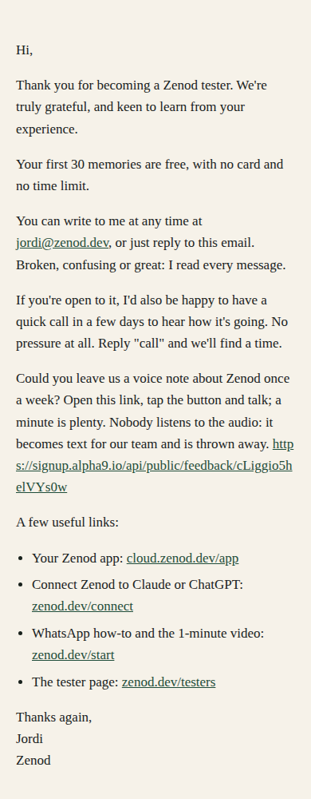
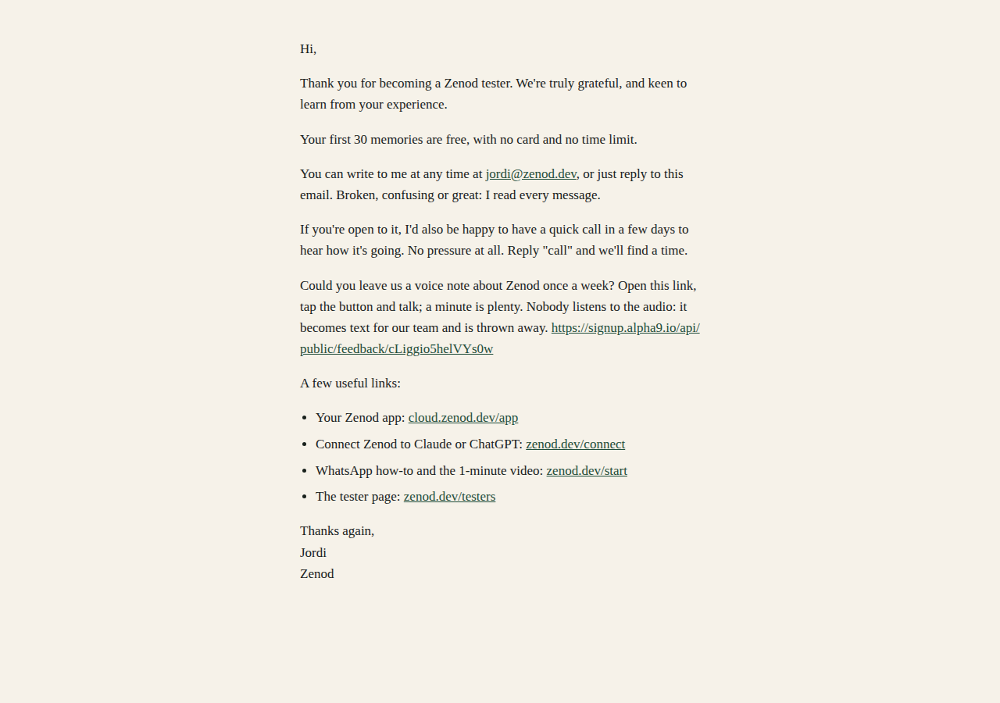

# E7-S10: the tester thank-you email asks for a weekly voice note, with their own link

**Answer:** yes. From this release on, the thank-you email a tester gets when they link WhatsApp carries Jordi's
approved paragraph and the tester's own voice feedback link. Nobody already thanked gets a second email.

```
 tester links WhatsApp ──► thank-you queued ──► link made? ──yes──► email WITH the paragraph ──► sent once
 (production)               (production)          │                                              (team Gmail, vps3 timer)
                                                  no ──► wait, at most 30 min (2 link-timer ticks)
                                                         └─ still none ──► email WITHOUT it, sent once
```

Source: Jordi answered E7-A26 on 16 Nov 2026: "APPROVED - Yes: the extra paragraph for new testers." (Team desk
vn_7f478843, 20:29Z: "So the first one, OK").

## The paragraph (word for word)

> Could you leave us a voice note about Zenod once a week? Open this link, tap the button and talk; a minute is
> plenty. Nobody listens to the audio: it becomes text for our team and is thrown away. {their link}

It sits after the quick-call paragraph and before "A few useful links". Subject and every other line are unchanged.

## Preview for our test tester account

Rendered by production's own composer (`testerThanksMail`) with the link production holds for our test account
(operations@alpha9.io, named `TEST` on the console); that link opens the recording page (200). Nothing was sent:
the preview is the composed email, not a delivery.





## The rules, and which way we chose

- **New testers only.** The email is composed when the queue is read, so only mails not yet sent get the paragraph.
  Production before this release: 2 thank-yous sent, 0 queued (`/api/ops/testers/onboarding`, 20:3xZ). Sent records
  are never listed again (`markSent` unchanged), so those 2 people get nothing new.
- **No link yet when the thank-you is due: wait, bounded.** The link timer (`zenod-tester-feedback`) runs every 15
  minutes; a tester's link exists from their checkout, usually long before they link WhatsApp. A mail with no link
  yet is held for at most 30 minutes after it was queued (two ticks), then goes without the paragraph. A held mail
  stores nothing and is listed once it is due, so it is still sent exactly once. Why: the thank-you stays prompt (at
  worst 30 minutes later) and nearly every tester gets the link; waiting without a bound could hold a thank-you for
  good.
- Only a real `https://…/api/public/feedback/<token>` link is used; anything else leaves the paragraph out.

## Tests

`packages/server/test/testerOnboarding.test.ts`, "the voice feedback paragraph in the thank-you (E7-S10)", 6 tests:
the exact approved words and the rest unchanged; a bad link leaves it out; a tester with a link gets one email and
relinking or a test send sends nothing more; a tester already thanked is never mailed again; no link yet waits and
then sends with it; no link after the wait sends without it, once. PR [#1685](https://github.com/zenod-ai/zenod/pull/1685).

## Live

| Check (2026-11-16) | Result |
| --- | --- |
| PR #1685 | `ci` green (14m30s), squash-merged as `bc12314` |
| Staging `zenod-staging` | `bc12314`, healthy |
| Promote gate (root D28) | question set passed: demo 96/100/1.7, real notes 94.1/93/3.1 |
| Production `zenod-mt` | `bc12314` since 21:21:59Z, `/api/health` ok |
| Mail queue after the promote | mode on, 0 queued, 2 sent before (unchanged): nobody is mailed again |

Rollback: `scripts/promote-production.sh --rollback`, or revert #1685 (later emails go without the paragraph).
