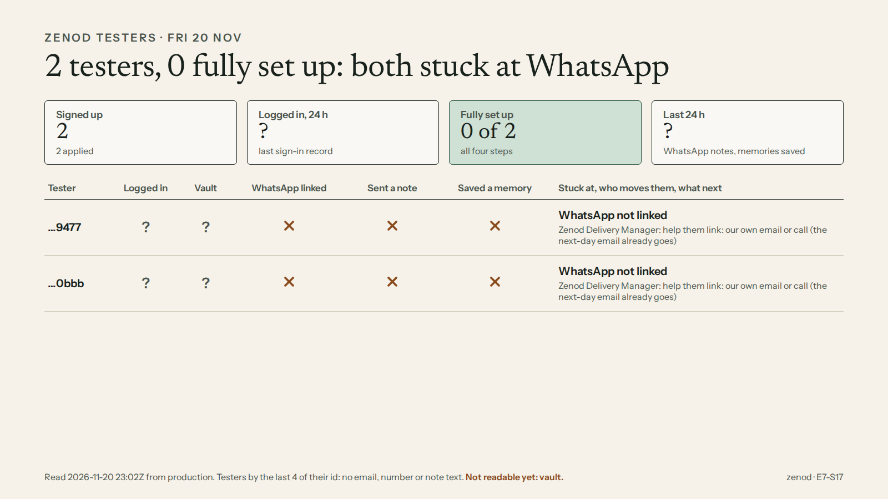

# E7-S17: the daily tester picture, 20 Nov 2026

**2 testers, 0 fully set up: both stuck at WhatsApp.** Today's picture, built from production's own records:



```
 05:30 Mexico City  vps3 timer ──ssh VPS1──► production ops route ──► picture.py ──► latest.png + latest.json
                                                                                          │
                                  06:00 briefing (agent_team places it, desk note sent) ◄──┘
```

Row: E7-S17 in [EPIC-7](../EPIC-7-REAL-USER-TEST.md). Run: run_f58aa599-9ff3-4c51-ba76-037154435bf9. Source: Jordi, vn_b73d7c41 (20 Nov 22:38Z): "how many testers logged in? How many testers are fully set up ... GitHub ... WhatsApp ... at least one message ... at least one memory ... right now I'm lost."

## His questions, one by one

| He asked | The picture shows | Today |
|---|---|---|
| How many testers do we have | signed up, and how many applied | ✓ 2 signed up, 2 applied |
| How many logged in | last 24 h, from a sign-in record | ✗ shows `?` for now: the record starts when the next release is live |
| How many fully set up (four steps) | one ✓ / ✗ per step per tester | ✓ 0 of 2; vault shows `?` for now, the other three are read |
| Where each is stuck | the first ✗, who moves them, what happens next | ✓ both at WhatsApp, owner: Zenod Delivery Manager |
| Daily, before his briefing | a timer 05:30 Mexico City | ✓ written; installs once PR #1721 is merged |
| In his WhatsApp briefing | agent_team places it | ✗ not yet: one desk note sent, so the row stays active |

## What it reads (all read only, no personal data)

- Production's new ops route `GET /api/ops/testers/progress` (PR #1721): per real tester, the vault state, the WhatsApp step, WhatsApp notes and finished memories (all time and last 24 h) from the tenant's task ledger, and the last time they used the app. Our own test accounts are left out and one person with two accounts counts once. A tester is shown as the last 4 characters of their account id. No email, number, code or note text leaves production.
- Until that release is live the script falls back to the existing WhatsApp setup route plus `tester-watch`: WhatsApp and saved memories are read, the vault and sign-ins show `?` and the picture's footer says so. Nothing is guessed.
- "Sent a note" counts notes the tester sent over WhatsApp that Zenod took in; the one-tap link message is not a note.

## Next

1. Merge PR #1721 once `ci` is green, install the timer (`scripts/tester-picture/install.sh`), then the Delivery Manager promotes the release: the vault and sign-in columns turn real by themselves.
2. agent_team places the picture in the 06:00 briefing and creates the Zenod goal-manager persona (desk note [2026-11-20-zenod-jordi-vn-b73d7c41-a-daily-zenod-tester-p](https://github.com/AlfaBlok/epic-team/blob/main/desk/inbox/2026-11-20-zenod-jordi-vn-b73d7c41-a-daily-zenod-tester-p.md)). The row goes to review only when he sees the picture in his briefing.
