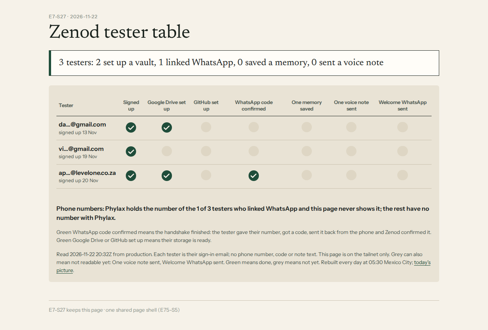
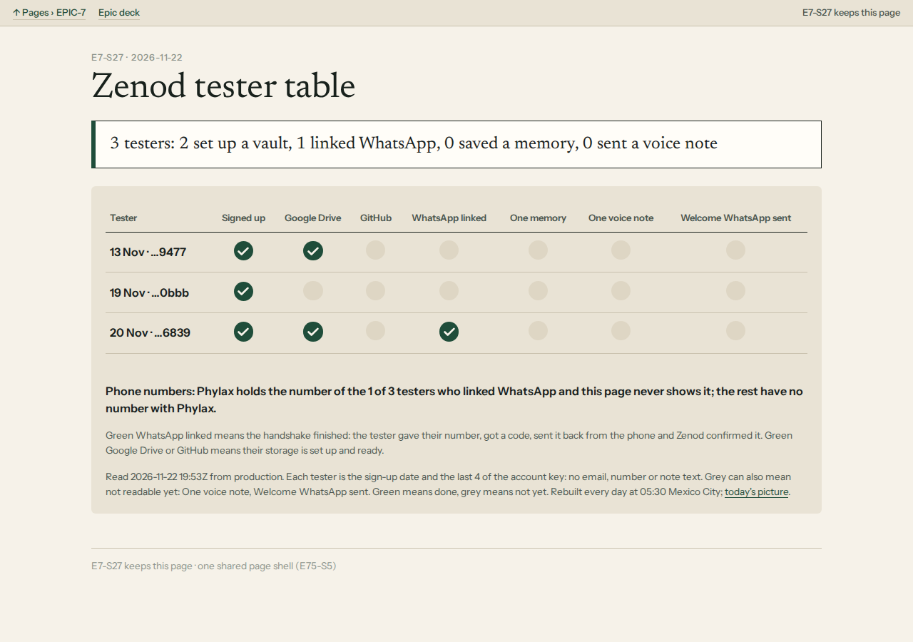

# E7-S27: Jordi's tester table (22 Nov 2026)

**Iteration 2: each tester is now shown by email, on the page, in the daily picture and in the Testers tracker. The tracker inside the objective and the daily briefing wait on agent_team.**

```
 production ─► tester-watch (VPS1) ─► picture.py 05:30 Mexico City ─┬► page :9008 (tailnet, email per row)
 (progress route)   gives the email                                  ├► latest.png / latest.json (email, label)
                                                                      └► trackers.py feed ─► Testers tracker, Name = email
                                              agent_team (desk note) ─► tracker on the objective + its daily briefing   ✗ waits
```

Iteration 2 run: run_2e5a9fc8-b741-4428-834b-abd611f4b269. Code: [PR #1744](https://github.com/zenod-ai/zenod/pull/1744) (merged b9619f01, ci green). Page: http://vps3.taild81fbb.ts.net:9008/ (tailnet only). Screenshots with the emails masked, because this repo is public: [1280](e7-s27/table-iter2-1280.png), [390](e7-s27/table-iter2-390.png), [daily picture](e7-s27/table-picture-iter2.png).



## His words, point by point (vn_c2e56f5c, 22 Nov, relaunching)

He asks in one line: show me the email of each tester, put the table as a tracker inside the objective, and make it part of a daily briefing for that objective.

| He asked | Now | |
|---|---|---|
| "can we just have a fucking email, bro? ... I cannot even see the tester" | each row is the tester's sign-in email with the sign-up date small under it, on the page and in the 05:30 picture; the page is tailnet only and still shows no phone number, code or note text | ✓ |
| "can this be a tracker inside the objective" | the Testers tracker (zenod-live) is fed from this table with the email as Name: 3 testers, `trackers.py feed`, nothing in agent_team masks it. Showing it on the objective itself, expandable, is agent_team's screen: one desk note asks for it | ✗ waits on agent_team |
| "can this be part of the daily briefing? ... maybe some objectives can have a daily briefing ... we can turn on the daily briefing ... I don't know how to set that up" | Zenod cannot turn a briefing on in agent_team. The same desk note asks agent_team for a daily briefing for this objective that carries the Testers table, with the picture `~/.local/state/zenod-tester-picture/latest.png` | ✗ waits on agent_team |

## How the email is read

The production progress route keeps the email back by design. The email comes from `tester-watch --json` on VPS1 (read only, the same call the picture already used for memories), joined to each tester by the last 8 characters of the account key. A tester whose email cannot be read keeps the old date and last-4 label. The email is in the page, the picture, `latest.json` and the private tracker; never in this repo (tests use made-up addresses, the screenshots above are masked).

## Checks (iteration 2)

`python3 scripts/tester-picture/picture.test.py` 26 tests; `text_wall_check` and `clean_look_check` clean on the page; page opened at 390 and 1280 px; `trackers.py check` 0 broken; the service rebuilt the live page from main at 20:49Z.

---

# Iteration 1 (earlier the same day)

**3 testers: 2 set up a vault, 1 linked WhatsApp, 0 saved a memory, 0 sent a voice note. One row per tester, one green or grey dot per step.**



```
 production ──► progress route ──► picture.py (05:30 Mexico City) ──► PNG for the briefing
 (voice notes, welcome sent added)                                  └► page :9008 (tester table)
```

Row: E7-S27 in [EPIC-7](../EPIC-7-REAL-USER-TEST.md). Run: run_29e80097-6e28-4c90-a368-3cf99c95a559. Code: [PR #1738](https://github.com/zenod-ai/zenod/pull/1738). Page: http://vps3.taild81fbb.ts.net:9008/ (tailnet). Picture: [table-picture.png](e7-s27/table-picture.png).

## His words, point by point (vn_40b9ff8f, 22 Nov)

| He asked | The table | |
|---|---|---|
| "a table of testers ... rows, and each row is a tester" | one row per tester, shown as the sign-up date and the last 4 of the account key | ✓ |
| columns: sign up, Google Drive, GitHub, one memory, one voice note | the same seven in his order, plus WhatsApp linked (his earlier four steps) | ✓ |
| "Is it green or not green?" | each cell is a green disc or a grey disc, nothing else | ✓ |
| "welcome WhatsApp sent, maybe that's another column" | last column: the link welcome or the first-note message reached the tester | ✓ |
| "a daily briefing" | PNG rebuilt daily at 05:30 Mexico City; desk note asks agent_team to place it in the 06:00 briefing | ✗ not placed yet |
| "did they give the phone number? Can we even see it?" | one line on the page: Phylax holds the number of each linked tester (1 of 3), the page never shows one | ✓ |
| "when the guys put a phone number ... we send a code ... are we monitoring ... whether this handshake was successfully filled in" | the WhatsApp linked cell is green only at the verified state (number given, code sent back from the phone, confirmed); a key line under the table says so, and that green Drive or GitHub means storage ready ([PR #1741](https://github.com/zenod-ai/zenod/pull/1741)) | ✓ |

## What turns grey for now

The running production release does not send voice-note counts or the welcome record yet, so those two columns read grey for everyone and the footer says so. This PR adds both to `GET /api/ops/testers/progress` (`voiceNotes`, `welcomeSentAt`); they turn real at the next promote, no change to the table needed. The link welcome is read from the onboarding record (armed at the code request, marked sent when the link is seen); the first-note message from its own record (still switched off, E7-A35).

## Phone numbers, honestly

A tester who links WhatsApp has a verified number, and Phylax holds it. Zenod's own account record keeps no number. Zenod's request log can hold a number a tester typed when asking for a code; nothing in the table or page reads it. The page shows none.

## Checks

`python3 scripts/tester-picture/picture.test.py` 20 tests; vitest testerProgress, testerOnboarding, testerFirstNoteNudge 31 tests; `tsc --noEmit` clean; `text_wall_check` and `clean_look_check` clean on the page; page opened at [390](e7-s27/table-390.png) and [1280](e7-s27/table-1280.png) px.
