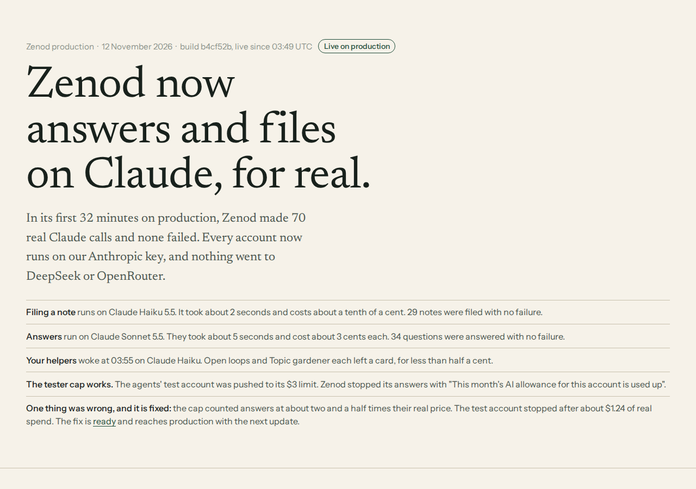
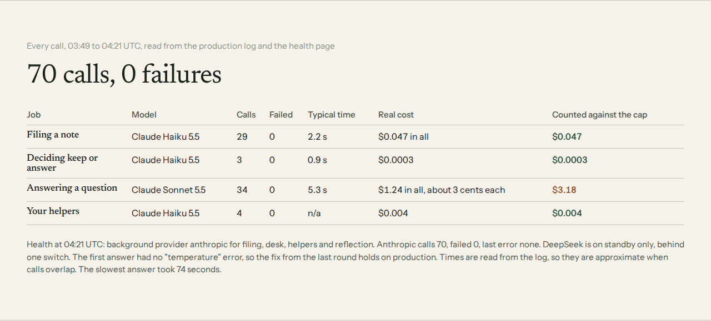
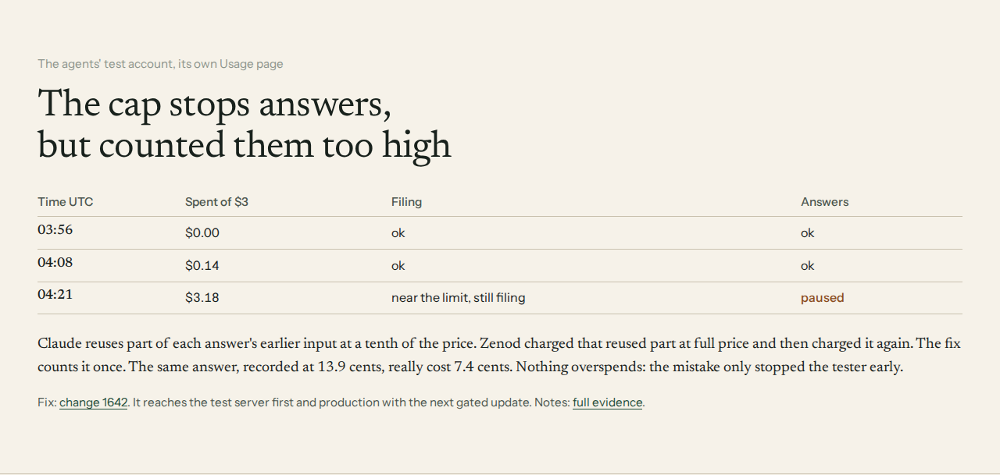

# E7-S3: the first real Claude calls on production (2026-11-12)

Row: E7-S3 in [EPIC-7](../EPIC-7-REAL-USER-TEST.md), follow-up of [E7-S1](e7-s1-2026-11-11.md). Run: run_3b6e3fb0-e514-42a1-bed0-bbafcb955588.
Live page (tailnet): http://vps3.taild81fbb.ts.net:8921/e7-s3/

**Bottom line.** Production `zenod-mt` has run `b4cf52b` since 03:49Z. In its first 32 minutes it made **70 real Claude calls with 0 failures** and none on DeepSeek or OpenRouter: filing, chat routing and helpers on Claude Haiku 5.5, answers on Claude Sonnet 5.5. The per-tester cap counts this spend and stopped the agents' test account with its message. **One defect:** the cap counted a cached Sonnet answer at about 2.5 times its price, so the test account stopped at about $1.24 of real spend instead of $3. The fix is [#1642](https://github.com/zenod-ai/zenod/pull/1642), merged `b53e4a7` at 04:26Z after `ci` passed. Production keeps working and nothing overspends, so no rollback.

## How this was read

- `GET https://cloud.zenod.dev/api/health` (public, counts only).
- `zenod-mt` container `80e343f4…`, image `sha-b4cf52b`, through the VPS1 sudo allowlist's read-only `docker logs --since --until --timestamps` form. Only `[llm-usage]`, `[llm-cost]`, `[persona]` and error lines were kept. They carry no content and no tenant. Nothing from env was printed.
- The agents' rehearsal account (operations@alpha9.io, Zenod user `usr_b17aca05…`, free pass) through its own Usage view `GET /api/console/usage`, read from a separate tab of the agents' sign-in browser. Jordi's account was not touched.
- No calls were made by this run. The T7 round 5 / T7-F1 run (run_7e5d9249) was using the rehearsal account at the same time. It connected the vault at about 03:57Z, filed notes and asked questions. Those calls were real tester-path traffic on an agent-owned account, so this row reads them and does not add its own set.

## Health

| When | `background` | `credit.anthropic` |
|---|---|---|
| 03:53:40Z | `provider: anthropic`, `model: claude-haiku-5-5`, jobs filing, desk, personas, reflection all `anthropic`, `state: idle`, `fallback {deepseek: standby, switch: ZENOD_CREDIT_TENANTS}` | `on: true`, `askModel: claude-sonnet-5-5`, `capUsd: 3`, `accounts: all`, calls 0 |
| 04:21:13Z | same, `state: ok` | calls **70**, failed **0**, `byModel {claude-haiku-5-5: 36, claude-sonnet-5-5: 34}`, `lastError: null` |

`standby` (staging shows `off`): production holds a DeepSeek key, ready if `ZENOD_CREDIT_TENANTS` is unset. No call used it.

## Every call, 03:49Z to 04:21Z

From `[llm-usage]` lines. Latency is the gap from the call's `[llm-cost]` line, so it is approximate when calls overlap. The log's own `latency_ms` is `none` on this route. Real price uses Anthropic's list prices (Haiku 5.5 $0.10/$0.50, Sonnet 5.5 $2/$10 per million, cache read 0.1x, write 1.25x).

| Job | Model | Calls | Failed | Latency median (max) | Real spend | Counted by Zenod |
|---|---|---|---|---|---|---|
| Filing (classify, place) | claude-haiku-5-5 | 29 | 0 | 2.2 s (28 s) | $0.047, about 0.1 cent a note | $0.047 |
| Chat routing (keep or answer) | claude-haiku-5-5 | 3 | 0 | 0.9 s (1.1 s) | $0.0003 | $0.0003 |
| Answers | claude-sonnet-5-5 | 34 | 0 | 5.3 s (74 s) | $1.24, median 3.4 cents | **$3.18** |
| Helpers (Jordi's Open loops, Topic gardener, 03:55Z) | claude-haiku-5-5 | 4 | 0 | n/a | $0.0037 | $0.0037 |
| **All** | | **70** | **0** | | **$1.29** | **$3.23** |

The first calls were Jordi's helpers at 03:55:01Z. They are written up in [E14-S41 round 3](e14-s41-r3-2026-11-12.md). The rehearsal account's first chat routing call came at 03:59:37Z, its first filing at 04:00:06Z and its first Sonnet answer at 04:03:44Z: input 57,235 tokens (29,185 cache read, 3,713 cache write), output 977, 11.7 s.

No Anthropic 400 and no `temperature` error: E7-S1's request-shape fix holds on production.

## The per-tester cap

The rehearsal account's Usage view (`/api/console/usage`):

| When | Spent of $3 | Filing | Chat answers |
|---|---|---|---|
| 03:56Z | $0.00 | ok | ok |
| ~04:08Z | $0.143 | $0.0031 ok | $0.1397 ok |
| 04:21Z | $3.18 | $0.0046 near | $3.18 **paused** |

At 04:16:26Z the account's next question was refused before any call: `LlmAllowanceExceededError: This month's AI allowance for this account is used up. It resets on 2026-12-01.` So the cap counts Claude spend and stops answers. Filing goes on (`near`) as the limits model says.

**Defect: the cap overcounted cached answers about 2.5 times.** The AI SDK (`@ai-sdk/anthropic` 3.0.82, `ai` 6) reports `inputTokens` as the total, with cache reads and writes included. Zenod's `estimateCostUsd` priced that total at the full input rate, then added the cache reads and writes again. Example, the 04:03:44Z answer: counted $0.139, real $0.074. Over the 34 answers it counted $3.18 for $1.24 of real spend, so the test account stopped at about 41% of its real $3. Filing and helpers use no cache and were counted right. Nothing overspends. The error only stops testers early, which is the safe direction.

- Fix: [#1642](https://github.com/zenod-ai/zenod/pull/1642), `packages/server/src/usageStore.ts`. Only the uncached part bills at the full rate, the same way the DeepSeek branch already read it. A test pins the production numbers (0.0735635 dollars). `tsc` is clean and 132 tests pass in the 8 affected files.
- Merged `b53e4a7` (squash, `ci` green in 14 min, branch and worktree removed).
- Rollout: staging on merge. Production on the Delivery Manager's next gated promote (D28). Ledger rows already written keep their old figure, so the rehearsal account stays paused until 1 December unless its month is reset.

## Not covered here

- Answer quality and the cap message on screen belong to T7 round 5 (same account, same window).
- Speech to text still runs on OpenRouter Whisper (E7-S1). No voice note reached production in this window.

## Spend

This run made no model calls: $0.
