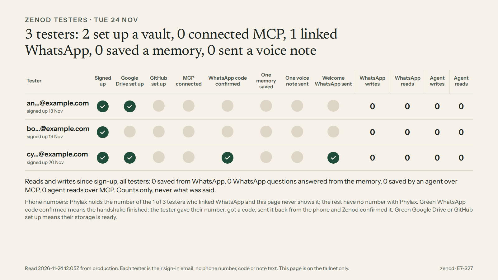

# E7-S31: MCP connected, and memory reads and writes, per tester (24 Nov 2026)

**The tester table now has an MCP connected step beside storage and WhatsApp, plus four counts (WhatsApp writes and reads, agent writes and reads). Today's real numbers for the 3 testers: 0 writes from either channel. MCP connected and the read counts become readable once production runs the merged release (a promote).**

```
 production (zenod-mt) ── /api/ops/testers/progress ──► picture.py (vps3, 05:30 Mexico City, from origin/main)
   oauth_tokens / zmt_ tokens ─► mcp.connected                ├► page :9008  (dot: MCP connected)
   tasks.sqlite (by channel)   ─► WhatsApp / agent writes      ├► latest.png / latest.json
   chat outcome answer|both    ─► WhatsApp reads               └► Testers tracker (agent_team feed)
   usage.sqlite tools[]        ─► agent reads (from this release)
```

Row: E7-S31 in [EPIC-7](../EPIC-7-REAL-USER-TEST.md). Run: run_8c2412b6-b59c-49b3-a039-a45bfec02b91. Code: [PR #1758](https://github.com/zenod-ai/zenod/pull/1758), merged as `ad960d1c`.



## His words, point by point (vn_aa7447c3 on E7-A42, 24 Nov)

| He said | Now | |
|---|---|---|
| "they have MCP connected. That's another thing that we have not been measuring" | the `MCP connected` dot column sits with the setup steps, after GitHub and before WhatsApp. It goes green on the tester's first OAuth sign-in to their tenant, when they use a personal MCP token, or on any agent read or write | ✓ built. It reads only once production runs the release |
| "connecting the repo, the Google Drive, the MCP and the WhatsApp" | all four are columns of the same row: GitHub set up, Google Drive set up, MCP connected, WhatsApp code confirmed | ✓ |
| "them reading and writing into the memory ... write from the WhatsApp voice notes or from the agents" | `WhatsApp writes` and `Agent writes`: memories saved since sign-up on each channel | ✓ |
| "the reads can also be like reads from WhatsApp or reads from the agents" | `WhatsApp reads` counts WhatsApp messages Zenod answered from the memory. `Agent reads` counts agent questions to Zenod plus MCP searches and reads | ✓. Before this release, MCP searches were not named in the usage log, so they count from the promote onward |
| "they import ... an existing obsidian brain" | not this row: it is E7-S32 | → E7-S32 |

## The actual numbers today (read 24 Nov 2026 11:58Z, production progress route over the VPS1 ops call)

| Tester (last 4 of key) | Vault | MCP connected | WhatsApp linked | WhatsApp writes | WhatsApp reads | Agent writes | Agent reads |
|---|---|---|---|---|---|---|---|
| …9477 (signed up 13 Nov) | Google Drive | not readable yet | no | 0 | 0 | 0 | not readable yet |
| …0bbb (19 Nov) | none | not readable yet | no | 0 | 0 | 0 | not readable yet |
| …6839 (21 Nov) | Google Drive | not readable yet | yes | 0 | not readable yet | 0 | not readable yet |

How each number was read:
- **Writes are 0 for all three, exactly.** Production's running route gives `memoriesSaved` = 0 for each tester, which counts finished saves on any channel. A WhatsApp or agent write is one of those saves, so both are 0. `whatsappNotes` = 0 and `voiceNotes` = 0 too.
- **WhatsApp reads are 0 for …9477 and …0bbb**: neither has linked WhatsApp, and an unlinked number never reaches Zenod. For …6839 (linked), the running route does not yet count answered WhatsApp questions.
- **MCP connected and agent reads cannot be read from outside today.** The running production release does not expose them, and the prod volumes on VPS1 are root-only (sudo is limited to `tester-watch`). They will appear on the page and in the 05:30 picture the morning after production runs `ad960d1c` or later.
- The live page at http://vps3.taild81fbb.ts.net:9008/ shows the new column as grey, the four counts as a dash, and the headline says "MCP not readable yet". It never shows 0 for something it cannot read.

## Checks

- Server: `vitest run test/testerProgress.test.ts`, 7 passed. New cases cover the channel split (WhatsApp, agent, web app and Telegram left out, self-tests left out, keep-only turns are not reads) and reads from the usage ledger.
- Chassis: `usage.test.ts` and `createUnit.test.ts`, 56 passed. The usage row names the called tools.
- Table: `picture.test.py`, 32 passed, 5 new.
- `npm run typecheck`: clean. Dry run against production: done (numbers above).
- Privacy: counts and tool names only. No note text, question, phone number or email in the route or in this repo.

## Where it is live

- **Table script**: on vps3 the timer runs `picture.py` from origin/main, so the column is in the next 05:30 Mexico City build. It stays grey until production runs the release.
- **Server route and chassis**: merged to main (`ad960d1c`). The publish workflow rolls **staging**. **Production (zenod-mt) is not changed until the Delivery Manager promotes** (`scripts/promote-production.sh`).
