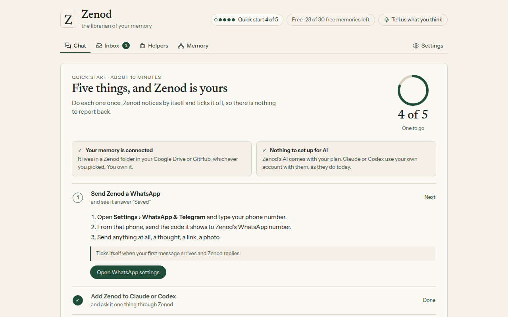

# E7-S9: every tester has their own voice feedback link, live on production

**Answer:** yes. Each Zenod tester now sees one quiet "Tell us what you think" link in the app that opens their own
voice feedback page. Production `zenod-mt` runs c0f6ec8 since 2026-11-16 12:24:55Z. The public counts answer
`feedback_recorded`: 0 today, which is true.

```
 production (VPS1, cloud.zenod.dev)            vps3 timer every 15 min              team console (VPS3 only)
 ┌──────────────────────────────┐   ops route  ┌───────────────────────────┐  POST  ┌────────────────────────┐
 │ testers who finished checkout ├─────────────►│ zenod-tester-feedback     ├───────►│ one link per person     │
 │ tester-feedback.json          │◄─────────────┤ one link per person, kept │◄───────┤ product Zenod,          │
 │  ├ app: Tell us what you think│ link + filed │ never messages anyone     │ filed  │ campaign testers        │
 │  └ counts: feedback_recorded  │ notes count  └───────────────────────────┘ notes  │ notes → agent_team      │
 └──────────────────────────────┘                                                    │ feedback/voice/         │
                                                                                     └────────────────────────┘
```

Source: Jordi, voice note vn_27afac4e, 8 Nov: "that's our way of getting feedback from customers, that we can send a
link and this link will allow them to provide voice notes that ... link back to a structured data of feedback ... I am
so worried that all this feedback is going to get lost."

## What is live

| Check (2026-11-16, ~12:26Z) | Result |
| --- | --- |
| Production sha | `c0f6ec8` (promote gate passed: staging healthy; question set demo 96/100/1.7, real notes 94.1/93/3.1) |
| Timer `zenod-tester-feedback.timer` on vps3 | every 15 min; first tick: "2 tester link(s) handed to production (2 new, 0 with filed notes); refused []" |
| Links made | 2 people: our test account (operations@, named `TEST …` on the console) and the 1 real tester `signed_up` counts |
| Our test account on cloud.zenod.dev, 1280 px | entry shown next to the plan line ([screenshot](e7-s9/app-1280.png)) |
| The same at 390 px | entry shown under the plan line ([screenshot](e7-s9/app-390.png)) |
| The link opens | 200, "Tell us about Zenod", the recording page on signup.alpha9.io ([screenshot](e7-s9/recording-page-390.png)) |
| Signed out | `GET /api/console/feedback-link` 401, nothing shown |
| Non-testers | the route answers `url: null` for any account that is not a tester (unit test), and production holds a link for no one else: the timer only makes links for the testers the ops list returns. No real non-tester was signed in to check this. |
| `/api/public/counts` | `feedback_recorded: 0`, `signed_up: 1`, `test_signups: 1`; the definitions line and today's history line carry it |



## How it works

- **Production** (`packages/server/src/testerFeedback.ts`): `GET /api/ops/testers/feedback-links` (ops token) lists
  every tester who finished the free checkout, with our test accounts flagged; `POST` the same route keeps each link
  (https links on the public feedback host only) with its count of filed notes in `tester-feedback.json`;
  `GET /api/console/feedback-link` gives the signed-in tester their own link, `null` to everyone else.
- **The app** (`apps/web/src/components/tester-feedback.tsx`): one quiet header link, as plain as the plan line, opens
  the link in a new tab. Not under Settings.
- **vps3** (`scripts/tester-feedback/sync.py`, the zenod-tester-stuck pattern): the console runs on VPS3 only, so the
  timer reads the testers over ssh on VPS1 (the token never leaves it), makes a link on the console for anyone new
  (ledger by email written first: one link per person, never a second one), counts each link's filed notes and hands
  everything back.
- **Count**: `feedback_recorded` = distinct tester links with at least one filed note, our test accounts left out. A
  filed note is never unfiled, so the count never goes down.

## Not done here

- Nothing tells a tester the link exists outside the app: sending it by email or WhatsApp contacts a third party, so it
  is one ask (the row's report).
- The filed notes land in agent_team `feedback/voice/` (the console's home world); Zenod's map names zenod-social. A
  desk note asked the Team desk to point the totem at the real place.
- `clean_look_check.py --screens` covers EpicTeam and EpicSocial only; this screen was judged on the screenshots above.

Rollback: `systemctl --user disable --now zenod-tester-feedback.timer` stops new links; `scripts/promote-production.sh
--rollback` takes production back to 6f3ee83; a link can be turned off on the console's Voice feedback page.
