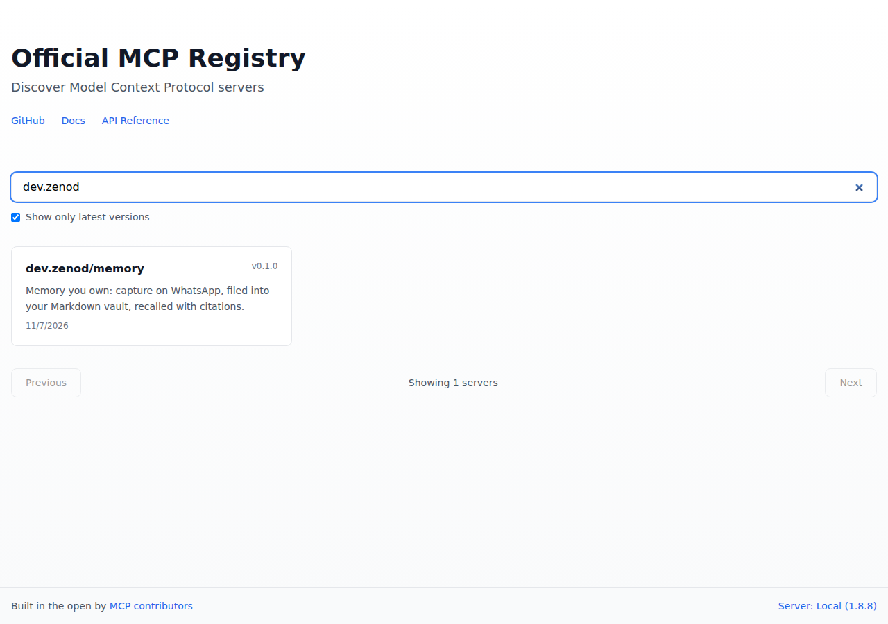

# EPIC-10 E10-R3 evidence: Zenod in the official MCP Registry (2026-11-07)

Run: run_5932dd01-bc21-4238-ad44-aa1c72897671 · approval: E10-A1 "APPROVED" (39746f0)

## Live listing

- Registry page: https://registry.modelcontextprotocol.io/?q=dev.zenod (shows `dev.zenod/memory` v0.1.0, published 2026-11-07)
- API (the row's done check): `curl 'https://registry.modelcontextprotocol.io/v0.1/servers?search=dev.zenod'` returned `count: 1`, `name: dev.zenod/memory`, `version: 0.1.0`, `status: active`, `isLatest: true`, `publishedAt: 2026-11-07T20:55:22Z`
- Version URL: https://registry.modelcontextprotocol.io/v0.1/servers/dev.zenod%2Fmemory/versions/latest (HTTP 200)

## What was published

[server.json](../epic10/server.json), unchanged: name `dev.zenod/memory`, title `Zenod Memory`, description = P1 §3 registry description (93 chars), websiteUrl https://zenod.dev/connect, three icons from E10-R2, repository zenod-ai/zenod `units/zenod`, remote streamable-http `https://cloud.zenod.dev/mcp`. Checked before publishing: icons and /connect 200, `cloud.zenod.dev/api/health` 200, unauthenticated POST to `/mcp` 401 (OAuth, as P1 §1), `mcp-publisher validate` ✅.

## Namespace proof (DNS)

- Tool: official `mcp-publisher` v1.8.8, `login dns --domain zenod.dev` (ed25519).
- TXT record on zenod.dev (Cloudflare API, token used in place on VPS1, never printed; record comment "MCP Registry namespace proof dev.zenod (EPIC-10 E10-R3)"): `v=MCPv1; k=ed25519; p=YOEfWzM97KTWO7JGy61RG/j/XJmPxCi2/esvLOARPYs=` (public key; seen on 1.1.1.1 and 8.8.8.8).
- Private key (never printed, never in this repo): VPS1 secret store `zenod-mcp-registry/MCP_REGISTRY_PRIVATE_KEY` (class per-app) and GitHub Actions secret `MCP_REGISTRY_PRIVATE_KEY` on zenod-ai/zenod. Names-only manifest: infra-vps `secrets/zenod-mcp-registry.yml` (232c708). The first key generated was replaced once before use because the store does not release per-app values; the current key was written to both places at creation and the local copy shredded. Local publisher token removed after publishing.
- Rotate: new key into both places, then PATCH the TXT record to the new public key.

## CI publish for later versions

`.github/workflows/mcp-registry.yml` ([PR #1501](https://github.com/zenod-ai/zenod/pull/1501)): on a change to `docs/epic10/server.json` on main (or by hand) it validates, skips a version already in the registry, logs in by DNS with the Actions secret, publishes and confirms in registry search. To publish a new listing: bump `version` in server.json.
