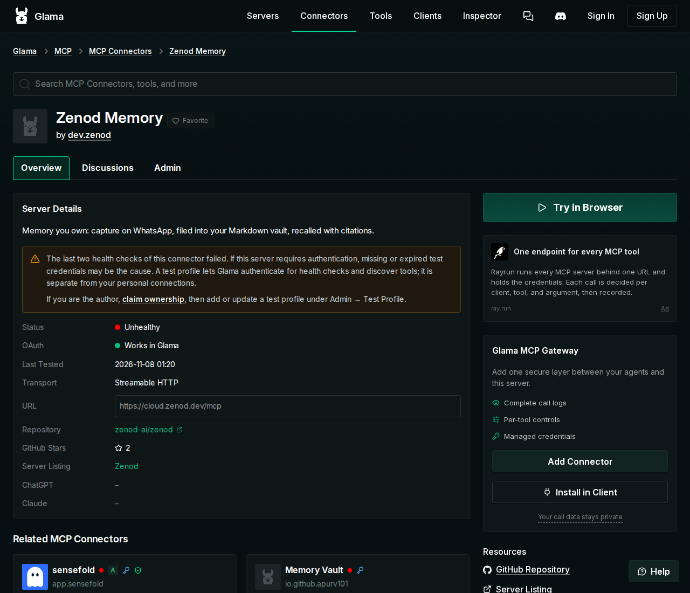

# E10-R10 Glama step (E10-A4), 2026-11-08

Run: run_2b4350c5-e69f-4b09-abf5-3d08f94e26da. Approval: E10-A4 (Jordi, 2026-11-08, "APPROVED"). Baseline: [epic10-r10-2026-11-08](epic10-r10-2026-11-08.md). Table: [findability-2026-11-08](../epic10/findability-2026-11-08.md). No secret is on this page.

## Result

**Not fixed yet: both approved steps need a sign-in or a key no agent has.** Nothing was created on Glama or in Zenod production. Glama still marks Zenod **Unhealthy** (last test 2026-11-08 01:20 UTC).

Search on Glama connectors, signed out, 2026-11-08 ~01:52 UTC (read from the page's result list):

| Query | Zenod | Note |
|---|---|---|
| zenod | **4th of 4** | new since the baseline (then missing); behind two Zenodo servers; still marked Unhealthy |
| memory | not in the 30 shown | unchanged |
| whatsapp memory | not in the 30 shown | unchanged |
| notes | not in the 30 shown | unchanged |

Screenshots: [listing](epic10-r10-glama-2026-11-08/listing.png), [admin / claim panel](epic10-r10-glama-2026-11-08/admin.png), [search "zenod"](epic10-r10-glama-2026-11-08/conn-zenod.png), [search "memory"](epic10-r10-glama-2026-11-08/conn-memory.png).

## What Glama needs (read from its claim panel and schema)

1. **Claim.** For a listing imported from the official MCP Registry, Glama verifies the **domain the namespace is named after**: `dev.zenod/memory` is claimed through **zenod.dev**, by a DNS TXT record or a `/.well-known/glama.json` on zenod.dev holding a `glama_claim_…` token ([schema](https://glama.ai/mcp/schemas/connector.json)). GitHub identity only applies to `io.github.*` namespaces, so the repo's `glama.json` (`maintainers: [AlfaBlok]`, commit 81fde3a) covers the *server* listing zenod-ai/zenod, not this connector. The token is bound to a signed-in Glama account and is shown only in that account's claim panel.
2. **Test profile.** Only the claimed owner can add it (Admin → Test Profile).

The agents can publish the DNS TXT record themselves (Cloudflare token on VPS1). The missing piece is a **signed-in Glama account**: no agent has one (the team browser has no Glama or GitHub session, the agents' VNC browser on VPS3 has no GitHub or Glama sign-in, and the 2026-11-01 rule stands that agents do not create accounts).

## The empty test Zenod account

Hosted Zenod sign-up is GitHub or Google only, and no agent has a spare identity (Jordi's accounts already own tenants; operations@alpha9.io is still not signed in, E7-A15). The other path, the one the EPIC-7 cap proof used, is the control plane (`POST /api/tenants` on cloud.zenod.dev creates a tenant with no account, no Stripe, no phone, and returns a static MCP token). Its key `CONTROL_PLANE_TOKEN` is per-app to `zenod-mt`; `secret run --from zenod-mt CONTROL_PLANE_TOKEN` was refused by the store ("class per-app, not shared"). Using it needs a grant, which widens access, so it is ask-tier. Nothing was created.

Planned once allowed: tenant `e10-glama-healthcheck` ("EPIC-10 Glama health check (empty test account)"), its token stored as VPS1 secret `zenod-glama/GLAMA_TEST_MCP_TOKEN`, checked with `initialize` and `tools/list`, then given to Glama as a bearer header in the test profile. Zenod has no read-only token scope; the tenant's vault is empty and holds nothing real. Rollback: `DELETE /api/tenants/e10-glama-healthcheck` (the token dies with it).

Open question for that step: Glama's inspector supports custom headers and bearer tokens, but its docs do not say whether a test profile for an OAuth connector accepts a static bearer. If it only runs OAuth, the test account needs its own GitHub or Google identity instead.

## Ask-tier (for the persona to raise)

See the run report: one ask for the step blocking now (the test account), the Glama sign-in after it.
