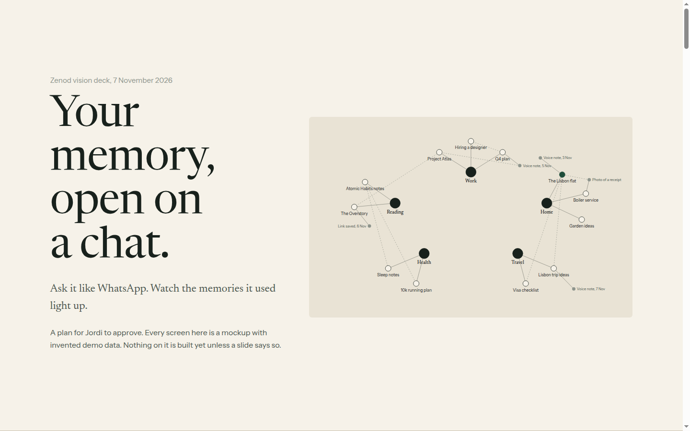
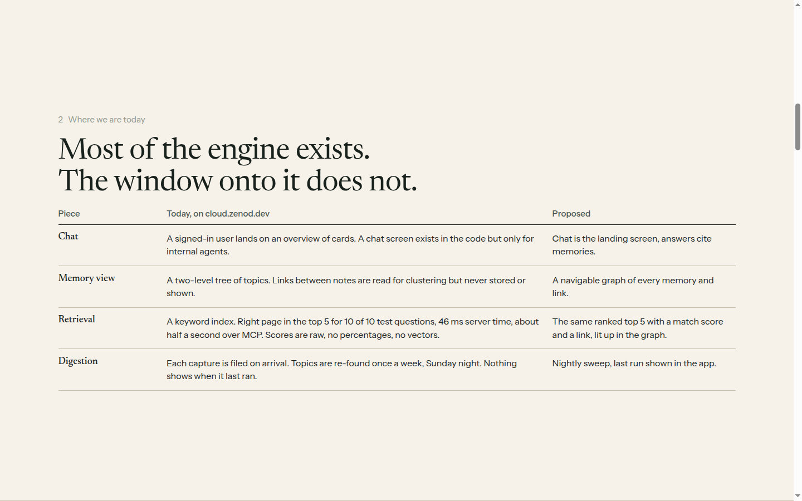
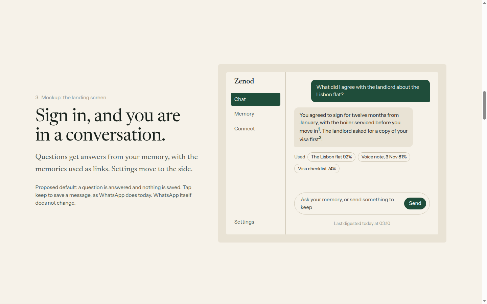
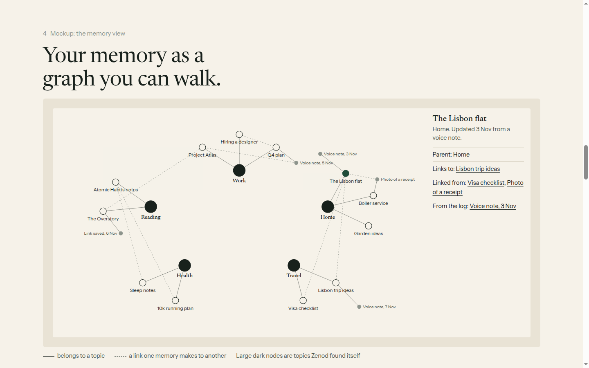
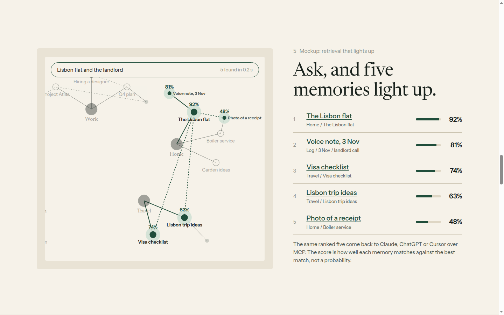
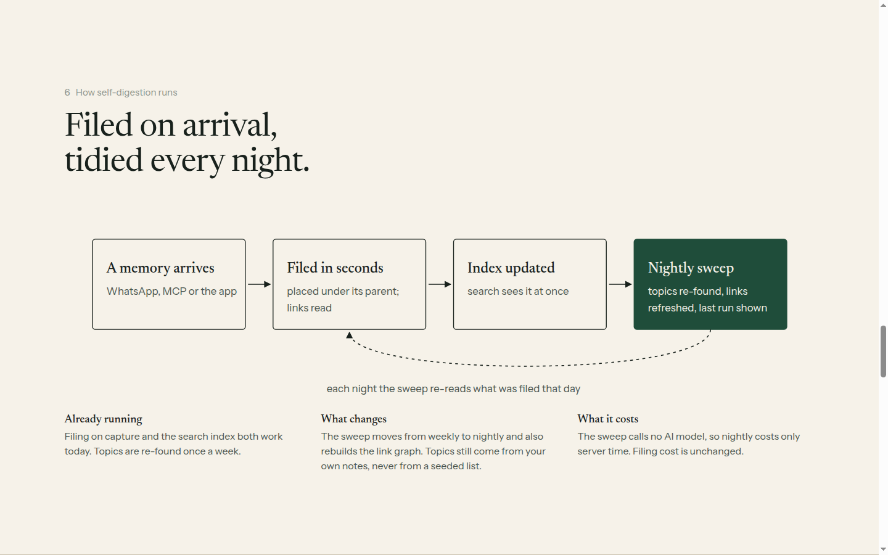
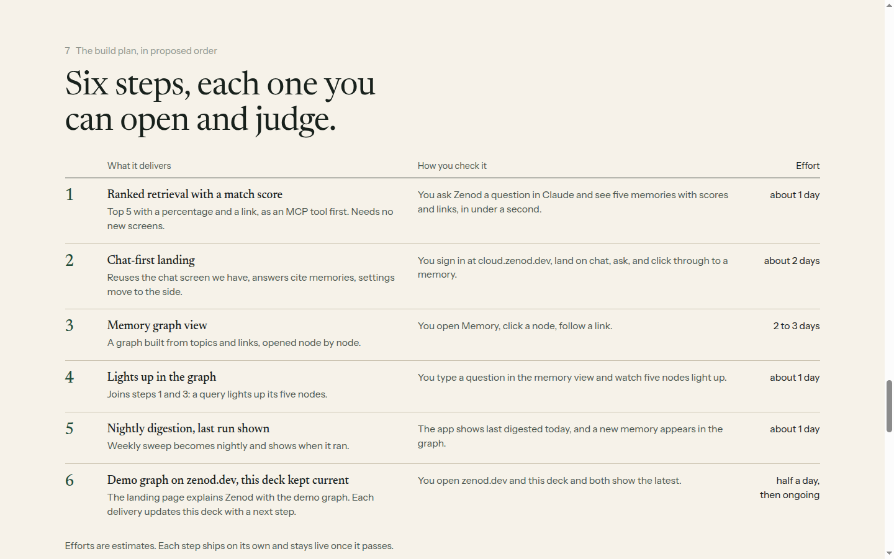
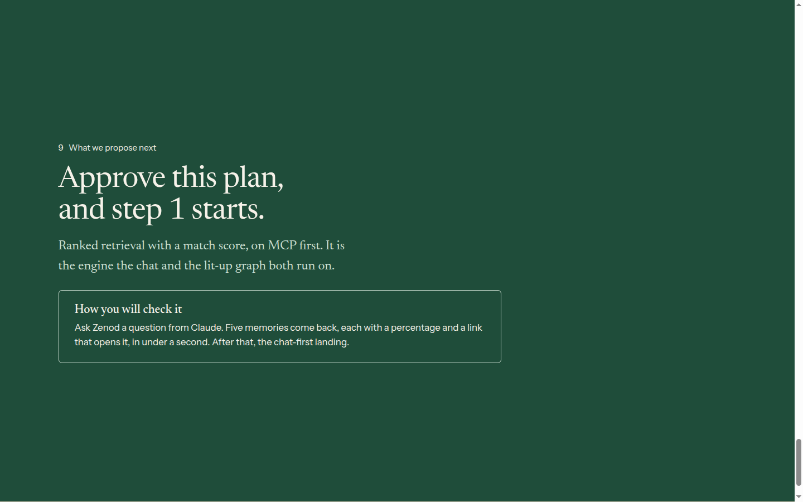
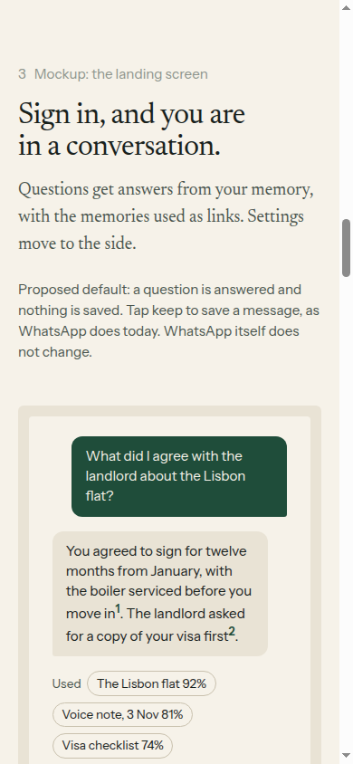

# EPIC-12 P1 evidence: plan and vision deck, 2026-11-07

Row: P1 of [EPIC-12](../zenod-app-chat-first-memory-graph-retrie.md). Run: run_1613c53f-1ce4-48fc-a8cb-21c0307e8b69. Plan only, no product code.

**Deck:** http://vps3.taild81fbb.ts.net:8912/ (tailnet only, opens from Jordi's Mac). Source: [docs/epic12/](../epic12/README.md). Ten slides: vision, today vs proposed, three mockups (chat-first landing, memory graph, a query lighting up five memories with scores and links), how self-digestion runs, the build plan in order, risks, the proposed next step. Mockups use invented demo data only. Served page checked: HTTP 200 from the tailnet name; Hallmark sloplint 0 FAIL (one waived word-count warning: a ten-slide deck).

## What exists today (read from `main` at c726d1c)

| Done means | Today | Reusable | Gap |
|---|---|---|---|
| E12-1 chat-first landing | Hosted users land on `Settings.tsx` Overview tab (cards). `views/ChatTab.tsx` (streaming, voice, sources, wikilinks) renders only for internal units; `/api/chat*` exist in `packages/server/src/app.ts` but not in `customerLayer.ts` | ChatTab, `ask_brain` (tree briefing, cites pages; about $0.0016 per ask, EPIC-9) | expose a tenant-scoped chat route; make chat the default tab; settings behind it |
| E12-2 memory graph | Memory tab = read-only two-level tree (`memory-tree-card.tsx`, `/api/console/memory-tree`, 60 s cache) | wikilinks parsed (`core/src/vault/pages.ts` `extractPageLinks`), tree parents from frontmatter (`core/src/vault/tree.ts`) | no link graph is built, stored or served; no backlinks; no graph renderer; zenod.dev has no demo graph (`memory-diagram.tsx` unused) |
| E12-3 lit-up retrieval | `search_memory` over per-tenant SQLite FTS5/BM25 (`core/src/vault/memoryIndex.ts`): top 5 hit 10/10 eval questions, server p95 46.1 ms, MCP wall p50 0.5 s (`docs/evidence/epic9-e9-5a-2026-11-02.md`). No embeddings | the index, its tree paths per hit | scores are raw negated BM25, not a percentage; no link per hit for the app; no graph highlight. "Vector search" not needed to hit < 1 s |
| E12-4 self-digestion | filing on capture (LLM classify + `placeCapture`); `tree_sweep` weekly, Sunday 02:00–06:00 UTC (`treeSweepSchedule.ts`), no model calls; daily memory-keeper E9-5c deferred | sweep + schedule key | make it nightly, rebuild the link graph in the same pass, record and show last run |
| E12-5 deck kept current | this deck, first version | `docs/epic12/` build | a team process (L-7), not a product feature |

Risks: privacy (a graph and chat show the whole vault; per-tenant only; public page uses demo data); vault size (about 730 indexed rows for Jordi; graph must open on topics and expand); cost (chat per answer ≈ ask_brain; sweep and search use no model); vectors would send vault text to a provider, so add them only if a measured eval beats BM25; a match % must be labelled as relative, not a probability; L-6: WhatsApp unchanged, chat lives in the app only.

## Proposed changes to S1–S5 (for the Delivery Manager)

1. Reorder: retrieval first (it is the engine of chat citations and the lit-up graph).
2. Split S3: **S3a** ranked retrieval with match % and link, MCP first (about 1 day); **S3b** lights up in the graph (about 1 day, after S2).
3. Split S2: **S2** in-app memory graph (2–3 days); **S2b** demo graph on zenod.dev (half a day; Deploy gate `apps/site`), can ride with S5.
4. Order: S3a → S1 (about 2 days) → S2 → S3b → S4 (about 1 day) → S2b + S5.
5. S1 open question to settle inside E12-A1: cloud chat answers questions and saves nothing unless the user taps keep (proposed default).

## Screenshots (1440×900 unless noted)

