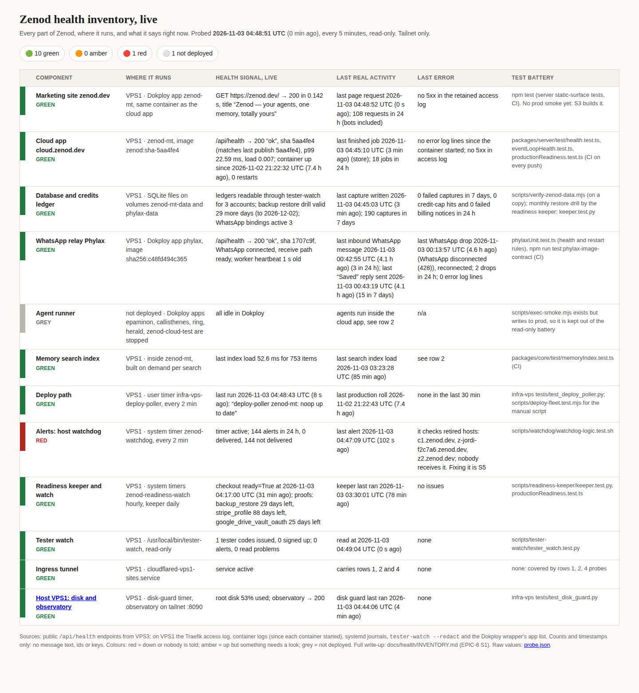

# EPIC-6 S1 evidence — live health inventory page, 2026-11-03

Run: run_ecb4e1a0 (S1 re-run after the 2026-11-03 review: "needs evidence"). Spine row: [EPIC-6](../EPIC-6-HEALTH-DASHBOARD.md) S1.

## What Jordi opens

**http://vps3.taild81fbb.ts.net:8742/** (tailnet only, per EPIC-6-A1). Screenshot: [s1-live-2026-11-03.png](../health/s1-live-2026-11-03.png).
Review card: [docs/cards/S1.md](../cards/S1.md).

## Checks (timestamped)

- 2026-11-03T04:50:16Z `curl http://vps3.taild81fbb.ts.net:8742/` → **200**; page says probed **2026-11-03 04:48:51 UTC**.
- 2026-11-03T04:50:16Z `probe.json`: probedAt, cloud sha, WhatsApp state, watchdog undelivered 24 h → `2026-11-03T04:48:51Z 5aa4fe4 connected 144`.
- 2026-11-03T04:50:16Z `systemctl --user is-active epic6-s1-health-serve.service` → **active**; listener: `LISTEN 0 5 100.86.141.63:8742 0.0.0.0:* ` (tailnet IP only, not 0.0.0.0).
- 2026-11-03T04:50:16Z timer: `Tue 2026-11-03 04:53:51 UTC 3min 35s Tue 2026-11-03 04:47:33 UTC 2min 43s ago epic6-s1-health-probe.timer epic6-s1-health-probe.service`. Linger is on for t3agent on VPS3, so both survive logout and reboot.

## How it works

- Probe: [docs/health/s1-live/probe.py](../health/s1-live/probe.py), installed copy `~/.local/lib/epic6-s1-health/probe.py` on VPS3,
  run by `epic6-s1-health-probe.timer` every 5 min (units in [docs/health/s1-live/units/](../health/s1-live/units/)).
  It curls the three public health endpoints and the observatory from VPS3, asks GitHub for the newest successful
  *Publish image* run, and runs one `ssh hetzner_vps_1 python3 - --remote` that uses only t3agent's narrow sudo rules
  (docker ps/inspect/logs --timestamps, journalctl, Traefik access log, `tester-watch --all --json --redact --no-stripe`,
  `dokploy apps`). Output: counts, states, timestamps. No env, keys, ids, phone numbers or message text.
- Server: `epic6-s1-health-serve.service` = EpicSpine `artifact_host.py --serve ~/artifacts/epic6-s1-health --port 8742`.
- The page reloads every 60 s and shows a red "stale" banner if the probe is older than 15 min.
- Colour rules are in `rows()` of probe.py (red = down or nobody told, amber = needs a look, grey = not deployed).

## Result at the refresh

10 green, 1 red (host watchdog: 144 alerts in 24 h, 0 delivered, still pointed at retired hosts — S5's job), 1 grey
(agent runner not deployed). Facts that changed since 2026-10-25 are in [INVENTORY.md §0](../health/INVENTORY.md).

## Not done here

- The EPIC-6 spine was not edited (row update proposed to the delivery manager).
- No production change, deploy, restart or write. Nothing was asked of Jordi beyond the card.

Iteration 2 (same day): the page moved behind a password to https://health.zenod.dev, see [epic6-s1-it2-2026-11-03.md](epic6-s1-it2-2026-11-03.md).
