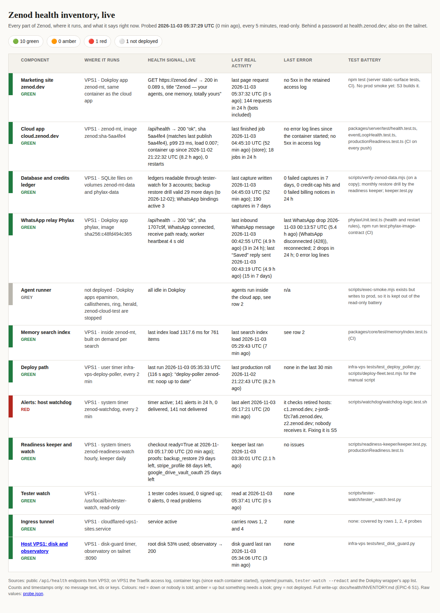

# EPIC-6 S1 iteration 2 evidence: the live health page on https://health.zenod.dev behind a password, 2026-11-03

Run: run_a7876ca6-18f9-415c-8b57-c7fbf9f8c67d. Spine row: [EPIC-6](../EPIC-6-HEALTH-DASHBOARD.md) S1. Ask: Jordi 2026-11-03,
"can it be on health.zenod.dev? and be pwd protected, yeah?" (supersedes the tailnet-only answer EPIC-6-A1).

## What Jordi opens

**https://health.zenod.dev** from any browser: a sign-in page (user `jordi`, password handed over in chat; the browser
offers to save it), then the same live page as iteration 1 (12 components, live values, colours, stale banner).
Screenshots: [sign-in](../health/s1-live-it2-signin-2026-11-03.png), [page after sign-in](../health/s1-live-it2-2026-11-03.png).
Card: [docs/cards/S1.md](../cards/S1.md).

## Checks from the public internet (VPS3 → Cloudflare 2a06:98c1:3120::3, `server: cloudflare`)

- 2026-11-03T05:38:09Z `GET https://health.zenod.dev/` no credentials → **401** (body = sign-in form, no browser popup).
- same, wrong password → **401**; `/probe.json` without credentials → **401**.
- same, correct password (Basic header) → **200**; sign-in form POST → 303 + 30-day cookie → `/` **200**.
- `probe.json` `probedAt` = **2026-11-03T05:37:29Z** (40 s old at the check; limit 15 min).
- `http://health.zenod.dev/` → **301** to `https://health.zenod.dev/`. TLS: Cloudflare edge certificate (Google Trust Services WE1, CN zenod.dev).
- Real browser (headless Chromium, playwright): first load 401 shows the sign-in page; filling the password lands on
  `https://health.zenod.dev/` with the live table (screenshots above).
- Tailnet page http://vps3.taild81fbb.ts.net:8742/ → 200, **kept** (same files, no password, tailnet only; a fallback if VPS1's
  Traefik or the tunnel is down).

## How it works

- **Probe** unchanged in what it reads: VPS3 user timer `epic6-s1-health-probe.timer` every 5 min runs
  [probe.py](../health/s1-live/probe.py). New `ExecStartPost` in [the service](../health/s1-live/units/epic6-s1-health-probe.service)
  rsyncs `index.html` + `probe.json` (`--delay-updates`, atomic) to VPS1 `~t3agent/.local/share/zenod-health/www/`.
  Page text changed from "Tailnet only." to say it is behind a password; row 12 now links the public observatory
  https://health.alpha9.io instead of a tailnet IP.
- **Gate**: Dokploy app `zenod-health` (project zenod/production, appName `zenod-health-kvf9rp`, image `python:3.12-alpine`,
  64 MB limit) runs [gate.py](../health/s1-live/gate.py) from a bind mount of that VPS1 directory (it only reads it). It is the
  infra-vps `health_gate.py` pattern (health.alpha9.io, EPIC-8 D3) because Jordi said there that a password manager cannot fill the
  browser basic-auth popup: a real sign-in form, 401 for any request without a session, a signed 30-day cookie, 10 failed tries
  per 5 min then 429, `Cache-Control: no-store`, `X-Robots-Tag: noindex`. `Authorization: Basic` is also accepted for scripted checks.
- **Route**: Dokploy domain `health.zenod.dev` → port 8080 (Traefik). No DNS or tunnel change: the existing `*.zenod.dev` CNAME
  to tunnel `vps1-sites` and its catch-all ingress `https://localhost:443` already covered it (it answered 404 before).
- **Why not Cloudflare Access**: the agents' Cloudflare token has no Access scope (secrets catalog), and Access's e-mail code is
  more steps for Jordi than a saved password.

## Secret handling

- Password: 24 random characters, stored as `zenod-health/HEALTH_PAGE_PASSWORD` in the VPS1 store (`secret put --stdin`) and in
  the app's Dokploy env (`dokploy env-set --stdin`). Manifest (names only): infra-vps `secrets/zenod-health.yml` (0bd0909).
  Never in the repo, this file, the page or any log. Bitwarden: no agent write path exists, so the value went to the delivery
  manager for Jordi in chat; his browser saves it at the first sign-in.
- Rotate: `secret put` + `dokploy env-set` with a new value, `dokploy redeploy zenod-health` (signs everyone out).

## Rollback

`dokploy api POST application.delete` for `zenod-health` (removes the route; health.zenod.dev returns 404 again), drop the
`ExecStartPost` line, `rm -r ~t3agent/.local/share/zenod-health` on VPS1. No production app was touched.
