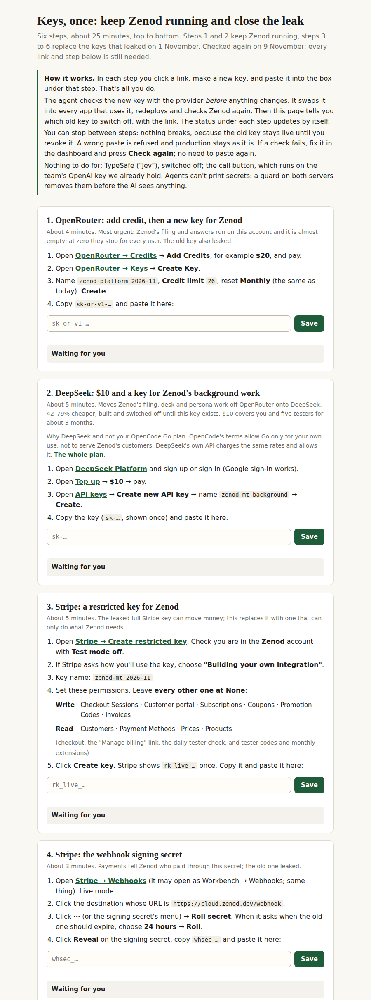
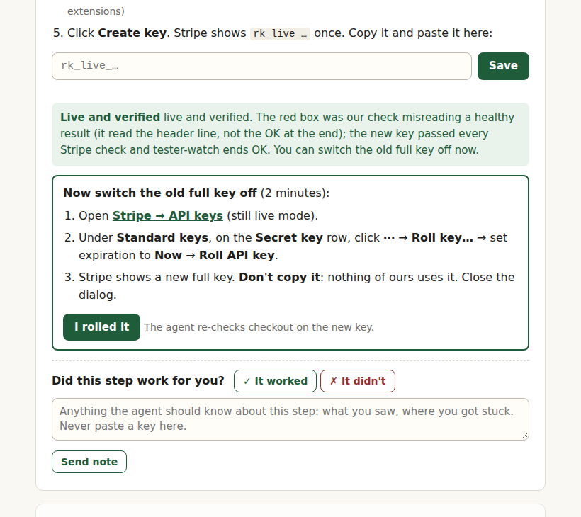

# EPIC-7 T3.4: one central key page for Jordi, Jev off (2026-11-02)

Run `run_6f7f6d3e-1d24-478b-bce3-ecb3e93eb855`. Asks E7-A12 ("give me links… I just don't know what I need to do
exactly") and E7-A13 ("turn it off… a central place… I do it once… turn off whatever you need to turn off in the
meantime"). Approval for the key writes: E7-A10. No secret value appears here or in any tool output of this run.

**The page:** <http://100.104.206.10:8783/> (VPS1, tailnet only; `curl` → 200). Code:
[AlfaBlok/infra-vps scripts/key-page](https://github.com/AlfaBlok/infra-vps/tree/main/scripts/key-page)
(ce39d3f, d2c4694).

## 1. Turned off now, without Jordi

| What | How | Check |
|---|---|---|
| TypeSafe "Jev" fast path | `printf 0 \| dokploy env-set zenod-mt ZENOD_JEV_ENABLED --stdin`; `dokploy env-unset zenod-mt TYPESAFE_API_KEY`; `dokploy deploy zenod-mt` (14:54 UTC) | wrapper: both changes "verified"; `env-names` lists no `TYPESAFE_API_KEY`; deployment `done` 14:54:28 UTC; health ok on 68cae4a; readiness `ready:true` |
| Filing with Jev off | Jev's failure path already falls back to the main classifier (`classifyFallback.ts`); with the flag at 0 it is never called | filing receipt: see "Filing after Jev off" below |

The old TypeSafe value stays in the secret store, so the output guard keeps redacting it. Revoking it in TypeSafe's
dashboard is optional.

**Nothing else could be turned off safely with tools we hold:**
- OpenRouter: lowering the platform key's limit needs the provisioning key, which is only in Jordi's Mac Keychain
  (catalog: `alpha9-openrouter-provisioning-key`). The key already has a $26/month cap.
- Stripe: restricting or rolling the full key is a dashboard action. Turning checkout off would break the product.
- Google and GitHub sign-in: disabling either breaks sign-in; neither secret is usable without a user's login code.

## 2. Two blockers found and fixed before Jordi pastes anything

| Found | Effect if missed | Fix |
|---|---|---|
| Zenod's readiness check `stripe_key` accepted only `sk_live_` | the moment the restricted key (`rk_live_`) went in, readiness would flip to false and close checkout | zenod [#1471](https://github.com/zenod-ai/zenod/pull/1471) (merge f4c352b, ci green): accepts `(sk\|rk)_live_`, with a test. The mode guard, readiness keeper, tester-watch and stripe-testers already accepted `rk_live_` |
| Since agent_team E59-S9 (this morning's sudo tightening) the root half of `secret put --dokploy` reads approvals only from infra-vps `docs/*.md`, not from the caller's `SECRET_DOCS_DIR` | every money-class Dokploy write approved in a zenod spine was refused (`--approved E7-A10 is not one`). This also affects the agent_team console's key cards for asks raised outside infra-vps | infra-vps ce39d3f: [docs/secret-approvals-from-other-repos.md](https://github.com/AlfaBlok/infra-vps/blob/main/docs/secret-approvals-from-other-repos.md) mirrors the answered E7-A10 line with its source link (linked from the secrets catalog, d2c4694). Re-test against a non-existent app: the approval passes, and the write stops at "no Dokploy application named t34-canary", nothing stored |

The Stripe permission list was also corrected from the T3.3 guide by reading every Stripe call in the code. Zenod uses
`checkout.sessions` create/retrieve, `subscriptions.retrieve` (expand discounts), `billingPortal.sessions.create`.
tester-watch uses subscriptions (expand customer and discounts), `payment_methods`, `invoices/create_preview` and
`promotion_codes`. The readiness keeper uses `account` and `billing_portal/configurations`. stripe-testers (T9 codes,
T10 monthly extensions) uses POST `coupons`, `promotion_codes`, `subscriptions`, `invoices/void`. So the key needs:
**Write** on Checkout Sessions, Customer portal, Subscriptions, Coupons, Promotion Codes and Invoices; **Read** on
Customers, Payment Methods, Prices and Products. It can still never create charges or refunds, or read the balance.
The guide's banner now says so and points to the page.

## 3. The paste path

The agent_team console's Secrets page can store several keys in one sitting, but Jordi would have to type each app
and NAME. It sets the value in the live Dokploy env straight away, with no provider check, and its Dokploy writes hit
the E59-S9 approval gap above. So the page uses its own small server (`key_page.py`, user service
`t3-4-key-page.service`, runs as t3agent, binds only to the tailnet address). For each paste it:

1. refuses the wrong format at once ("should start with rk_live_…"; nothing stored);
2. checks the value with the provider while the old key is still live:
   - Stripe: the right account (the `ZENOD_TESTER_1M` coupon exists) and every permission above. Writes are probed
     with empty or unknown-id POSTs, which fail with 403 before 400/404. One unpaid live Checkout session is created
     and expired at once. The key must be narrow: balance, charges and refunds must be refused.
   - Google and GitHub: a token exchange with a fake code must fail on the code (`invalid_grant` /
     `bad_verification_code`), not on the client. The client id is read from Zenod's own sign-in redirect.
   - OpenRouter: the key has a credit limit, and one 5-token call works.
   - The webhook secret cannot be checked before the swap (no provider endpoint).
3. `secret put <app> <NAME> --stdin --dokploy --approved E7-A10` for every holder:
   - Stripe: zenod-mt.
   - Google: zenod-mt, under both `GOOGLE_OAUTH_CLIENT_SECRET` and `GOOGLE_OIDC_CLIENT_SECRET`.
   - GitHub: zenod-mt, phylax, callisthenes, herald and ring. The last three are paused; they only get the env.
   - OpenRouter: zenod-mt.
4. `dokploy deploy` (zenod-mt; phylax too for GitHub), waits for Dokploy `done` and health ok;
5. checks again: health, readiness `ready:true`; Stripe also `tester-watch --check` and the full key check; the webhook
   gets a test event signed with the new secret (must be 200) and one with a random secret (must be 400); Google,
   GitHub and OpenRouter repeat their provider check; Phylax health for GitHub;
6. shows "Live and verified" and the exact revoke step with its link. Jordi's "I did it" re-runs the checks, so a
   wrong revoke (for example deleting the new Google secret) shows up at once.

Values exist only in that process's memory (until the revoke check passes) and in the root-only store. They are never
on disk, in logs (the server logs method, path and status only) or in responses, and tool stderr is scrubbed. POSTs
need an `X-Key-Page: 1` header and a same-origin `Origin`. Tests: a missing header and a foreign Origin get 403; a
`sk_live_` pasted as the restricted key gets 400 with nothing stored. Fake values get the right refusal from all four
providers, and a random-secret webhook gets 400 from Zenod.

**Canary proof (15:06 UTC):** a fresh random `t34canary_…` value, never printed, was POSTed to the tailnet page from
VPS3. The page reported "stored". `secret find T34_CANARY` showed `t34-canary/T34_CANARY_SECRET` (1 entry). Then the
same value was piped from VPS3 into `AGENT_GUARD_NO_ALERT=1 agent-output-guard scan` on VPS1, against fingerprints
rebuilt at 15:06:43 after the write: `1 secret name(s) found: t34-canary/T34_CANARY_SECRET`. So the stored value is
byte-for-byte the pasted one. Cleanup: `secret rm t34-canary T34_CANARY_SECRET` → removed; local copy deleted.

## 4. The page

Five numbered steps, ordered so nothing breaks in between. Every new key is checked before it goes live, and every
old key stays valid until Jordi revokes it after "verified".

1. Stripe restricted key: [create link](https://dashboard.stripe.com/apikeys/create), the exact permission table,
   paste. Revoke: [API keys](https://dashboard.stripe.com/apikeys) → Standard keys → Secret key → ⋯ → Roll key… →
   expiration Now; don't copy the new full key.
2. Stripe webhook secret: [webhooks](https://dashboard.stripe.com/webhooks) → the `cloud.zenod.dev/webhook`
   destination → Roll secret → old expires in **24 hours** → Reveal → paste. Nothing to revoke.
3. OpenRouter: [keys](https://openrouter.ai/settings/keys) → Create Key `zenod-platform 2026-11`, limit 26 monthly
   → paste. Revoke: delete the old Zenod platform key.
4. Google: a deep link to Zenod's exact OAuth client in Google Cloud console (client id filled in from the live
   sign-in redirect) → Add secret → paste. Revoke: Disable, then Delete the older secret.
5. GitHub: [OAuth Apps](https://github.com/settings/developers) (org fallback link), the exact Client ID shown →
   Generate a new client secret → paste. Revoke: delete the older secret.

Live status per step updates every 3 s: Waiting for you → Checking… → Swapping in… → Live and verified (revoke box
appears) → Done ✔. A failed check says what to fix. For Stripe that is the missing permission by name, with "Check
again" and no re-paste.

## Filing after Jev off

Agents can no longer create a throwaway tenant: since E59-S9 `secret run` refuses the per-app `CONTROL_PLANE_TOKEN`. So
the receipt is the next real capture: a `memory: capture …` and a `memory: topic filing …` commit in Jordi's vault
(AlfaBlok/obsidian-brain) after 14:54 UTC. The last ones before the switch were at 14:47–14:48 UTC; none had arrived
by 15:35 UTC. The next wake (monitoring) records the first one here. If filing failed, the fallback is
`ZENOD_JEV_ENABLED=1` again, but with no TypeSafe key Jev would only fail into the same main classifier.

Production after this run: health ok on **f4c352b** (#1471 live via publish.yml and the deploy poller, 15:3x UTC),
readiness `ready:true`, `stripe_key` ok.

## Proposed T3.4 row update (for the Delivery Manager; the spine is not edited by this worker)

`T3.4 | Ticket worker | worker run_6f7f6d3e | One central key page … | active (monitoring: waits for Jordi's pastes) | E7-A12, E7-A13 | zenod #1471 (f4c352b); infra-vps ce39d3f, d2c4694 | main | [T3.4 evidence](evidence/epic7-t3-4-2026-11-02.md): Jev off on zenod-mt (ZENOD_JEV_ENABLED=0, TYPESAFE_API_KEY removed, deployed 14:54 UTC); readiness accepts rk_live_ (#1471); E59-S9 approval gap fixed by mirroring E7-A10 in infra-vps; one page http://100.104.206.10:8783/ (tailnet, 200) with 5 steps, links, paste boxes, provider check before swap, auto swap/deploy/verify, revoke guidance and live status; paste path proven with a random canary (guard scan matched the stored value byte-exact; removed) | 2026-11-02 | Jordi follows the page once (E7-A14); agent confirms each key verified and each old key revoked; then stop the page service |`

## Proposed replacement ask (E7-A14; replaces E7-A12 and E7-A13 as the open key ask)

`[ask E7-A14: do] Open http://100.104.206.10:8783/ and follow it once, top to bottom (about 15–20 minutes) — that
page is everything: each step has the link, what to click and a paste box; the agent checks, swaps in and verifies each
key itself and tells you on the page which old key to switch off`

## Round 2 (2026-11-09)

Run `run_c3a4fda4-1f84-4b97-8681-e045b869dfdb`. Feedback E7-A14 ("Available to run actions now, just checking all these
links will work and all remain relevant after all changes"). No secret value appears here or in any tool output.

**Bottom line.** The page at <http://100.104.206.10:8783/> (same URL, 200 from VPS1 and over the tailnet from VPS3) now
has six steps, production first: OpenRouter credit and a new key, then the DeepSeek key, then the four leaked-key rolls.
Every link was opened, every paste box was tested with fake values against the real providers (all refused, nothing
stored), the store path was proven again with a canary (byte-exact), and the Dokploy write path was proven with dummy
values on an idle test app (then removed). Nothing has been pasted yet; every step shows "Waiting for you". Code:
AlfaBlok/infra-vps 5871705, 8c322ce.

| Step | Result | What changed and why |
|---|---|---|
| 1. OpenRouter: add credit, then a new key | **fixed** | Moved to first. Production bills the same nearly empty account (E15-A6), so step 1a now adds credit ([Credits](https://openrouter.ai/settings/credits)) before the new key. The check refuses an account under $5 and a 402 on the test call. The test model `deepseek/deepseek-chat` is still listed. The stale "about $2–3 used" note was removed; the revoke step now says to leave every other key alone. |
| 2. DeepSeek: $10 and a key | **added** | EPIC-14 S10 round 4 built hosted background work on DeepSeek's own API, off until `zenod-mt/DEEPSEEK_API_KEY` exists. It must be a DeepSeek API key, not the OpenCode Go key: OpenCode's terms allow Go only for your own internal use, not for serving Zenod's customers ([S10 round 4](e14-s10-go-2026-11-09.md)). Links: [platform](https://platform.deepseek.com/), [top up](https://platform.deepseek.com/top_up), [API keys](https://platform.deepseek.com/api_keys). Check before: `GET /user/balance` accepts the key and shows a USD balance (no model call). Then `secret put zenod-mt DEEPSEEK_API_KEY --dokploy --approved E15-A6`, `dokploy deploy zenod-mt`. Check after: `/api/health` shows `background.provider: deepseek` and not `empty` (today it shows `off`, health on 551bb7d with #1548 live). No old key, so the step ends at Done. E15-A6 (Jordi: "I want to make openrouter deepseek go live") is mirrored in infra-vps `docs/secret-approvals-from-other-repos.md` for the root half of `secret put`. |
| 3. Stripe restricted key | **ok** | Links unchanged. Zenod's Stripe calls are unchanged since round 1 (`checkout.sessions` create/retrieve, `subscriptions.retrieve`, `billingPortal.sessions.create`), so the permission list stands. Rolling the old standard key cannot break Phylax, Callisthenes, Herald, Ring or whatgpt: they hold different key values. |
| 4. Stripe webhook secret | **ok** | `https://cloud.zenod.dev/webhook` still answers 400 to an unsigned event. |
| 5. Google sign-in secret | **fixed** | The deep link and client id still come from the live sign-in redirect (302). Added: if Google won't add a third secret, Disable (not Delete) the older one first. The revoke step now says to remove every secret except today's. The idle `zenod-cloud-test` holds a different Google secret and is not touched. |
| 6. GitHub sign-in secret | **ok** | The live sign-in redirect gives the Client ID. The org fallback link is for the zenod-ai org, which exists; GitHub shows 404 to signed-out visitors. Targets are unchanged: zenod-mt, phylax, callisthenes (now a compose; `secret put` handles it), herald and ring. Phylax health is ok. |
| OpenCode Go key | **not added** | Per the Delivery Manager, this page carries no Go step. |
| Call button OpenAI key | **not needed** | It uses the team's OpenAI key already held (E14-A3). |
| TypeSafe (Jev) | **not needed** | Off since round 1. |
| Every failed check | **fixed** | "Check again" now works on every step, not only Stripe. A failed check reads "Fix it in the dashboard and press Check again". |

**Tests (2026-11-09 04:49–04:53 UTC):**
- POST without the header: 403. Foreign Origin: 403.
- `sk-or-v1-…` pasted as DeepSeek: 400. `sk_live_…` pasted as the restricted key: 400. Nothing was stored.
- Fake values that passed the format check were refused by the real providers, and production was not changed:
  - OpenRouter: "does not accept this key"
  - DeepSeek: "does not accept this key"
  - Stripe: "does not accept this key"
  - Google: `invalid_client`
  - GitHub: `incorrect_client_credentials`
- "Check again" re-ran the check.
- Canary through the live page: 202, then `secret find` showed `t34-canary/T34_CANARY_SECRET`, then the guard scan found `t34-canary/T34_CANARY_SECRET`, so the stored value is byte-exact. Removed afterwards.
- `secret put … DEEPSEEK_API_KEY --dokploy --approved E15-A6` and `… T34R2_CANARY --approved E7-A10` with random dummies on the idle `zenod-cloud-test` app: approval accepted, and the env was "set, verified".
  - The first DeepSeek write did not read back, because two Dokploy apps are named `zenod-cloud-test`. The retry verified. `zenod-mt` is unique, and "Check again" re-runs the write.
  - Both env lines were unset and both store entries removed.
- The page state was reset, so all six steps show "Waiting for you".

**Next:** Jordi follows the page once (E7-A16). When all six show Done, stop `t3-4-key-page.service`.

## Round 3 (2026-11-09)

Run `run_75d6668b-1647-466c-a537-787595978986`. Answer E7-A16: "I did as many as I could … I wish I had a feedback box
per element, and could confirm in line whether I succeeded or not. Item 5 I don't have a way to create new secrets. on 3
got weird red box. 6 worked fully. as did 1 and 2. 3 i tried twice". No secret value appears here or in any tool output.

**Bottom line.** Five of six keys are live in production and verified: OpenRouter, DeepSeek, the Stripe restricted
key, the Stripe webhook secret and the GitHub sign-in secret. The old OpenRouter key, the old GitHub secret and the old
webhook secret are already switched off. Step 3's red box was a bug in our check, not the key. Two things are left for
Jordi on the same page: roll the old full Stripe key (the box under step 3, 2 minutes) and step 5, Google, which now
says where Google moved **Add secret**. Every step now has **✓ It worked**, **✗ It didn't** and a note box, saved for
agents. Code: AlfaBlok/infra-vps c574286. Production unchanged since the 16:23Z key deploy: `cloud.zenod.dev/api/health`
ok on `5f7aa149`, readiness `ready: true`.

| Step | State (page, read 16:30Z) | Notes |
|---|---|---|
| 1. OpenRouter credit and key | **done** 16:03Z | Swapped 15:59Z, old key deleted, re-verified 16:03Z. The check refuses an account with under $5 left, so the balance was at least $5 at 16:03Z. Agents cannot read the exact amount: `ZENOD_PLATFORM_OPENROUTER_KEY` is a per-app key that `secret run` won't hand out, by design. |
| 2. DeepSeek | **done** 05:41Z | `/api/health` `background.provider: deepseek`, `state: ok`, balance $9.98 (16:23Z). |
| 3. Stripe restricted key | **verified**, old key to roll | Swapped and deployed 16:10Z and 16:23Z. Both runs passed the full permission check, including the post-swap re-check. The only failure was `tester-watch on the new key`, see below. Readiness after the swap: `stripe_key`, `stripe_profile`, `stripe_prices` and `stripe_tax` all true, so production reads Stripe with the new key. `tester-watch --check` at 16:31Z: exit 0, ending `OK 1 tester(s), no alerts`. Its read of the tester coupon is live from Stripe on `zenod-mt`'s key. State set to verified at 16:34Z, so the old-key box shows. |
| 4. Stripe webhook secret | **done** 16:13Z | The signed test event was accepted and a random-secret event refused. The old secret expires by itself (24 h). |
| 5. Google sign-in secret | **waiting** | Never pasted. Jordi's screenshot shows the client page with only the form. Per [Google's help](https://support.google.com/cloud/answer/15549257), **Add secret** sits on the right of the client details page, in a side panel. In a narrow window that panel is hidden behind the round info button next to **Delete**. The step is rewritten: don't touch the form, open the panel, **+ Add secret**, copy it once. If two secrets already exist, write it in the note box and don't disable anything, because which old one production uses must be checked first. If Google refuses at first, wait 2 minutes and press Check again. |
| 6. GitHub sign-in secret | **done** 16:22Z | Stored for zenod-mt, phylax, callisthenes, herald and ring. zenod-mt and phylax were redeployed. Old secret deleted, re-verified. |

**Step 3, the true cause.** `tester_watch_ok()` took the first line of `tester-watch --check` and required it to start
with `OK`. Since T6 that command prints a `# tester-watch <time> · AI cap …` header and a table first and ends with `OK …`
(exit 0), `ALERT …` (exit 1) or a read error (exit 2). The header was taken for the verdict, so a healthy run showed red.
Fix: the verdict is exit 0 plus a last line starting `OK`; otherwise the ALERT lines are shown. Checked against the real
command: `(True, 'OK 1 tester(s), no alerts')`. The revoke re-check for this step now runs tester-watch even after a server
restart, when the pasted value is no longer in memory. The restart to load the fix did drop it.

**Feedback per step (his wish).** Under every step: **✓ It worked**, **✗ It didn't**, a note box and **Send note**. Each
is saved to `~/.local/state/key-page/feedback.jsonl` on VPS1 and shown back under the step ("Saved for the agents").
Anything in a note that looks like a key is replaced before it is written. Agents read it at
`http://100.104.206.10:8783/feedback` (tailnet). Tests on a dry-run copy (127.0.0.1:18783): a confirm was saved and
shown; a note containing a fake `GOCSPX-` value was saved as `[removed: looked like a key]`; an empty note gave 400;
no header gave 403. The page served 200 after the restart and all statuses survived.

**Production.** All landed keys went in through `secret put --dokploy` and each step redeployed. The last `zenod-mt`
deploy (16:23:23Z, "new Stripe restricted key") is `done`. Health ok on `5f7aa149`. `dokploy env-names zenod-mt` lists
`STRIPE_SECRET_KEY`, `STRIPE_WEBHOOK_SECRET`, `ZENOD_PLATFORM_OPENROUTER_KEY`, `DEEPSEEK_API_KEY` and
`GITHUB_OAUTH_CLIENT_SECRET` (names only). No new deploy was needed.

**Next:** Jordi rolls the old full Stripe key (button under step 3) and does step 5. When all six show Done, stop
`t3-4-key-page.service`. Read `/feedback` first.

## Close-out (2026-11-09)

Run `run_e1ee0527-31cb-47e8-ada0-2c098ac25ff1`. Answer E7-A17: "done". No secret value appears here or in any tool
output of this run.

**Bottom line.** All six steps are done and every leaked outside key is rolled: the new keys are live in production
and checked, and each old key is switched off. Zenod is healthy on `79e2c7c` with readiness `ready: true`, tester-watch
OK and Google sign-in reaching Google's sign-in page for Zenod. The key page is stopped and removed at 17:33Z. Nothing
listens on port 8783 any more.

| Step | Final state (page `/status`, read 17:30Z) | Jordi's inline confirm (`/feedback`) |
|---|---|---|
| 1. OpenRouter credit and key | **done** 16:03Z, old key revoked, production re-verified | ✓ It worked, 16:51Z |
| 2. DeepSeek | **done** 05:41Z, no old key to switch off | ✓ It worked, 16:51Z |
| 3. Stripe restricted key | **done** 16:53Z, old full key rolled by Jordi, production re-verified after the roll | none sent. His 16:54Z note (filed under step 4) is about this roll, see below |
| 4. Stripe webhook secret | **done** 16:13Z, old secret revoked | ✓ It worked, 16:53Z |
| 5. Google sign-in secret | **done** 16:56Z: pasted, checked with Google, swapped in and deployed 16:55:37Z, old secret disabled, re-verified | ✓ It worked, 16:56Z |
| 6. GitHub sign-in secret | **done** 16:22Z, old secret deleted | ✓ It worked, 16:56Z |

**Independent checks, this run (17:25–17:35Z).**

- `dokploy env-names zenod-mt` (names only) lists `STRIPE_SECRET_KEY`, `STRIPE_WEBHOOK_SECRET`,
  `GOOGLE_OAUTH_CLIENT_SECRET`, `GOOGLE_OIDC_CLIENT_SECRET`, `GITHUB_OAUTH_CLIENT_SECRET`,
  `ZENOD_PLATFORM_OPENROUTER_KEY` and `DEEPSEEK_API_KEY`. The deploy "EPIC-7 T3.4: new Google sign-in client secret" ran
  16:55:37Z and is `done`. The 17:20Z production roll to `sha-79e2c7c` (deploy-poller) kept the env. `secret check`
  shows no drift between the store and the app for `zenod-mt` or `phylax`. No redeploy was needed.
- `cloud.zenod.dev/api/health`: `ok` on `79e2c7c9cd60b44e2c37f9ffd07a3c59e86bd1ce`, background route `deepseek` `ok`.
  `phylax.zenod.dev/api/health`: `ok`.
- Google sign-in: `GET cloud.zenod.dev/auth/google/start` → 302 to `accounts.google.com/o/oauth2/v2/auth` with the
  exact `cloud.zenod.dev/auth/google/callback`. Following it lands on `accounts.google.com/v3/signin/identifier`, 200,
  "Sign in - Google Accounts", naming Zenod, with no `invalid_client` or `deleted_client`. The secret itself was
  accepted by Google's token endpoint before the swap (`invalid_grant` on a fake code, the page's check) and again
  after the old one was disabled. Readiness `google_identity_oauth` is true.
- Stripe: `sudo tester-watch --check` exit 0, last line `OK 1 tester(s), no alerts`. Readiness `ready: true`, with
  `stripe_mode`, `stripe_key`, `stripe_webhook_secret`, `stripe_prices`, `stripe_tax` and `stripe_profile` true. The
  four false items are the advisory checks (`stripe_webhook`, `billing_portal`, `live_billing_journey`,
  `google_drive_vault_acceptance`), not set by this work. An unsigned event to `cloud.zenod.dev/webhook` gets 400.
- The old full Stripe key no longer works: its value was never stored by agents, so it cannot be called directly. The
  proof is that Jordi rolled it with expiry Now, the page re-checked production after the roll (16:53Z) and found it
  still working, and production now holds the restricted key: the page refuses a full `sk_live_` key in that box with
  400, and readiness passes. T3.3 found no other app holding that value (Phylax, Callisthenes, Herald, Ring and whatgpt
  hold different Stripe values), and Phylax is healthy. Money-class keys cannot be loaded by agents (`secret run`
  refuses), so a direct balance call on any Stripe key was not made, by design.

**Jordi's note on step 3** ("now we have a standard key that nothing can use… why didn't we just delete it"). Stripe
does not let the standard secret key be deleted: rolling is the only way to switch the leaked one off. The new standard
key was never copied, so it sits unused in the dashboard, and Zenod runs on the narrower restricted key.

**The page is stopped.** `/feedback` was saved first to `~/.local/state/key-page/feedback-final-20261109.json` on
VPS1 (mode 600). Then `t3-4-key-page.service` was stopped and disabled and its unit file removed at 17:33Z. No
`key_page.py` process is left, `ss` shows nothing on 8783, and `curl http://100.104.206.10:8783/` is refused. Pasted
values only ever lived in that process's memory. A scan of the remaining state and feedback files finds no key-shaped
value. The code stays in AlfaBlok/infra-vps `scripts/key-page` as history.

T3.4 closes `done (no confirm: all leaked keys rolled; page stopped)`.
