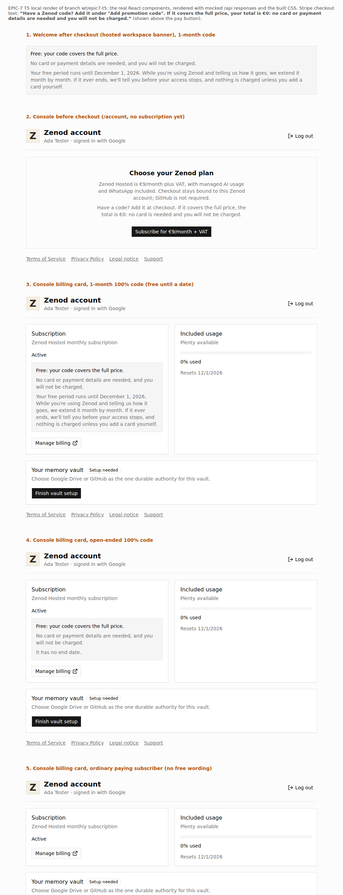

# EPIC-7 T5: tester wording (2026-11-01)

Worker run `run_12d29631-7ad6-44b7-b8eb-1b89aaaf72d7`. Spine: [EPIC-7](../EPIC-7-REAL-USER-TEST.md), row T5. Code: [PR #1450](https://github.com/zenod-ai/zenod/pull/1450). Jordi reviews the wording after the fact.

Rule followed (spine Decisions 2026-10-27): testers are ordinary production users, only their price differs. No code path knows who a tester is. Every product line below is keyed on the **Stripe discount on the subscription**, so it is true for anyone who checks out with a 100% code, including the 2 existing free-forever accounts.

## What changed

| Where | Wording | Shown when |
|---|---|---|
| Invite DM ([draft](../epic7/invite-dm.md)) | Jordi, first person: sign up at cloud.zenod.dev, "Add promotion code" `{CODE}`, total €0, no card or payment details, won't be charged; a month free, extended month by month while you use it and tell me how it goes; "I'm never going to charge you for this"; feedback = reply to this DM | sent by T9 after T8, never by this ticket |
| Stripe Checkout, above the pay button (`custom_text.submit.message`, `customerBilling.ts`) | "Have a Zenod code? Add it under "Add promotion code". If it covers the full price, your total is €0: no card or payment details are needed and you will not be charged." | every Zenod checkout (it is conditional in its own words, so it is true for paying users too) |
| Console before checkout (`/account`, plan card) | "Have a code? Add it at checkout. If it covers the full price, the total is €0: no card is needed and you will not be charged." | no subscription yet |
| Welcome after checkout (hosted workspace, where `/checkout/complete` lands) and console Subscription card | "Free: your code covers the full price. No card or payment details are needed, and you will not be charged. Your free period runs until <date>. While you're using Zenod and telling us how it goes, we extend it month by month. If it ever ends, we'll tell you before your access stops, and nothing is charged unless you add a card yourself." (open-ended codes: "It has no end date.") | subscription `active` and a 100% coupon attached |

How "free" is read (`subscriptionFreePeriod`, `customerBilling.ts`): a 100%-off coupon on the subscription (legacy `discount` or the expanded `discounts`, either `coupon` or `source.coupon`). `forever` → free, no end date; `repeating` (the 1-month tester coupon) → the discount end; `once` (the monthly extension, [T2.1](epic7-t2-1-2026-11-01.md)) → end of the period after the current one, since it covers the next renewal. The authoritative Stripe refresh now retrieves with `expand: ["discounts"]` and stores `fully_discounted` / `free_until` on the account; `/api/console/account` returns them.

Why each promise is true: €0 with no card is `payment_method_collection: if_required` (live-proven twice, [T1](epic7-t1-new-user-path-2026-10-31.md)); with no card on file nothing can be charged, and a missed extension makes the renewal fail and Zenod notify the user before suspension (T2.1 backstop). "Before your access stops" relies on that notice reaching the user over WhatsApp, which needs the Phylax build with `phylax_management_v1_account_notice` (T2.4 rolled Phylax to `1707c9f`).

## Known gap (copy, not money)

After a 1-month code's renewal, if the `once` extension was applied **before** renewal it is consumed by that invoice, and the subscription carries no discount until the next extension is applied. In that window the console shows a plain "Active" card without the free wording (nothing wrong is said, the reassurance is just missing). Recommendation for T4/T10: apply each month's `once` extension right after a renewal (the runbook allows any time in the period), so a pending extension is always attached and the console always says "free until".

## Proof

- Tests: `packages/server/test/customerFreePeriod.test.ts` (no discount, 50%, repeating, `source.coupon`, once extension, forever, unexpanded ids; checkout message wording and Stripe's 1200-char limit), `customerLayer.test.ts` (checkout sends `custom_text`; console reports `fully_discounted` from the Stripe discount and drops it when the discount goes; retrieve is called with `expand: ["discounts"]`), `apps/web/src/components/free-plan-notice.test.tsx`, `apps/web/src/views/HostedAccount.test.tsx` (free with date, open-ended, paying user sees no free wording, pre-checkout hint). Local `npm run build && npm test` on Node 22: all green (server 133 files passed, web 21 files / 129 tests, node --test 240 pass).
- Local render of the real components (jsdom, mocked `/api`, built CSS): [render.html](epic7-t5/render.html), screenshot [console-and-welcome-render.png](epic7-t5/console-and-welcome-render.png). Served during the run at `http://100.86.141.63:18961/index.html` (VPS3 tailnet), curl 200.

- WhatsApp welcome line (optional item 3): skipped. The phone-link confirmation lives in the Phylax channel path, which has no billing state; adding it would need new plumbing or a tester-specific line, both out of scope.

## Deployed

[PR #1450](https://github.com/zenod-ai/zenod/pull/1450) merged as `fcbe434` with `ci` green (rebased on T6's #1449 first). Publish run `41295187684`: ci, publish, deploy all success. `https://cloud.zenod.dev/api/health` read `ok fcbe434e88481b0606fb3d33c7bcb38d08fd1353` on 2026-11-01 at 10:17 UTC, and the live web bundle `/assets/index-Dar2YLLD.js` contains "Free: your code covers the full price." and "Have a code? Add it at checkout". zenod-mt only; Phylax untouched (not needed). The live checkout text and the console card for a real €0 user are first seen in T7.
