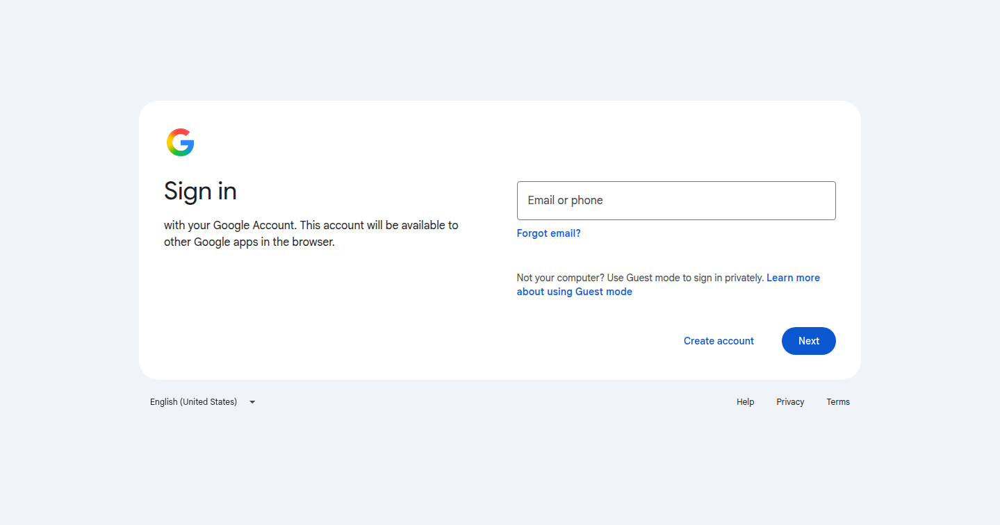

# EPIC-7 T7 round 2: the team sign-in as a Mac-agent ticket (2026-11-11)

Run: run_02d22167-9f74-48b6-8c89-e1d8c335c9b2 · source: Jordi's feedback on E7-A18 (commit 43ddc8f0): "be more specific what you want me to do - I have several claude accounts I can log the browser with operations into, and can run from cli or from claude desktop, I think with desktop easier, give me better steps on what I have to do".

## What the agents' browser needs

| Question | Answer, checked 2026-11-11 ~03:37Z |
|---|---|
| Which account | Google `operations@alpha9.io` (Jordi's E7-A9 answer), password in his Bitwarden, 2-step on his phone |
| Which sites | Google only. T7 signs up on cloud.zenod.dev with "Continue with Google"; the Glama claim and its empty test account (E10-A4) and the WebMCP origin-trial token (EPIC-11) sign in with the same Google identity |
| Which browser | The drivable sign-in Chromium on VPS3 (profile `~/.agent-browser/operations-profile`, CDP 127.0.0.1:9333, noVNC on the tailnet). The rehearsal clicks, types and pays €0 in it |
| Why not the M4 sync | agent_team M4 (console Browser auth → Sync, cookie script on the Mac) copies Mac cookies into the Team Browser on VPS1, whose tools (`browse`, `fetch`, `screenshot`) only read pages: no click, no form. It cannot run T7, the Glama claim or the token form. Google may also refuse a cookie copied to a datacenter host. So the sign-in happens directly in the VPS3 browser |
| Session today | VPS3 browser: on Google's Sign in page, no Google session cookie (checked over CDP, values never read) — . Team Browser `auth_sites`: only `*.airbnb.com`, `*.reddit.com`, `*.x.com` — no Google |
| Which Claude account | Any. The Claude app only drives Jordi's Chrome to open a tailnet page; the Google sign-in lives in the VPS3 browser. The one condition: the Claude in Chrome extension in that Chrome is connected to the same Claude account as the app |
| CLI or desktop | The Claude app (desktop). No CLI, no terminal lines |

## What was built

- A private tailnet page (not in this repo, it holds the one-time remote-window password): `http://vps3.taild81fbb.ts.net:8921/t7-signin/` with one button, Open the agents' browser, and a status file `status.txt` (`waiting` → `signing-in` → `signed-in-headless-ok`). Public IP: no answer.
- The VPS3 watcher (`e7-signin-watch`, user unit) now writes its verdict to that status file as well as `result.txt`; restarted 03:37Z with a fresh 7-day window (until 2026-11-18). Backup of the old script beside it (`watch.mjs.bak-t7r2`). After the sign-in it closes the remote window and proves the session headless on myaccount.google.com.
- Row T7-M1 (Role Mac agent) and its `### Laptop ticket T7-M1` in the spine; the ticket page and the Mac list are built by agent_team `scripts/laptop_ticket.py`.

## Jordi's steps (on the ticket page, no terminal)

1. On your Mac open the Mac list and the ticket "Sign the team Google account into the agents' browser"; press Copy.
2. Open the Claude app, start a new session, paste, send. Any of your Claude accounts works.
3. When Claude stops at the password, copy the operations@alpha9.io password from Bitwarden and type or paste it in the remote window; answer the phone prompt if Google asks.
4. Wait about two minutes: the remote window closes by itself and Claude says signed-in-headless-ok and marks the ticket Done.

Rollback: sign the agents' browser out at myaccount.google.com → Security → Your devices, or delete the VPS3 profile folder.
