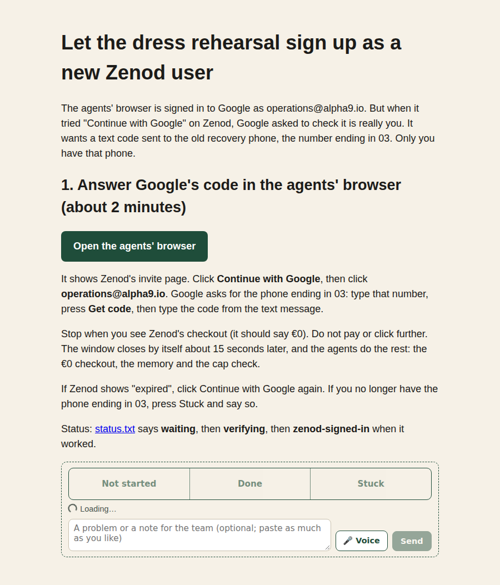

# EPIC-7 T7 round 3: dress rehearsal on production, stopped at Google's phone check (2026-11-11)

Run `run_020f90c0-c09e-475e-8e07-5e35f064b668` (parent `run_92c86d8e`). Bound epic: [EPIC-7](../EPIC-7-REAL-USER-TEST.md), row T7. Earlier rounds: [2026-11-01](epic7-t7-2026-11-01.md), [2026-11-02](epic7-t7-2026-11-02.md), [round 2](epic7-t7-r2-2026-11-11.md). This round reuses the stranger path that [E23 U7](e23-u7-2026-11-11.md) put live and does not repeat its checks.

Production during the run: `cloud.zenod.dev/api/health` ok, sha `d9ebdd6e`, 04:24Z to 04:31Z.

## Result in one paragraph

The new-user path works on production up to Google. As operations@alpha9.io, the agent applied at zenod.dev/testers. Zenod answered "You're in", with a personal link and a one-time code inside. The link opened the invite page with the code applied. "Continue with Google" opened Google's account chooser with operations@alpha9.io in it. Then Google stopped the sign-in with "Verify it's you". The recovery phone on the account was changed recently, so Google wants a text code sent to the previous recovery phone, ending in 03. That phone is Jordi's. The agents' Google session itself is fine: it was proved headless at 04:16Z. Google asks again only when the account signs in to a new app. Nothing past that point ran. No Zenod account was created, no checkout ran, Stripe was not touched, and nothing was saved. A one-link page now waits for Jordi. He opens the agents' browser, clicks Continue with Google, types the code, and stops at checkout. A watcher then hands the session back, and the next round runs steps 2 to 6 from there.

## Steps

| # | Step | Result | Evidence |
|---|---|---|---|
| 1 | Sign up on cloud.zenod.dev with Continue with Google, as operations@alpha9.io | **failed, waits on Jordi.** The application, personal link and invite page all work. Google's account chooser shows the account. Google then asks to verify by a text to the previous recovery phone, ending in 03. The only other choice it offers is the same phone. An agent cannot answer it | [apply answer](epic7-t7-r3/02-apply-answer.png), [invite page](epic7-t7-r3/03-join-page.png), [account chooser](epic7-t7-r3/04-after-google.png), [Verify it's you](epic7-t7-r3/05-after-account.png), [other ways](epic7-t7-r3/06-google-verify-options.png) |
| 2 | Own single-use tester code, €0 checkout with no card | **half passed.** The code part passed. The application from our own domain was accepted and marked as a test, so it takes none of the ten places. The answer carried a fresh one-time code (`ZT-…`, masked in every screenshot) and its personal link. The invite page says the code is applied at checkout, €0, no card. Checkout itself was not reached (step 1) | screenshots 02, 03 |
| 3 | WhatsApp to the Zenod production number, 3 voice notes → 3 Saved, visible in the console | **not run (step 1), and not possible for an agent as written.** Linking needs a phone that sends a short code to the Zenod number from WhatsApp. The only project number is the Zenod number itself, and Jordi's phone is bound to his own account ([T2.4](epic7-t2-4-2026-11-01.md), E7-A4). The closest path an agent can run once the account exists: open Settings → Link WhatsApp and record the code screen, then save three notes through the account's own MCP (`save` on cloud.zenod.dev/mcp) and check they show under Recent saves. The real voice-note leg stays for the first tester, watched live, or for Jordi with a second phone | [T2.4](epic7-t2-4-2026-11-01.md), [T2.5](epic7-t2-5-2026-11-01.md) |
| 4 | A test account pushed to its usage cap shows the stop message | **failed: no access.** No account exists yet (step 1). Even with one, pushing it to the cap means writing a $3 row into that account's own usage ledger in the production container, as [T3 live](epic7-t3-live-2026-11-01.md) did on 1 Nov. Agents no longer have `docker exec` or root on VPS1. The sudo list allows `docker ps` and `logs` but not `exec`, the root key maps to t3agent, and the control-plane token is a per-app secret. Spending a real $3 of AI through chat to reach the cap is not practical. The cap itself is live: tester-watch reads "AI cap: 3 USD/month", and the capped reply was proven on a synthetic tenant on 1 Nov | tester-watch 04:30:15Z header; [T3 live](epic7-t3-live-2026-11-01.md) |
| 5 | Stripe shows €0 and no card, read-only | **not run (step 1).** There is no customer to read yet. Agents also have no read path to Stripe here: the Stripe key is a money-class per-app secret, and `secret run` serves shared keys only. tester-watch reads Stripe only for the older T4 ledger, so it still lists just `t7-rehearsal-jordi` (unused, expires 2026-11-15). It does not see codes from the zenod.dev/testers flow (finding F2) | tester-watch `--redact`, `--check` OK 1 tester |

## What was made for Jordi

- A steps page, [Let the dress rehearsal sign up as a new Zenod user](http://vps3.taild81fbb.ts.net:8921/t7-verify/) (tailnet; console steps page `sp_76d9ea9f`, wired to ask `E7-A20`, copy-paste check clean). Its one button opens the agents' browser in a remote window, already on Zenod's invite page with the code inside. He clicks Continue with Google, picks operations@alpha9.io, types the number ending in 03, presses Get code, types the code and stops at checkout. 
- Behind it, on VPS3 (not in the repo, all under `~/.agent-browser/t7-verify/`, mode 700): `verify-browser.sh` is a copy of the round-2 sign-in stack (Xvfb :79, x11vnc on localhost :5979, noVNC on the tailnet IP only, port 6082, one-time password in the link). The user unit `t7-verify-watch` (7-day limit) writes `status.txt` (`waiting` → `verifying` → `zenod-signed-in`) and stops the remote window 15 s after Zenod's sign-in lands. Undo: `verify-browser.sh stop`, `systemctl --user stop t7-verify-watch`, delete the folder and `~/zenod-evidence-pages/t7-verify/`.

## Findings

- **F1. Google asks for the phone on a new app sign-in.** "Your recovery phone recently changed" makes Google ask for the previous recovery phone on the first OAuth sign-in to Zenod, even with a valid session. The same check may come back for the Glama claim (EPIC-10) and the WebMCP token (EPIC-11), which use this account too. Once Jordi answers it once in this browser, Google usually trusts the device.
- **F2. tester-watch does not see tester-flow applicants.** Codes made by the zenod.dev/testers flow live in `tester-flow.json` on the production data volume. tester-watch reads only the private T4 ledger on VPS1. When the first real tester signs up through the apply page, tester-watch will not list them. This needs a small change: tester-watch reads the flow's testers, without emails or codes, through a narrow read rule. That rule is the same gap ZAL-A13 recorded. Proposed to the Delivery Manager as a row; not fixed here, because it needs a VPS1 read grant.
- **F3. One wasted test code.** The first application (operations@alpha9.io, 04:25Z) made a real one-time Stripe code. The agent masked the page before saving the link, so the code was lost. Nobody saw it, and it expires unused in 14 days, on 2026-11-25. It takes no tester place, because the application is test-marked. The second application (operations+t7r3@alpha9.io, 04:27Z) holds the code the steps page uses. To switch the first one off now: the tester coupon's codes in Stripe, or cloud.zenod.dev/admin/testers.
- **F4. No login to add to Bitwarden.** The rehearsal account will sign in with Google, so it has no Zenod password of its own (root L-53 does not apply).

## Done means mapping

| Done means | This round |
|---|---|
| E7-1 caps shown live on a test account | not proven: no account, and no ledger access on VPS1 (step 4). **Not proposed done.** |
| E7-2 €0 sign-up, no card | apply, code and invite proven live as a new applicant; checkout waits on step 1 |
| E7-3 Saved over WhatsApp, seen in console | not run; the voice leg needs a second phone (step 3) |

## T8 go or no-go

Still no-go from this rehearsal alone. The part a stranger sees first (apply, code, invite, Google) works on production. Checkout, memory, saves and the cap have not been walked by a new account since the U7 changes.
