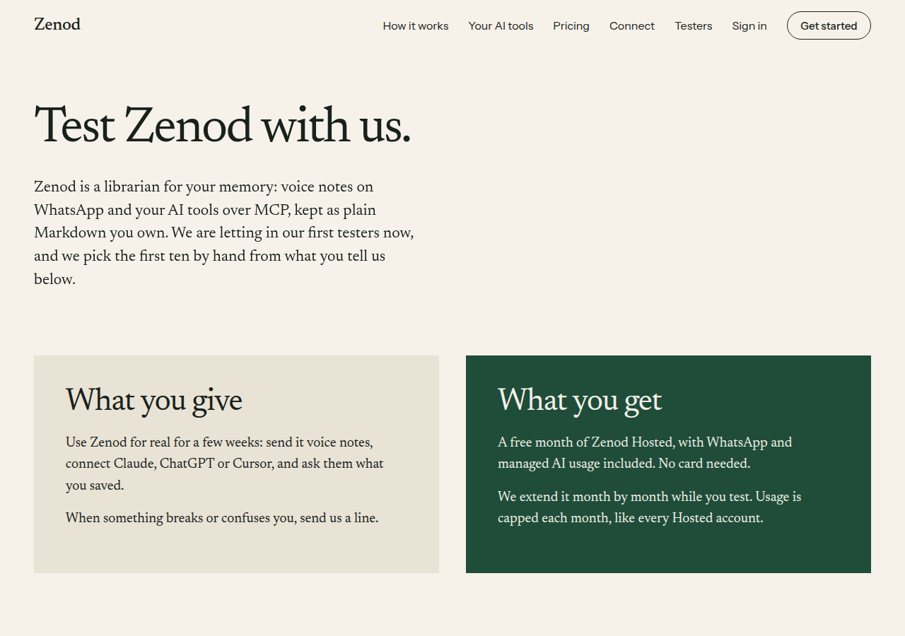
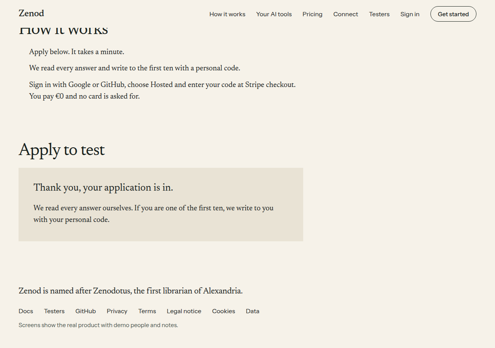
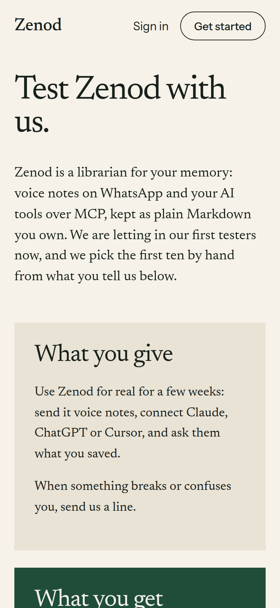
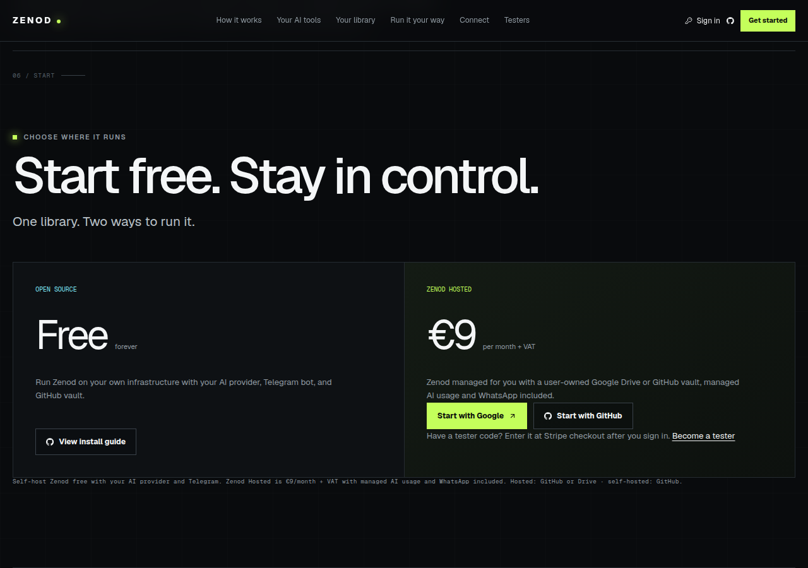

# ZAL-A13: Zenod testers program open on zenod.dev, sign-up path fixed, visits and sign-ups counted

**Bottom line:** [zenod.dev/testers](https://zenod.dev/testers) is live with the apply form, and production runs `3abe85e` since 2026-11-09 06:05:45Z. A TEST application was kept privately on the server (1 kept, the honeypot probe dropped), and the alpha9 counter answered 200 to one TEST visit and one TEST sign-up.

Worker run `run_72c2fd2d-5d23-4e5a-a40f-6546f7413d70`, PR [#1550](https://github.com/zenod-ai/zenod/pull/1550) merged as `3abe85e` (ci green 9m38s), rolled by publish.yml. `cloud.zenod.dev/api/health` sha `3abe85e016797aa71f11680b193d7dd56c7366ea` first seen 2026-11-09T06:05:45Z.

## The testers page

- Paper style, linked from the home nav, the plans and the footer.
- Offer as EPIC-7 runs it (T4): a personal code for a free month of Hosted at €0, no card (Checkout `payment_method_collection: if_required`, `allow_promotion_codes: true`), extended month by month, usage capped each month like every Hosted account. First ten picked by hand.
- Form: "How are you going to be using Zenod Memory?" plus a contact. `POST /api/public/testers/apply` appends `{at, use, contact}` to `tester-applications.jsonl` on the production data volume (`/data`, mode 0600), never a repo. No address is stored. Spam: hidden honeypot field (answered as kept, nothing kept), 5 per address per hour (in memory only), 300 a day.
- Live checks: empty form → 400; honeypot → 200 and not kept; a TEST application through the real page → 200 and the thank-you; production log shows exactly 1 `[testers] application kept` since the roll.

## The walk note, item by item

| # | Walk finding | What happened |
|---|---|---|
| 1 | /pricing and /connect nav links `/#ways-in`, `/#voice` land at the top | Fixed: they now go to `/#how`, `/#mcp`, `/#yours`, `/#start`, all present on home (checked live). Old dark header kept; the restyle stays parked as A7. |
| 2 | No Sign in or menu at 390; Get started on /pricing links to itself | Fixed: Sign in stays visible at 390 and a Menu holds the links below 960 wide; Get started on /pricing goes to its plans (`#start`). |
| 3 | Choose Hosted on /pricing offers GitHub only | Fixed: signed out it shows Start with Google and Start with GitHub, like home. |
| 4 | Nothing says where a tester code goes | Fixed: "Have a tester code? Enter it at Stripe checkout after you sign in." on /pricing and home plans, with a link to /testers. |
| 5 | Readiness: `live_billing_journey` and `stripe_webhook` not OK | True cause: both are dated attestations, not broken parts. `stripe_webhook` needs `ZENOD_STRIPE_WEBHOOK_VERIFIED_AT` within 31 days and it is stale; `live_billing_journey` needs `ZENOD_LIVE_BILLING_VERIFIED_AT` within 90 days and it was never set (no real live checkout has been recorded). Both are advisory (`ready: true`). The proof is one €0 tester checkout end to end, which is EPIC-7 T7 (waits on Jordi's sign-in E7-A15); and E7-A16 step 4 rolls the webhook secret, so the stamp should be set after that roll, not before. |
| 6 | /signup, /login, cloud.zenod.dev/app log a CSP error from the inline theme script | Fixed: the script moved to `/assets/theme-init.js`. Live: 0 CSP errors on all three, theme class applied. |
| 7 | Any unknown path answers 200 with the login card | Not changed: the app's client routes rely on that fallback; a real 404 needs the route list served by the server. Parked as a follow-up. |
| 8 | http://zenod.dev answers 200 over http; www.zenod.dev 404 | Not changed: this is the edge (proxy and DNS), not this app. Parked as a follow-up for infra. |

## Visits and sign-ups

- Every zenod.dev page (home, /pricing, /connect, /testers, the legal pages) asks `https://signup.alpha9.io/api/public/pv?h=zenod.dev&p=<path>` once per load, with `s=` from the link and the referring host only. No cookie. The campaign id is kept in the tab's session storage only so a sign-up can carry it.
- Sign-ups: the server marks the redirect after a first-ever sign-in with `?signed_up=1` (Zenod only); the landing page (zenod.dev or cloud.zenod.dev/app) sends `e=signup` once and removes the marker. A testers application sends `e=signup` too. Sign-ups that start inside an MCP client's sign-in are not counted (their consent page is server-drawn).
- CSP `img-src` and `connect-src` widened for `https://signup.alpha9.io` only.
- Live TEST, from a real browser on https://zenod.dev/testers?s=TEST: `pv?h=zenod.dev&p=/testers&s=TEST` → 200 and `pv?h=zenod.dev&e=signup&s=TEST` → 200. Screenshot runs blocked the counter so they added no visits.

## Reading the applications

The file lives in the `zenod-mt-data` volume on VPS1. Agents can see that an application arrived (`[testers] application kept` in the container log) but cannot read the file: the agent account has no `docker exec` or volume read. A narrow read rule is raised as an ask in the run report.

**Read approved (ZAL-A13-A1, Jordi, 2026-11-09, 873fd0fe).** Worker run `run_0e46d4c7-1821-48a5-b7a1-a6a9ee309dd0`:

- **The rule.** One root line, nothing else readable: `Cmnd_Alias ZAL_A13_TESTERS = /usr/bin/cat ^/mnt/HC_Volume_106231047/docker/volumes/zenod-mt-data/_data/tester-applications[.]jsonl$` (Docker root is `/mnt/HC_Volume_106231047/docker`; zenod-mt mounts the volume at `/data`, the image's `ZENOD_DATA_DIR`). Since E59-S9 root lines are added only from infra-vps `hosts/vps1/root-narrow/sudoers-t3agent` and applied with root's key, so the line went to the VPS1 steward as a desk note citing the approval: infra-vps `5c8014b` (`desk/inbox/2026-11-09-zenod-one-file-read-rule-tester-applications.md`), with the allow/deny matrix cases. Rollback: delete the line, `apply.sh apply`. Not live yet at 16:55Z (`sudo -n cat` of the path answers "a password is required").
- **The page.** `http://vps3.taild81fbb.ts.net:8921/zal-a13-applications/`, tailnet only, never in a repo. Built by `~/.local/lib/zenod-evidence/testers.py` on VPS3: it reads the file through that one rule, writes a private markdown file (`~/.local/state/zenod-testers/`, 0600) and renders it with `render.py`. It shows the count by day, each application (date, how they will use Zenod, contact), a short first take on fit (a clear use, likely to give feedback, WhatsApp or voice notes, AI tools named) and a suggested first ten, marked as suggestions only. TEST entries are left out. Where they came from: the shared counter's zenod.dev visits and sign-ups by day (it has no source split for zenod.dev yet). Until the rule is live the page says it is waiting.
- **Refresh.** `zenod-testers-page.timer` (systemd user unit on VPS3) runs it every hour at :41 (off the :00 pile-up on VPS1), first run 16:55Z: page 200, state "waiting".
- **Count so far.** Not known in full until the rule is live. Seen: the TEST application of 06:05Z; the log between then and 16:10Z went with the replaced containers (zenod-mt was redeployed several times today, clean exits, same sha `5f7aa149`), and since 16:10Z there were 0 `application kept` lines. The full count comes from the file once the rule is live. The counter shows 1 zenod.dev visit and 0 sign-ups on 2026-11-09 (TEST visits not counted).

## Tests

Server 1604 pass (new: apply form, honeypot, limits, first-sign-in marker), site 41 pass (testers page, walk fixes, counter URLs), web +2 (sign-up marker). CI green on #1550.
