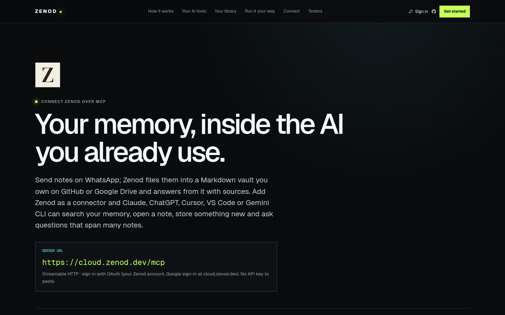
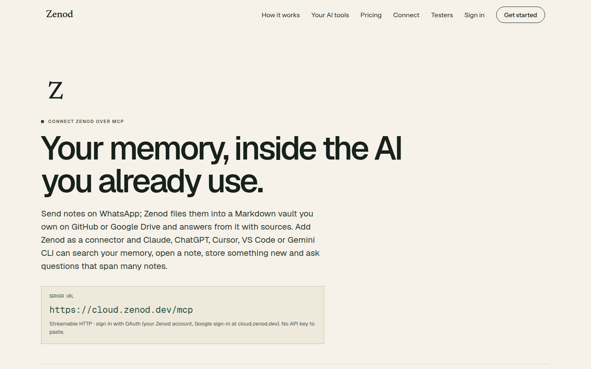
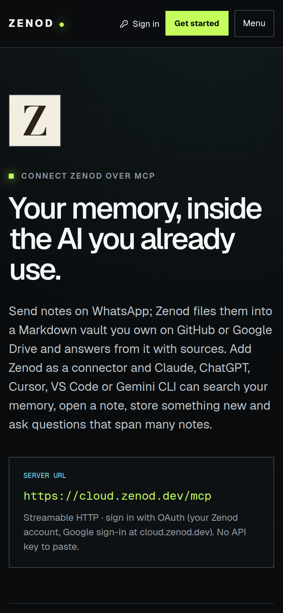
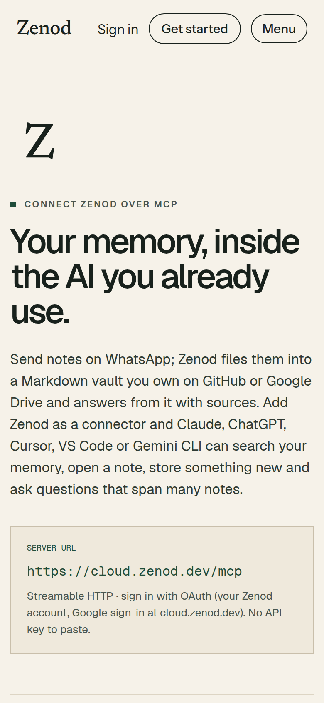
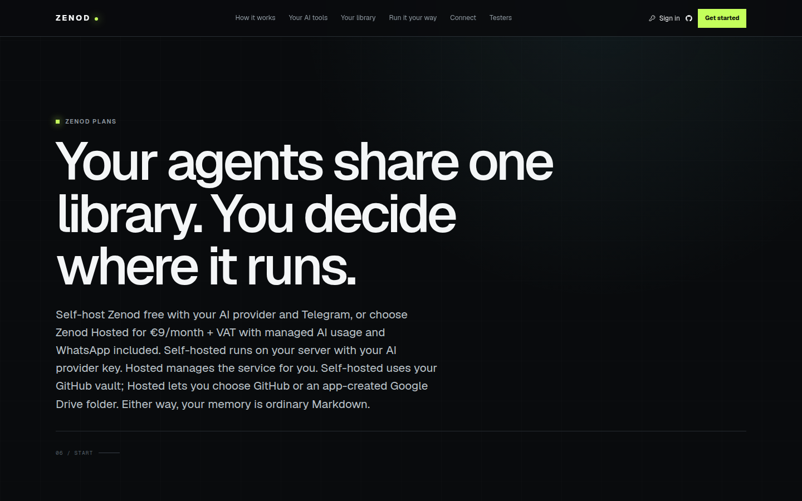
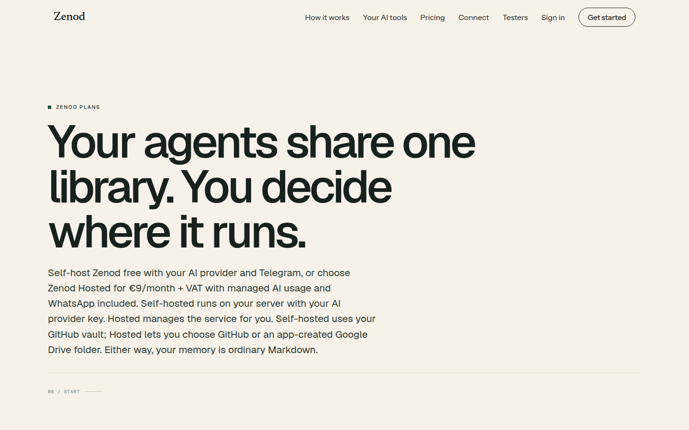
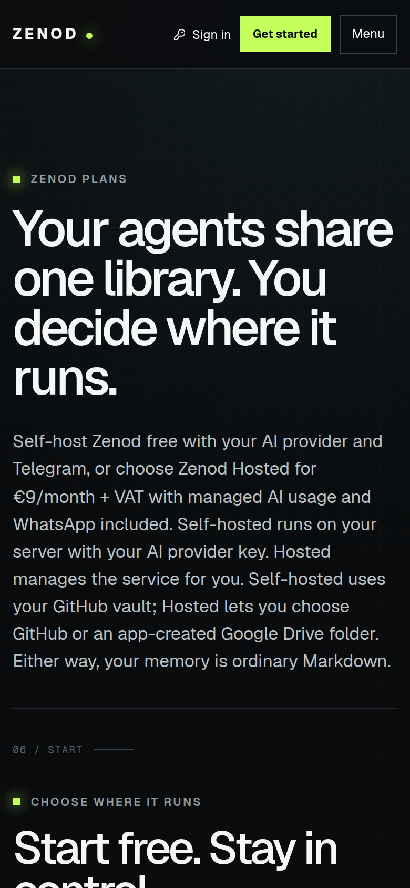
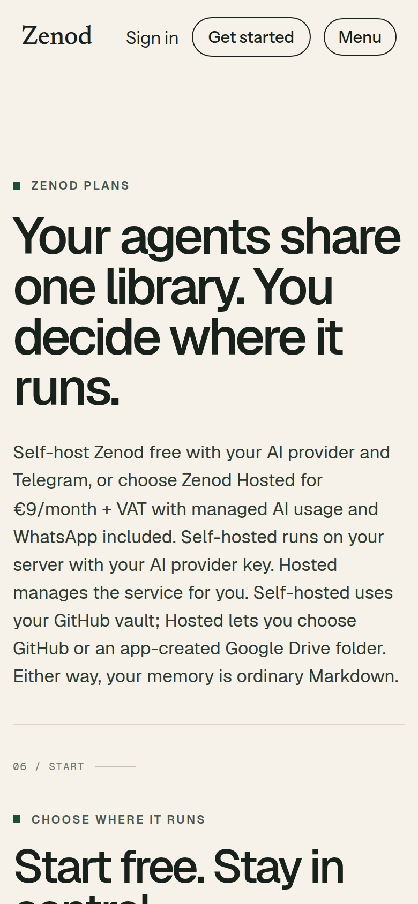
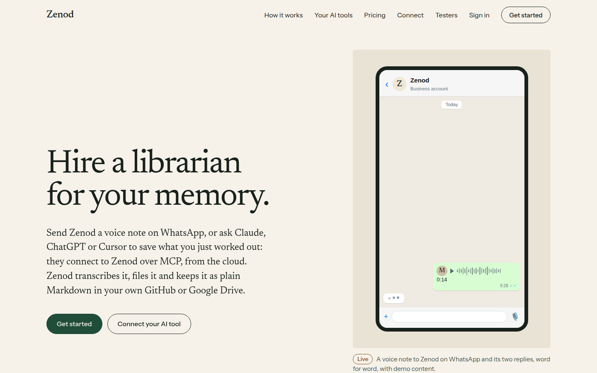

# ZAL-A17: /connect and /pricing wear the home header and Newsreader Z

**Bottom line:** [zenod.dev/connect](https://zenod.dev/connect) and [zenod.dev/pricing](https://zenod.dev/pricing) now show the same light header and Newsreader "Zenod" wordmark as home and /testers, on the same paper ground. Production runs `5f7aa14` since 2026-11-09T09:15Z. Their content, the connect steps, the A13 link fixes, the phone Menu and the alpha9 counter are unchanged. No wider restyle: A7 and A11 stay parked.

Worker run `run_eb03ed4d-4de2-4a83-a9f9-a197213e52f6`, PR [#1560](https://github.com/zenod-ai/zenod/pull/1560) merged as `5f7aa149` (ci green 12m44s), rolled by publish.yml. `cloud.zenod.dev/api/health` sha `5f7aa149f9dfc25a4018129a15593ea0425a5f12` first seen 2026-11-09T09:15:13Z.

## What changed

- Both pages use the shared Paper `Nav` component from the home page (same wordmark, links, Sign in, Get started). It gained an optional phone Menu (below 900 px wide, the same links) and a Get started target, so /pricing's Get started still goes to its own plans (A13).
- The page ground is paper (#f6f2e9), with ink text and one deep green, by remapping the old pages' colour variables. Layout and type are unchanged.
- The Z icon on /connect and the directory listing icons (`/brand/zenod-icon.svg`, 512 and 1024 PNG) are now the favicon's Newsreader Z, not the old Bodoni Z. The favicon was already new.
- The header's GitHub icon sign-in is gone with the old header. GitHub sign-in stays on /pricing as "Start with GitHub" and on the cloud sign-in page.
- Tests: a new check pins the shared header and icon on both pages. The A13 check now looks for the new Menu. The offer test checks GitHub sign-in on the Hosted plan. 42 of 42 site tests pass.

## /connect, desktop: before and after (live)

## /connect, 390 wide

## /pricing, desktop and 390 wide

## Home, for comparison (live)

