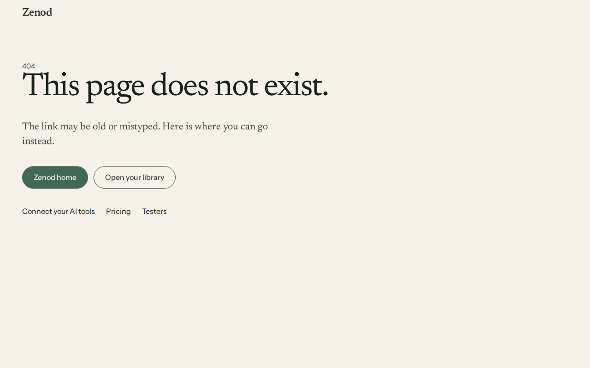
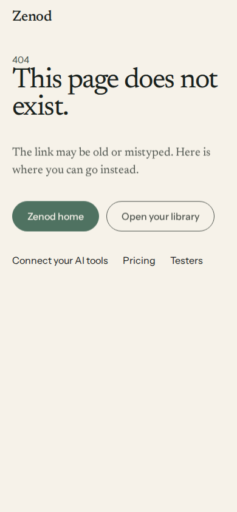

# ZAL-A19 and ZAL-A20: real 404 for unknown paths, http to https and www for zenod.dev

**Bottom line:** live on production `ba6b56e` since 2026-11-09T21:29:52Z. Unknown paths on zenod.dev and cloud.zenod.dev now answer **404** with a Zenod not-found page, while every real route still answers 200. `http://zenod.dev`, `http://www.zenod.dev` and `https://www.zenod.dev` now redirect permanently to `https://zenod.dev`, keeping path and query, and plain-http `cloud.zenod.dev` goes to https too. Both rows are plumbing: closed `done (no confirm)`.

Worker run `run_763c7663-3acb-4043-ac1d-e7e5fc4a7182`. PR [#1569](https://github.com/zenod-ai/zenod/pull/1569) (ci green) squash-merged as `ba6b56e`; `cloud.zenod.dev/api/health` sha `ba6b56ea6e3ae9b245d2cbe45bd3d3bfdaa9e4c5` first seen 2026-11-09T21:29:52Z.

## Before and after (curl against production)

| URL | Before (20:55Z, HEAD) | After (21:30Z, GET / HEAD) |
|---|---|---|
| http://zenod.dev/ | 200 | 301 → https://zenod.dev/ |
| http://zenod.dev/pricing?x=1 | 200 | 301 → https://zenod.dev/pricing?x=1 |
| http://www.zenod.dev/ | 404 | 301 / 308 → https://zenod.dev/ |
| http://www.zenod.dev/connect?a=b | 404 | 301 / 308 → https://zenod.dev/connect?a=b |
| https://www.zenod.dev/ | 404 | 301 / 308 → https://zenod.dev/ |
| https://www.zenod.dev/connect?a=b | 404 | 301 / 308 → https://zenod.dev/connect?a=b |
| http://cloud.zenod.dev/ | 200 | 301 → https://cloud.zenod.dev/ |
| http://cloud.zenod.dev/app?tab=memory | (200) | 301 → https://cloud.zenod.dev/app?tab=memory |
| https://zenod.dev/no-such-page | **200** (app shell) | **404** not-found page |
| https://cloud.zenod.dev/no-such-page | **200** (app shell) | **404** not-found page |
| https://zenod.dev/ , /pricing , /connect , /testers , /?tab=memory , /legal/terms.html , /favicon.ico | 200 | 200 |
| https://cloud.zenod.dev/ , /app , /app?tab=graph , /?tab=graph , /account , /api/health , /.well-known/oauth-authorization-server | 200 | 200 |

Raw probe output: [before.txt](zal-a19-a20-2026-11-09/before.txt), [after.txt](zal-a19-a20-2026-11-09/after.txt). Traefik answers HEAD on the www redirect with 308 (it keeps 301 for GET only); both are permanent and keep path and query. `https://zenod.dev/robots.txt` now answers 200 from Cloudflare's own managed robots file (content signals), no longer from the app shell.

## A19: the 404

- Cause: the MCP chassis answered every unmatched GET with the console's `index.html` (200), on both hosts.
- Fix: the chassis takes `ui.spaPath` and `ui.notFound`. With the public site mounted, Zenod passes the console's real client routes, read from the code: `/`, `/index.html`, `/account`, `/admin`, `/app`, `/app/*`. The tabs live in `#hash` and `?tab=` (apps/web `App.tsx` `initialTabFromHash`, `HostedApp.tsx` `?tab=`), so old `?tab=` links keep working. Every server redirect lands on `/`, `/app` or `/app/account`. The site's own routes stay as they were: `/`, `/pricing`, `/connect`, `/testers`, `/legal/*`, `/brand/*`, the favicons.
- Anything else gets `apps/site/404.html` (Paper style, noindex, absolute links that work from both hosts) with HTTP 404, and API-like paths get JSON 404. Other units (Phylax, Calli, Ring, Herald) keep the old fallback.
- Tests: `packages/server/test/zenodUnit.test.ts` "answers unknown paths with a real 404…" (200 for every real route on both hosts, 404 for unknown, HEAD too); `apps/site/paper-landing.test.tsx` renders the page.

## A20: http to https and www (edge)

What serves zenod.dev: Cloudflare (proxied CNAME to the `vps1-sites` tunnel; `www` is covered by the `*.zenod.dev` wildcard, so no DNS change was needed) → cloudflared → Traefik websecure → `zenod-mt`.

- **www → apex at Traefik.** Added through the `dokploy` wrapper on `zenod-mt`: domain `www.zenod.dev` (id `PO3feoY83D6dDYJllBsee`, https, port 8080) and a permanent redirect `^https?://www\.zenod\.dev(.*)$` → `https://zenod.dev${1}` (Traefik middleware `redirect-zenod-mt-fxpzoo-3`), the same way `mind.zenod.dev` already redirects. Live at 20:56Z, before the deploy.
  - Rollback: in Dokploy `zenod-mt`, delete the www.zenod.dev domain (`dokploy api POST domain.delete --json '{"domainId":"PO3feoY83D6dDYJllBsee"}'`) and the www redirect (Redirects tab). www then returns to Traefik's 404.
- **http → https in the app.** The tunnel lands every request on Traefik over one scheme, so Traefik cannot see a plain-http visitor. The edge token (`Cf tunnel v1`: Tunnel, DNS, Zone Read) cannot set Cloudflare's Always Use HTTPS or a redirect rule, and the Traefik dynamic directory is root-only. So the app reads Cloudflare's `Cf-Visitor` header: scheme `http` gets 301 (GET/HEAD) or 308 (other methods) to `https://<host><path><query>`. Without that header (local, self-host, internal container calls) nothing changes. Test: "sends plain-http visitors behind Cloudflare to https…".
  - Rollback: revert `cloudflareHttpsRedirect` in `packages/server/src/zenodUnit.ts` (one `app.use` line).
  - If Jordi ever turns on Cloudflare's "Always Use HTTPS" for zenod.dev, the edge does the same thing first and the app line becomes a no-op. This is not needed now.
